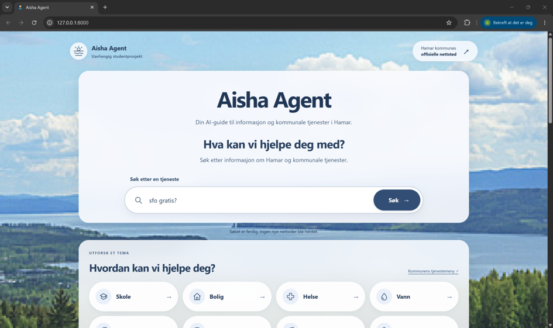
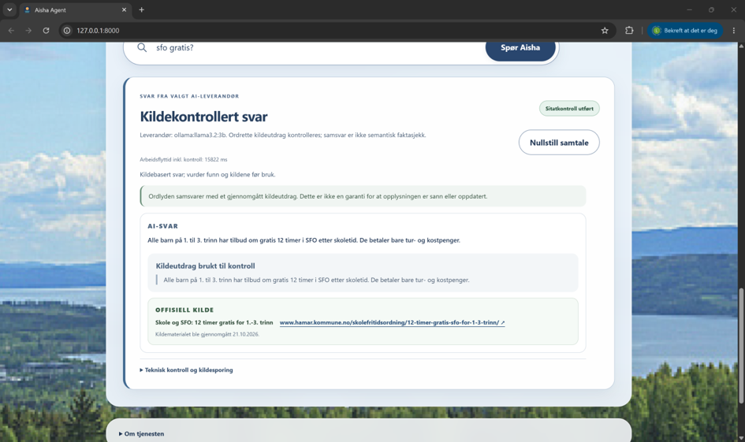

# Aisha Agent - Innlandet Agentic Workflows

Aisha Agent (also named Hamar KommuneAgent in earlier records) is a two-student software project for KIUA-2003 at the University of Inland Norway. It helps residents and others seeking general, non-personal municipal service information for Hamar through independent service-search and AI question-answering forms.

The real-source workflow retrieves reviewed local excerpts, asks a local model to select one complete paragraph, verifies its source and exact wording, and returns an official citation or a refusal. It permits at most one correction followed by mandatory re-verification. This is an extractive prototype: evidence matching establishes traceability, not factual truth, complete municipal coverage or semantic verification of paraphrases.

**Development status:** the walking skeleton, tests and historical evaluation evidence are retained for Compulsory 2 and continued development toward the final exam. This repository is not a completed or approved academic submission.

## Requirements and setup

- Python 3.12. Historical evaluation records identify Python 3.12.10.
- No third-party Python packages or credentials are needed for synthetic operation or the standard-library Ollama application.
- Real local inference additionally requires a running Ollama server, an installed server-allowlisted model, and an eligible approved local municipal catalog.

Open the repository in a terminal or IDE and use its root as the working directory. Check the interpreter:

```powershell
python --version
```

An isolated environment is optional. If desired, create one and use its interpreter for the commands below:

```powershell
python -m venv .venv
.\.venv\Scripts\python.exe --version
```

No package installation is required for the default local paths. OpenAI is an optional external provider, disabled by default. Install its separate [requirements](requirements-openai.txt) only after external processing has been explicitly authorized; follow the [provider configuration guide](docs/provider-configuration.md). No provider automatically falls back to a paid service.

The application reads process environment variables. [.env.example](.env.example) is a reference; the application does not load `.env` files. Keep credentials in ignored local configuration and never commit them.

## Run the synthetic walking skeleton

From the repository root:

```powershell
python -B -X utf8 -m hamar_agent --fixture fixtures/water-synthetic.json
```

Expected output is JSON on standard output with the explicitly synthetic source, two supported claims, evidence references and no verification findings. This path uses the mock provider, needs no catalog or model, and makes no municipal retrieval request. It checks orchestration and evidence matching, not real-model quality.

The historical result is preserved in [walking-skeleton-synthetic.json](comp2/evidence/walking-skeleton-synthetic.json), with command metadata in [new-command-register.json](comp2/evidence/new-command-register.json). Running the CLI command above does not overwrite either file.

For the offline demonstration website:

```powershell
python -B -X utf8 -m hamar_agent.web --demo --provider mock --port 8000
```

Open <http://127.0.0.1:8000>. Run only one server on the chosen port; reuse an existing appropriate server rather than starting a duplicate. In PyCharm, select Python 3.12 and run the module with the repository root as the working directory; do not execute `hamar_agent/__main__.py` as a standalone script.

## Run with approved local municipal sources

Real mode requires all of the following:

1. An existing, lawfully obtained and individually approved local catalog at `output/municipal-catalog.json`.
2. Exact URL- and paragraph-specific approval and provenance matching the reviewed manifests, with valid review and expiry dates.
3. Ollama already running locally, with the chosen model installed and allowed by server configuration. The documented model is `llama3.2:3b`; the application never installs or downloads models.

The catalog is ignored local data and is not supplied by a Git clone. The recorded source approvals expire on **2026-10-28**. Missing, expired or ineligible sources must cause real mode to refuse operation; do not extend dates simply to reproduce a result. Reproduction on a new machine requires separately authorized access to eligible excerpts.

### Source Approval Validity and Extension Request — Instructor Note

On **2026-10-27**, the project owner explicitly authorized renewal of all eight municipal sources to **2026-11-27** for continued KIUA-2003 academic testing, including municipal search and the real-source Ollama workflow, subject to all mandatory source, provenance and privacy checks. The [owner authorization and local technical review](docs/source-renewal-owner-authorization-20261027.json) record the actual authorization date and project-owner role separately from the Codex technical inspection. No private identity or independent reviewer role is inferred. The original recorded source review date remains **2026-10-21**, and the recorded approval expiry remains **2026-10-28**. **2026-11-27 is an authorized renewal target, not an active approval.** Owner authorization is not evidence of a fresh source review, privacy sign-off or instructor approval.

All eight records in [the approval manifest](docs/approved-service-pages.json), and their corresponding entries in [the reviewed selection](docs/reviewed-service-selection.json), carry that original expiry:

| Source ID | Reviewed service | Retained paragraphs | Renewal to 2026-11-27 |
| --- | --- | --- | --- |
| `hamar-sfo` | School-age childcare | 5 | Pending human re-review |
| `hamar-byggesak` | Building without an application | 5 | Pending human re-review |
| `hamar-folkehelse` | Public-health knowledge base | 4 | Pending human re-review |
| `hamar-bibliotek` | Municipal library | 5 | Pending human re-review |
| `hamar-kommuneplan` | Municipal community plan | 5 | Pending human re-review |
| `hamar-drikkevann` | Drinking water | 5 | Pending human re-review |
| `hamar-parkering` | Parking locations and payment | 5 | Pending human re-review |
| `hamar-luftkvalitet` | Air quality | 5 | Pending human re-review |

**Renewal review outcome: zero renewed, eight pending, zero rejected. Owner authorization is recorded for all eight; documented current human review remains incomplete. Controlled activation is implemented but has not been applied to these sources.** Read-only comparison of the existing local catalog against both manifests confirms matching official HTTPS URLs, source identities, paragraph hashes and unique paragraph IDs, combined text hashes, recorded raw hashes and expiry metadata for all eight sources. All 39 retained paragraphs pass the existing limited privacy-pattern screen. Retrieval/index timestamps are recorded from 2026-10-21. These checks establish consistency of the retained material, not current website content, current robots permission or a new privacy clearance. The recorded `no_personal_data` assertion and pattern screen are not a fresh human review; raw-page and robots hashes were not reverified against newly acquired material. No municipal HTML was fetched or imported.

Existing local evidence under `output/final-technical-evidence/` includes a bounded catalog privacy review and `source-renewal-review-20261022.json`. The latter records all eight human renewal approvals as pending, no expiry updates, and an older requested target of 2026-11-30. That historical evidence is unchanged. The new owner authorization is recorded separately; it does not retroactively change the earlier findings or supply a new source/privacy reviewer sign-off.

An extension requires a documented, authorized re-review of each exact source URL and approved excerpt under the [source-review process](docs/source-review-process.md), including privacy, service facts, hashes and provenance. Record the actual review date, responsible reviewer using an appropriate project identifier, affected sources, authorization and resulting expiry only when those steps have really been completed. No qualifying new source/privacy re-review or activation was established in this update. The conditional owner authorization therefore leaves the approval manifests, active catalog and historical evidence unchanged.

The legacy content-change proposal workflow remains non-activating, and expired approvals cannot be renewed through its proposal decisions. A separate owner-controlled unchanged-content renewal path is now implemented in `source_admin.activate`: it validates the recorded owner authorization, exact input bytes, all source reviews and their current sanitized provenance evidence before changing expiry metadata. The owner may personally perform and document the required source/privacy review using the `project-owner` role; no independent municipal or instructor approval is implied. A role declaration without completed checks is insufficient.

To complete renewal, an authorized source reviewer and privacy reviewer must document the exact URLs and paragraph scope, an actual review date, the service-fact checks (including dates, numbers, fees and conditions), privacy eligibility and permitted source/robots provenance. Use project identifiers rather than private personal details, and record an explicit source-specific decision for the requested expiry. Current eligible material must be supplied through an authorized non-personal input boundary; do not fetch raw HTML to fill the gap. Only after those checks may the controlled activation command update approval/selection expiry and active catalog expiry together. It preserves original `reviewed_on` dates, source content, all paragraph/raw/text/robots hashes and retrieval/index timestamps; the actual new review dates and reviewer identifiers belong to the new transaction audit. The existing proposal `decide` command alone cannot renew sources. No production activation or expiry edit has been performed.

Earlier validation on 2026-10-27, before the activation implementation, passed all 318 then-existing offline tests. With the original approvals still current, real-source web startup returned HTTP 200 and loaded eight documents using `ollama:llama3.2:3b`. One bounded real-source CLI call for `hamar-drikkevann` returned one claim with zero verification findings. This exercised the existing 2026-10-28 approvals, not a November renewal, and does not establish factual correctness, fresh source review or all-source model quality. No municipal requests were made, and no historical results were overwritten.

The earlier [implementation validation record](docs/source-renewal-validation-20261027.json) documents the completed 350-test offline run, synthetic workflow, real-source Ollama web startup, municipal search and one evidence-checked AI answer. The actual renewal check still reports eight incomplete human reviews (exit `3`); no production activation was attempted. All eight approval/selection/catalog records agree on **2026-10-28**. These successful software checks do not activate the authorized November target or verify the separate academic report.

The subsequent [technical-completion validation](docs/source-renewal-technical-verification-20261027.json) records 356 passing tests, all technical metadata completed for eight sources/39 paragraphs, and successful real-source startup, search and one Ollama answer. It lists the exact remaining human review fields and source-specific factual assessment items. Provenance file paths and hashes are now populated from real local files, but those files are unchecked review drafts, not approved current-source evidence. Actual expiry remains **2026-10-28** for all eight sources.

### Examiner access on November 20: verified date behavior

The owner supplied October 30, 2026 as the submission date and November 20, 2026 as the required examiner-access date. **The actual project sources are not yet usable on November 20:** all eight still expire on October 28. The [simulated-date validation](docs/source-renewal-date-validation-20261027.json) exercised the actual approval/catalog data and runtime loaders with a test-only scoped clock: on November 20, new loading was refused, already-loaded search returned no results, AI refused for insufficient eligible evidence, and no model generation occurred. November 28 likewise correctly refused expired sources. The system clock and production expiry checks were not changed.

Six new offline regressions separately prove that a genuinely authorized renewal of a synthetic temporary test package loads, searches and answers on November 20, includes November 27 itself, and refuses new startup and already-running search/AI on November 28. Those positive cases are not activation of the eight project sources. The complete suite passes 362 tests. Current-date local Ollama web startup/search/one AI answer also passed under the original October 28 approvals. November examiner access remains blocked until the documented human content/privacy/provenance review is completed and the actual renewal transaction succeeds. No fresh official-page check was performed: the approved workflow still has no authorized non-personal delivery boundary for new raw HTML acquisition.

### Owner-controlled renewal: review, check, activate

This is an offline, all-or-nothing renewal of the entire authorized source set, not content admission. No source is changed if any review is missing or rejected. All required human review and provenance observations must be on the activation's current UTC day, not in the future. A project-owner review is a local attestation; the tool does not authenticate identity or independently establish the truth of the review. Protect the local files and audit directories accordingly.

Prepare an unchecked review draft, using a new output filename in an existing directory:

```powershell
$renewalInputs = @('--owner-authorization', 'docs/source-renewal-owner-authorization-20261027.json', '--approvals', 'docs/approved-service-pages.json', '--selection', 'docs/reviewed-service-selection.json', '--catalog', 'output/municipal-catalog.json')
python -B -X utf8 -m hamar_agent.source_admin prepare-renewal @renewalInputs --output output/source-renewal-review-20261027.json
```

Preparation does not perform a human review: every decision is `pending`, every check is `false`, and review timestamps/identifiers are empty.

Automatically complete the verifiable local metadata before the owner reviews it. Use a new technical-evidence directory:

```powershell
python -B -X utf8 -m hamar_agent.source_admin complete-renewal-technical @renewalInputs --reviews output/source-renewal-review-20261027.json --output-dir output/source-renewal-technical-20261027
```

This verifies all eight source bindings and 39 paragraph hashes, records eight separate technical checks per source, creates actual hash-bound provenance draft files, and fills their relative paths/digests in the review JSON. It preserves the original draft as `review.before.json` and creates a local `owner-review-items.json` containing the exact retained paragraphs and assessment items. These ignored local files are not published. It never sets human decision/check/identity fields, invents source-observation timestamps or silently rebinds a changed reviewed file. The existing local draft has now been technically completed this way; all eight human decisions remain pending. Missing provenance file paths and hashes are therefore no longer the blocker. For **each of the eight source entries**, the owner must:

1. Actually review the exact URL, unchanged retained paragraphs, current service facts, privacy eligibility and permitted source/robots provenance. Use authorized non-personal material; do not acquire/import raw HTML. If hashes, paragraphs or provenance differ, this expiry-only path must refuse the record; a separate content-admission process is needed.
2. Complete `decision` (`approve` or `reject`), `reviewer` (a GitHub-style project identifier), `reviewer_role` (`project-owner` or `source-and-privacy-reviewer`) and the genuine timezone-aware `reviewed_at`. Set the seven named `checks` to `true` only for checks actually completed; leave missing checks false. The same owner may perform the combined review without claiming independent approval.
3. Open the provenance draft file created by technical completion (or copy `provenance_template` into a separate sanitized `.json` file beneath the review file's directory if that step was not used). Preserve the source/URL/paragraph/hash binding. Set its actual `observed_at`, and complete its four `checks` only after verifying current service information, source permission, the non-personal input boundary and original hash provenance. The required `input_boundary` is `authorized_non_personal_material`. No raw document, personal data or credentials belong in that evidence file.
4. Set `provenance_file` to that file's forward-slash relative path and `provenance_sha256` to its SHA-256 after editing. For example, `(Get-FileHash -LiteralPath output/REVIEWED-source-provenance.json -Algorithm SHA256).Hash.ToLowerInvariant()` computes the digest; it does not perform the review. Do not alter the draft's authorization/input hashes, target expiry, source IDs, paragraph IDs or content hashes. Evidence observation must precede the review on the same UTC day.

Inspect eligibility without changing the manifests:

```powershell
python -B -X utf8 -m hamar_agent.source_admin check-renewal @renewalInputs --reviews output/source-renewal-review-20261027.json
```

Exit `0` means eligible, not activated or academically approved; `3` means blocked with per-source missing checks/fields; `2` means invalid inputs or an operational failure. Only after a successful check, stop the application and use a new transaction directory:

```powershell
python -B -X utf8 -m hamar_agent.source_admin activate @renewalInputs --reviews output/source-renewal-review-20261027.json --transaction-dir output/source-renewal-transaction-20261027 --confirm 'renew 2026-11-27' --application-stopped
```

This command acquires an exclusive lock and preserves byte-identical original files, proposed files, owner authorization, reviews and provenance evidence in that transaction directory. It verifies all input bindings, stages schema-valid data, changes only the three expiry fields, verifies the resulting bytes and writes `COMMITTED.json`. Handled partial-write/audit failures restore the original bytes; unsuccessful rollback leaves a lock and recovery journal. A stale review, changed input, reused transaction, unexpected concurrent modification or rejected privacy decision cannot be silently accepted. Keep all transaction directories as evidence; restart the application only after successful commit verification.

Three separate filesystem replacements are **not crash-atomic**. Keep application processes stopped during activation. After a crash/interruption, inspect `PREPARED.json` and the final marker before restarting. For an uncommitted prepared transaction with its matching lock, verified recovery restores originals without changing content or historical audits:

```powershell
python -B -X utf8 -m hamar_agent.source_admin recover-renewal --transaction-dir output/source-renewal-transaction-20261027 --approvals docs/approved-service-pages.json --selection docs/reviewed-service-selection.json --catalog output/municipal-catalog.json --application-stopped
```

Recovery refuses committed transactions, mismatched paths/hashes and unknown concurrent edits. A failure before `PREPARED.json` needs manual inspection of the untouched inputs/staging directory and lock; do not delete locks or edit manifests blindly. The retained original files and existing historical manifests are never rewritten to make an audit pass. Historical copies retain their old expiry intentionally. After a genuine activation, README status must be updated from the committed audit; today all eight remain at 2026-10-28.

Runtime validation accepts a recorded approval only from its review date through its expiry date, inclusive, using the system date. The application must continue refusing expired, missing or ineligible sources; indexed expired documents are excluded from search. The synthetic CLI/web demonstration and offline tests remain available independently of municipal-source approval or Ollama. The project does not automatically fetch or approve municipal website content, renew approvals or download models. Raw HTML acquisition and snapshot import remain disabled.

**Raw municipal HTML acquisition and import are disabled, including offline snapshot parsing.** Historical acquisition instructions and observations do not authorize new retrieval. Do not recreate or renew a catalog from HTML until an approved input process establishes that personal information is never received or processed.

After satisfying the local requirements, inspect installed models and start real mode:

```powershell
ollama list
python -B -X utf8 -m hamar_agent.web --real-sources --model llama3.2:3b --ollama-timeout 90 --port 8000
```

Open <http://127.0.0.1:8000> and, for example, ask `Hva kan jeg bygge uten å søke?`. Check the displayed excerpt, verification status and official source link. The website lists only model tags both installed locally and allowed by the server. Default web startup uses real-source mode; synthetic mode requires the explicit demo flags.

A source-based CLI run is also available:

```powershell
python -B -X utf8 -m hamar_agent --real-sources --source hamar-byggesak --model llama3.2:3b --ollama-timeout 90
python -B -X utf8 -m hamar_agent --real-sources --source hamar-drikkevann --model llama3.2:3b --ollama-timeout 90 --output output/NEW-result.json
```

Use a new output filename: JSON export is exclusive and does not overwrite existing results. The CLI source run and the browser's question-based retrieval are distinct checks. An opt-in local-model synthetic example is documented separately:

```powershell
python -B -X utf8 -m hamar_agent --source synthetic-verification-demo --provider ollama --model llama3.2:3b --ollama-timeout 90
```

Real mode never silently substitutes synthetic data when its catalog, model or verification fails. See the [real-source workflow and historical test evidence](docs/real-source-workflow.md), [source review process](docs/source-review-process.md) and [provider configuration](docs/provider-configuration.md).

### Portal search and catalog loading

Ordinary municipal search uses `/api/search` over the reviewed local paragraph index and never invokes a model. The independent AI form uses `/api/answer`, performs its own retrieval and sufficiency check, and does not require a preceding ordinary search or reuse its category selection. A new or edited question clears the previous answer/download state. The index uses word-based retrieval and ranking, not semantic/vector search or whole-site crawling. Missing indexed evidence does not mean that a municipal service does not exist.

Follow-ups retain only bounded, volatile topic context and repeat retrieval; previous model answers are never evidence. Reset/model changes clear context. Do not enter personal information. POST bodies and privacy-pattern screening do not guarantee that arbitrary user input contains no personal data. Real-mode refusal must not trigger a synthetic or paid-provider fallback.

For an existing eligible catalog at a non-default path, use the current real-source loading options:

```powershell
python -B -X utf8 -m hamar_agent.web --real-sources --catalog LOCAL_CATALOG.json --approvals docs/approved-service-pages.json --model llama3.2:3b --port 8000
```

Repeat `--catalog` only for individually reviewed eligible catalogs matching the supplied approval manifest. Loading rechecks identity, URL, paragraph hashes, provenance and expiry; it does not acquire HTML or renew approvals. Do not combine real catalogs with `--empty-index` or treat old snapshot-import commands as supported ingestion. No web endpoint can approve sources, upload pages or enable fetching.

### JSON output and file saving

Use `--output` with an unused filename in an existing parent directory, preferably ignored `output/`. Successful CLI saving writes UTF-8 JSON and prints the same result to stdout. Exclusive creation prevents overwriting existing files; handled saving/serialization failures report an error on stderr and exit `2` without success JSON. No parent directories, filenames, retries or backups are created automatically.

Exclusive creation is not atomic completion or crash durability: interruption/write failure can leave a partial new file, and a stdout failure after saving can leave a valid file. Export does not add privacy detection or establish semantic correctness. Review new outputs before sharing; never regenerate historical evidence in place.

## Architecture and boundaries

The application uses Python's standard library, a local search index, local HTTP interfaces and versioned JSON results. Ordinary service search does not invoke the model. The AI form performs its own retrieval and sufficiency checks before invoking the provider.

The runtime stages are:

1. Apply privacy/topic constraints and check source eligibility and validity.
2. Retrieve approved local paragraphs and determine whether evidence is sufficient.
3. Ask the configured provider to select a whole reviewed paragraph.
4. Check paragraph identity, verbatim claim/evidence support and provenance through the existing verifier and strict adapter.
5. Permit at most one correction, re-verify, and return a cited result or safe refusal.

Human source admission precedes runtime. There is no autonomous crawling, source approval or unrestricted shell execution by the model. See the [workflow contract](https://github.com/powerNeron/innlandet-agentic-workflows/blob/dad5024fda555113ab65233b1d2abdd9c34f09cf/docs/full-system-contract.md), [integration guide](https://github.com/powerNeron/innlandet-agentic-workflows/blob/dad5024fda555113ab65233b1d2abdd9c34f09cf/docs/full-system-web.md), [summary and verification design](docs/summary-verification.md) and [workflow figure](comp2/figures/aisha-workflow.pdf). JSON export constraints are documented above.

### Privacy and security

Do not collect or process personal data. Public availability is not permission. Use synthetic fixtures for development and explicitly reviewed non-personal excerpts for real operation. Reject uncertain input and treat external source text as untrusted data rather than executable instructions. Source categories based on [Hamar's official menu](https://www.hamar.kommune.no/meny/) do not authorize ingestion.

The local web service binds to loopback and applies Host/Origin and session-token checks. Query topics, model choices, context lifetime and exported results are bounded. These controls and exact-paragraph verification reduce risk but do not establish universal security or semantic correctness. Keep Ollama local; do not expose it through a public tunnel.

Content-update comparison and its legacy decision records remain offline and proposal-only. They do not activate excerpts, renew approvals or fetch pages. The separately gated owner-controlled expiry renewal below does not enable content imports or network retrieval. Follow the [source-update policy](https://github.com/powerNeron/innlandet-agentic-workflows/blob/dad5024fda555113ab65233b1d2abdd9c34f09cf/docs/source-update-proposals.md) and [source proposal administration guide](https://github.com/powerNeron/innlandet-agentic-workflows/blob/dad5024fda555113ab65233b1d2abdd9c34f09cf/docs/source-proposal-administration.md). Historical raw-HTML processing remains an unresolved assignment-compliance concern; excerpt filtering alone does not establish that no personal data was received.

## Tests and evidence verification

### Offline evaluation harness

Run the full offline suite from the repository root:

```powershell
python -B -X utf8 -m harness.offline_tests
```

The full offline suite passes **362 tests**, with zero failures or errors: the existing 318 plus 44 unchanged-content renewal regressions. This includes 36 package-verifier regressions using temporary synthetic packages. These results do not certify live Ollama operation or authorize municipal-source use. The synthetic web demonstration above uses the mock provider and remains runnable without source approvals.

The harness blocks real sockets and DNS while discovering `eval/test_*.py`. It needs no model, credentials or municipal network access. To retain a new log, supply an unused path:

```powershell
python -B -X utf8 -m harness.offline_tests --output output/NEW-offline-tests.txt
```

For direct unittest discovery, the established command is `python -B -X utf8 -m unittest discover -s eval -p 'test_*.py' -v`; prefer the harness when whole-suite network blocking is required. Test pass rates are not estimates of factual accuracy or general reliability.

### Active application checks versus historical archive audits

The offline suite and synthetic CLI/web commands above validate the active application. The ten Markdown files on `main` provide current setup, architecture, source-review, provider, assignment and verification instructions. Historical analysis, meeting/decision records, prompt summaries and performance Markdown are preserved in `archive/exam-documentation-2026`, together with the complete original evidence package. Non-Markdown application inputs, tests, approved-source configuration, figures, CSV/JSON evidence and manifests are retained unchanged on `main`.

`comp2/verify_package.py` is an unchanged historical-package verifier, not an application startup requirement. It reads all original manifest files and both historical performance Markdown tables. **On the reduced `main`, `--evidence-only` must report missing historical Markdown and exit `1`; this is not a successful integrity verification and must not be represented as one.** The manifests and checks have not been changed to accommodate the cleanup. Run the full historical verification in the archive worktree instead:

```powershell
# From main's root, using the existing sibling archive worktree:
python -B -X utf8 ../innlandet-agentic-workflows-exam-documentation-archive/comp2/verify_package.py --evidence-only
```

If no archive worktree exists, first obtain the approved archive branch and create a separate worktree with `git worktree add ../innlandet-agentic-workflows-exam-documentation-archive archive/exam-documentation-2026`; do not merge it into main or overwrite an existing directory. This local branch is not assumed to be published. A main-only clone cannot perform a complete historical audit without the archive.

The selected-copy manifest additionally requires the ignored original `output/aisha-heading-encoding-fixed-browser-20261023/browser-check.txt`. An original-byte copy is preserved in both local worktrees, with SHA-256 `4aafbe6eedc58bbc8a58727b798964e72d67680ee141ab106f752621f6c1ce04`. It is not delivered by a normal clone/push. A separately transferred authentic original is needed for that source/copy check on another machine; the retained tracked copy is `comp2/evidence/aisha-browser.txt`. Do not claim a clean-clone full audit without satisfying this dependency. This limitation does not affect application startup or the synthetic tests.

The verifier retains 15 evidence/security checks covering manifests, hashes, selected copies, bilingual tables, provenance, saved outputs and security patterns. JSON schema `2.0` separates `evidence`, `worktree` and optional `report` results. Git inspection reports modifications, deletions, staging, untracked files and detected renames; ignored files are outside Git inspection. Repeated `--scope-path` options classify repository-relative task paths without approving them. `--strict-worktree` makes staging, conflicts, out-of-scope/unreviewed changes or unavailable Git inspection a separate gate failure.

Exit `0` means evidence passes and no requested gate fails; worktree warnings can remain. Exit `1` means integrity/security or verifier/output failure. Exit `2` means an explicit worktree/report gate fails with intact evidence, or invalid CLI usage. Evidence verification is the default; `--evidence-only` remains compatible. Report checks are `NOT RUN` unless `--check-report` is requested, optionally with `--report-source PATH`; these structural checks do not verify compiled page counts or academic correctness. `submission_ready` and `commit_and_push_permitted` always remain `false`.

The 36 verifier regression tests create their own temporary synthetic packages and remain part of the 362-test active offline suite; they do not require the removed historical Markdown. Run them separately with `python -B -X utf8 -m unittest discover -s eval -p 'test_package_verifier.py' -v`.

The separate `docs/reports/verify_evidence.py --archive-only` audit reads preserved historical non-Markdown artifacts and requires a new exclusive output path. Its recorded counts refer to earlier experiments, not new inference. Do not overwrite the existing untracked audit or historical evidence. Prefer running historical tools in the archive worktree. `comp2/build_package.py` and the results generators are historical generators; do not run them to reconstruct main or overwrite evidence, as they can recreate archived presentation files.

The legacy `resultat/audit_package.py --check` also belongs to the complete archive. Even there it has older fingerprint discrepancies for `harness/browser_smoke.cjs` and `hamar_agent/web_assets/app.js`, `index.html`, and `style.css`, all unchanged from the pre-cleanup HEAD. These unresolved discrepancies must not be reported as a successful full integrity audit. The archive's separate 190-file results manifest and evidence-only verifier are distinct checks.

## Results, provenance and academic evidence

| Location | Contents |
| --- | --- |
| Historical results archive | The complete package, including bilingual Markdown analysis, remains in `archive/exam-documentation-2026:resultat/`. Non-Markdown results, logs, figures and manifests are also retained on main; the local directory is not a complete standalone historical package. |
| [Verified-results report](https://github.com/powerNeron/innlandet-agentic-workflows/blob/dad5024fda555113ab65233b1d2abdd9c34f09cf/docs/reports/verified-results-2026-10-23.md) | Methods, historical outcomes, limitations and links to supporting evidence. |
| [comp2/evidence/](comp2/evidence/) | Selected original-byte logs, selection manifest, saved synthetic/real skeleton output and historical command/audit records. |
| [comp2/tables/](comp2/tables/) | Preserved English/Norwegian CSV results and the English LaTeX results table. Historical Markdown performance summaries are in the archive. |
| [comp2/figures/](comp2/figures/) | Mermaid/PDF workflow and an existing model response-time figure. |
| [Prompt excerpts](https://github.com/powerNeron/innlandet-agentic-workflows/blob/dad5024fda555113ab65233b1d2abdd9c34f09cf/resultat/english/17_prompt_excerpts.md) | Authentic sanitized evaluation instructions; not a complete development transcript. |
| [Prompt log](https://github.com/powerNeron/innlandet-agentic-workflows/blob/dad5024fda555113ab65233b1d2abdd9c34f09cf/docs/prompt-log.md) | Sanitized historical prompt summaries, explicitly distinguished from verbatim excerpts. |
| [Archived decision notes](https://github.com/powerNeron/innlandet-agentic-workflows/tree/dad5024fda555113ab65233b1d2abdd9c34f09cf/docs/meetings) | Original implementation decisions, human constraints, corrections and verification history; also present in the local archive worktree. |
| [Meeting register](https://github.com/powerNeron/innlandet-agentic-workflows/blob/dad5024fda555113ab65233b1d2abdd9c34f09cf/docs/meetings/meeting-register-2026-10.md) | Student-supplied October 2026 dates and October 19 agenda; October 27 is planned, not completed. |
| [Historical meeting evidence status](https://github.com/powerNeron/innlandet-agentic-workflows/blob/dad5024fda555113ab65233b1d2abdd9c34f09cf/resultat/english/09_agent_changes_meetings.md) | Earlier assessment retained unchanged; date registration does not establish attendance or formal confirmation of minutes. |

The selected 2026-10-23 evidence records 282 offline tests and a 23-case Ollama suite containing expected refusals. The 17 saved positive outputs belong to an earlier archived series, not a rerun of the later suite. These denominators must not be pooled. The retained browser log records desktop, tablet and mobile checks; it does not establish human-rated accessibility. Historical checks are not fresh runs on every later code version.

The recorded performance series completed 14 of 20 planned calls before a thermal stop. See the results package for measured latency, tokens and limits; incomplete samples must not be presented as production capacity. Historical failures and unresolved safety findings remain part of the evidence.

`comp2/run_walking_skeleton.py` is a historical recording script with exclusive output creation; it refuses existing evidence filenames. Use the synthetic CLI above for a check without file writes. `comp2/build_package.py` is a retained one-time generator and may regenerate removed presentation files. Do not run it or the `resultat/` generators over the existing package. Historical audit records describe their original state and are preserved unchanged.

## Known limitations and academic context

Students write their academic reports separately. Main provides the software, reproducibility instructions and retained non-Markdown evidence; the archive preserves historical documentation and the complete evidence package. The [official Compulsory 2 assignment](docs/official-assignment-user-supplied.md), [requirements matrix](docs/assignment-requirements-matrix.md) and [historical final-exam readiness evidence](https://github.com/powerNeron/innlandet-agentic-workflows/blob/dad5024fda555113ab65233b1d2abdd9c34f09cf/resultat/english/13_final_exam_readiness.md) remain available for assessment.

The [meeting register](https://github.com/powerNeron/innlandet-agentic-workflows/blob/dad5024fda555113ab65233b1d2abdd9c34f09cf/docs/meetings/meeting-register-2026-10.md) records the students' supplied dates and limited agenda information. It does not certify formal minutes or resolve all meeting-evidence requirements. Report formatting and page limits, submission/demonstration dates, a dated milestone plan, complete final-exam requirements, historical HTML/privacy compliance and lawful source reproduction after approval expiry remain matters for student review. Historical assessments remain unchanged and may describe earlier states.

Current limitations include a small reviewed source collection, extractive rather than semantic verification, no completed human usability study, local model availability/cold-start constraints, and no demonstrated global computation kill switch or aggregate token/cost enforcement. Some experimental controls exist only in the evaluation tools. Preserve those distinctions for the final white paper and demonstration.

The repository, code and documentation were assisted by OpenAI Codex under student direction. Students retain responsibility for design, review, interpretation and submitted claims. Do not fabricate prompt history, meetings, survey responses, dates or verification outcomes. Cleaning documentation does not resolve academic requirements or grant permission to publish or merge.

## Repository organization and collaboration

| Path | Purpose |
| --- | --- |
| [SPEC.md](SPEC.md), [AGENTS.md](AGENTS.md) | Scope, acceptance criteria and coding-agent boundaries. |
| [hamar_agent/](hamar_agent/) | Application, source/provider adapters, verification integration, CLI and website assets. |
| [fixtures/](fixtures/) | Explicitly synthetic non-personal examples. |
| [eval/](eval/), [harness/](harness/) | Test cases and execution/evaluation tools. |
| [docs/](docs/) | Current technical, source-review, provider and assignment guides; historical decisions/prompts are in the archive. |
| [comp2/](comp2/) | Functional skeleton scripts, selected evidence, tables and figures. |
| [resultat/](resultat/) | Retained non-Markdown historical evidence; the complete historical package is in the archive. |
| [tasks/](tasks/) | Planned work. |

Use separate feature branches and pull requests for shared integration. Cross-review is currently optional under the independent-component agreement. [powerNeron](https://github.com/powerNeron) owns source approval, fetching, orchestration, CLI and JSON output; [JeppeGs](https://github.com/JeppeGs) owns summarization, LLM integration, evidence verification and evaluation. Coordinate shared interfaces and preserve both students' contribution history. Read `AGENTS.md` before coding; record new task goals under `tasks/` and retain authentic sanitized prompt/decision evidence in the separately maintained submission appendices or approved archive workflow. The historical prompt and meeting records are archived unchanged.

Earlier implementation and ownership context remains in the [offline workflow](docs/source-workflow.md), [full-system decisions](https://github.com/powerNeron/innlandet-agentic-workflows/blob/dad5024fda555113ab65233b1d2abdd9c34f09cf/docs/meetings/full-system-web-decisions.md), [Ollama integration record](https://github.com/powerNeron/innlandet-agentic-workflows/blob/dad5024fda555113ab65233b1d2abdd9c34f09cf/docs/meetings/ollama-integration.md) and [historical integration gate](https://github.com/powerNeron/innlandet-agentic-workflows/blob/dad5024fda555113ab65233b1d2abdd9c34f09cf/docs/final-integration-gate.md). Remote writes and merging require explicit authorization under the project workflow.

### Historical documentation archive

The local branch `archive/exam-documentation-2026` preserves the pre-cleanup documentation at commit `dad5024fda555113ab65233b1d2abdd9c34f09cf`. It is not assumed to be published. For example, inspect an archived document without switching branches with `git show archive/exam-documentation-2026:docs/search-portal.md`. Historical documents describe earlier implementations and test runs; use this README and the current source-review requirements for operation. The two explicitly withdrawn verification-note/final-verification files are deleted in both working trees; earlier Git history is not rewritten.

The manifest-covered `resultat/` Markdown, nine meeting/decision documents, authentic prompt records and retired technical guides remain in the archive. Main retains the ten current Markdown guides and the unchanged non-Markdown application/evidence files. Documentation cleanup does not imply final-exam readiness. GitHub visibility applies to the entire repository, including every pushed branch: an archive branch in a public repository is not private. Verify access and obtain explicit approval before synchronizing either branch; use an approved private remote or private offline transfer if confidentiality is required.

## User Interface Screenshots

The screenshots below show the Aisha Agent application running locally.

### Homepage and Search Interface



### AI Response with Source Verification



The second screenshot shows a source-checked response generated
by the local Ollama llama3.2:3b model. The interface displays
the exact source quotation and a link to the official Hamar
municipality website.

Source quotation verification does not guarantee factual accuracy
or that the information is up to date.

