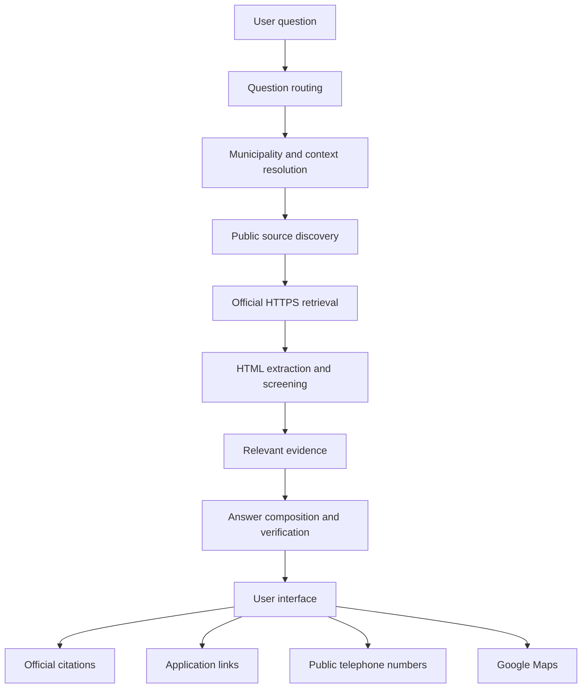
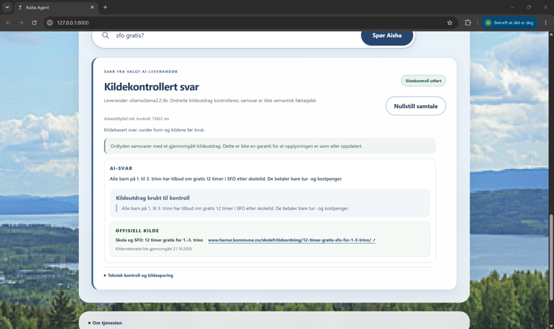

# Aisha Agent - Innlandet Agentic Workflows

## Final examination - Start here

Aisha Agent is an independent student prototype for Hamar,
Elverum and Gjovik.

Application baseline: `0562661`.
Submission branch: `exam/final`.

### Examination documents

- [Official assignment](final_exam/project_KIUA_2003.pdf)
- [Requirements register](final_exam/requirements.csv)
- [Technical readiness](final_exam/READINESS.md)
- [Development history](final_exam/CHANGELOG.md)
- [White paper outline](final_exam/report_outline.csv)

### Complete report evidence

- [All report results](output/rapport_resultater_0562661/)
- [Evaluation metrics](output/rapport_resultater_0562661/evaluering/metrics.json)
- [Raw evaluation](output/rapport_resultater_0562661/evaluering/raw.jsonl)
- [Dataset and tables T1-T8](output/rapport_resultater_0562661/evaluering/)
- [Policy comparison](output/rapport_resultater_0562661/evaluering/policy_comparison.csv)
- [Regression logs](output/rapport_resultater_0562661/regresjon/)
- [Repair evidence](output/rapport_resultater_0562661/reparasjoner/)
- [Reproducibility evidence](output/rapport_resultater_0562661/reproduserbarhet/)
- [Qualitative observations](output/rapport_resultater_0562661/brukertest.md)
- [Evidence integrity manifest](output/rapport_resultater_0562661/manifest.json)

### Final evaluation

| Measurement | Result |
|---|---:|
| Python regression | 899/899 |
| Previous Node VM/DOM regression | 39/39 |
| Mechanical evaluation | 56/56 |
| Input perturbation | 8/8 |
| Dependency failure | 20/20 |
| Recovery | 20/20 |
| Exact fixture grounding | 8/8 |
| Structural citation validity | 10/10 |
| Reserved-budget compliance | 100% |
| Task completion | 8/40 (20%) |
| One-call refusal | 2/20 (10%) |
| Bounded correction | 6/20 (30%) |

Synthetic experiments do not establish live model accuracy,
semantic truth or complete municipal coverage.

### Run Aisha

With dependencies installed and Ollama running:

    python -B -X utf8 -m hamar_agent.web --enable-live-research --model llama3.2:3b --port 8765

Open http://127.0.0.1:8765/.

Live research requires valid permissions and configuration.
Do not submit personal data.

### Reproduce the evaluation

    python -B -X utf8 -m hamar_agent --fixture fixtures/water-synthetic.json
    python -B -X utf8 -m eval.evaluate_verification --final-exam --output output/NEW-campaign

Choose a new output directory for each evaluation.

Earlier development records below are retained for provenance.

---


<!-- FINAL_EXAM_CURRENT_START -->

## Final Exam - KIUA-2003

**Aisha Agent - Innlandet Agentic Workflows**

University of Inland Norway
Final exam development status: 25 November 2026.

Aisha is an AI-assisted municipal information and guidance system.
Its purpose is to make public municipal services more accessible,
particularly for elderly residents and users who need assistance
finding information, applications and contact details.

### Current functionality

- Municipal service research for Hamar, Elverum and Gjøvik.
- Norwegian-language question answering.
- Municipality and locality recognition.
- Context-aware follow-up questions.
- Correction of selected municipal service spelling errors.
- Dynamic discovery of public municipal information.
- Official website navigation and alternative search strategies.
- Source-grounded answers with traceable citations.
- Direct links to municipal application forms.
- Digital and paper application options where available.
- Public institutional telephone numbers and click-to-call links.
- Google Maps searches and directions to documented facilities.
- Area-based map searches when exact addresses are unavailable.
- Explicit uncertainty when information cannot be verified.
- Local Ollama and optional OpenAI provider selection.
- Separate conversation histories for the two model providers.

### System architecture



The application separates source discovery, evidence extraction,
verification and presentation. Search results and navigation links
are not automatically treated as verified factual evidence.

Municipal responses use source-grounded application logic.
Model selection does not replace the underlying verification
requirements.

### Requirements

- Python 3.12 or 3.13.
- Ollama for local model inference.
- Internet access for live municipal research.
- Search dependencies listed in `requirements-search.txt`.
- Node.js for frontend regression testing.
- Optional OpenAI configuration for external model inference.

The current local development environment uses Python 3.13.7.

### Installation on Windows

Run the following commands from the repository root:

```powershell
python -m venv .venv
.\.venv\Scripts\Activate.ps1

python -m pip install -r requirements-search.txt

ollama pull llama3.2:3b
ollama list
```

Ensure that Ollama is running before starting the application.

### Start Aisha

```powershell
.\.venv\Scripts\python.exe -B -X utf8 -m hamar_agent.web --port 8127 --enable-live-research --model llama3.2:3b
```

Open the local website:

http://127.0.0.1:8127/

The application is intended for local execution.
Live research requires an available network connection.

### AI providers

| Provider | Model | Purpose |
| --- | --- | --- |
| Ollama | llama3.2:3b | Local AI inference |
| OpenAI | gpt-4.1-mini | Optional external AI inference |

OpenAI requires explicit authorization and valid provider
configuration. The application must not automatically switch
to a paid external provider.

See [AI provider configuration](docs/provider-configuration.md).

Never commit API keys, credentials or personal information.

### Example questions

- Jeg vil på dagsenter i Ridabu?
- Hvordan søker jeg?
- Hvem kan jeg ringe?
- Vis meg på kart.
- Hva slags hjemmehjelp kan jeg få i Hamar?
- Hvordan søker jeg om trygghetsalarm i Elverum?
- Hvordan søker jeg SFO-plass i Gjøvik?
- Hvilke dagtilbud finnes i Gjøvik?

Follow-up questions can inherit the previously established
municipality and service context.

### Source verification and security

Aisha uses controlled public HTTPS retrieval and evaluates
municipal source content before presenting factual information.

The implementation includes:

- URL and destination validation.
- Bounded network and document processing.
- Robots.txt policy handling.
- Public content and privacy screening.
- HTML structure and contextual evidence checks.
- Source provenance and retrieval timestamps.
- Exact retained source evidence.
- Restrictions on unsupported or ambiguous content.
- Explicit authorization for external model processing.

Official application links direct users to municipal systems.
Aisha does not submit applications or collect the information
required to complete them.

Google Maps links are navigation aids. Area-based searches are
not presented as verified street addresses.

### Testing and evaluation

Run the Python regression suite:

```powershell
.\.venv\Scripts\python.exe -B -X utf8 -m unittest discover -s eval -p "test_*.py" -q
```

Run frontend regression tests:

```powershell
node harness/browser_smoke.cjs --unit
```

#### Latest documented evaluation results

| Evaluation | Observed result |
| --- | --- |
| Targeted Python regression tests | 11/11 passed |
| Frontend VM/DOM regression groups | 39/39 passed |
| Broad live municipal API test | 9/9 HTTP 200 responses |
| Broad live functional checks | 6/9 passed before subsequent corrections |
| Targeted alarm and SFO live retest | 2/2 passed |
| Gjøvik application navigation fallback | Passed source and component checks |

The broad evaluation used actual municipal websites and the
local application configured with Ollama.

The subsequent targeted retest verified the corrected application
procedures for safety alarms and SFO.

The Gjøvik fallback provides actionable application instructions,
direct forms and a separate official guidance link while retaining
an explicit limitation concerning unverified conditions.

These results represent successive tested development states,
not a single final combined acceptance run.

Frontend VM/DOM tests do not establish actual browser rendering
or successful external navigation.

### Main implementation files

| File | Responsibility |
| --- | --- |
| `hamar_agent/question_router.py` | Question interpretation and context routing |
| `hamar_agent/discovery.py` | Source discovery, relevance and answer composition |
| `hamar_agent/internet_research.py` | Controlled public research pipeline |
| `hamar_agent/live_research.py` | HTML extraction and source-content screening |
| `hamar_agent/research.py` | Municipal registry and research policies |
| `hamar_agent/chat.py` | Conversation and model orchestration |
| `hamar_agent/web.py` | Local web application and HTTP API |
| `hamar_agent/web_assets/app.js` | Frontend interaction and service actions |
| `eval/test_internet_research.py` | Internet research regression tests |
| `harness/browser_smoke.cjs` | Frontend regression testing |

### Known limitations

- Live research depends on external website availability.
- Response times vary with retrieval, source size and model processing.
- Municipal website changes may affect extraction.
- Complete coverage of every municipal service is not established.
- Some application conditions cannot be automatically extracted.
- Some follow-up answers require improved service-subtype precision.
- PDF forms are provided as links; their contents are not necessarily parsed.
- Map searches do not guarantee an exact verified destination.
- Live end-to-end OpenAI parity remains to be verified.
- The latest complete regression run must be recorded separately.

The system is designed to prefer documented uncertainty over
unsupported claims.

### Repository and development history

- `main`: preserved Compulsory 2 baseline.
- `exam/final`: final exam development.

Development history is maintained in
[final_exam/CHANGELOG.md](final_exam/CHANGELOG.md).

The historical documentation below is retained for traceability.
Where earlier implementation descriptions differ from this section,
the dated Final Exam section describes the newer development state.

<!-- FINAL_EXAM_CURRENT_END -->

Aisha Agent (also named Hamar KommuneAgent in earlier records) is a two-student KIUA-2003 project at the University of Inland Norway. Its active municipal pilot covers Hamar, Elverum and Gjøvik; the register retains all 46 Innlandet municipalities. One web application provides local Ollama and OpenAI gpt-4.1-mini chat.

The real-source workflow retrieves reviewed local excerpts, asks a local model to select one complete paragraph, verifies its source and exact wording, and returns an official citation or a refusal. It permits at most one correction followed by mandatory re-verification. This is an extractive prototype: evidence matching establishes traceability, not factual truth, complete municipal coverage or semantic verification of paraphrases.

**Development status:** the walking skeleton, tests and historical evaluation evidence are retained for Compulsory 2 and continued development toward the final exam. This repository is not a completed or approved academic submission.

## Current entry points and reproduction

[Final readiness](final_exam/READINESS.md) is the current acceptance and evidence
map; [CHANGELOG](final_exam/CHANGELOG.md) preserves the decisions. Dated sections
below retain earlier implementation states and source-approval policies. Their
test counts and permissions are not acceptance of today's working files.

The public-source chat remains **NOT VERIFIED**: the last ordinary-terminal
Elverum journey fetched HTML but returned `research_no_sources`. Current parser
corrections still need a successful actual-source test and separate final review.
An HTTP200 or a passing mock is insufficient. PDF and Office fact extraction are
not supported; unsupported documents supply no facts. Unknown source text is
untrusted, and source origin, context, conditions and transfer rights are checked.

Use the repository root as the working directory. Offline operation needs only
Python3.12 or3.13. These commands need no API key, model, local catalog or search
package and do not overwrite historical evidence:

```powershell
python -B -X utf8 -m hamar_agent --fixture fixtures/water-synthetic.json
python -B -X utf8 -m harness.offline_tests
python -B -X utf8 -m harness.heldout_search_eval
node harness/browser_smoke.cjs --unit
```

Node24.14.0 is the locally tested UI runtime. Node checks use a deterministic DOM
model; browser rendering, mobile layout and screen readers need separate tests.
CI now selects both Python versions and the Node UI contracts; the updated
GitHub job itself has not yet run. For fresh quantitative/qualitative evaluation
artifacts, use a new output directory for each run:

```powershell
python -B -X utf8 -m harness.request_bound_eval --output output/request-bound-review
python -B -X utf8 -m harness.research_eval --output output/source-contract-review
```

The first command measures scripted source/model contracts and writes
`dataset.json`, `raw.jsonl`, `metrics.json` and tablesT1–T8. Report task completion
separately from correct refusals. Latency and correctness from scripted adapters
are not genuine model/site performance. Qualitative usefulness needs review of
actual answers. The second command runs synthetic source contracts without
external retrieval or model calls. Existing output directories are refused.

For automatic public research, use the existing `.venv` with
[requirements-search.txt](requirements-search.txt) already installed, start
Ollama with an installed server-allowed model, then run:

```powershell
.\.venv\Scripts\python.exe -B -X utf8 -m hamar_agent.web --enable-live-research --port 8000
```

Open <http://127.0.0.1:8000>. The five-step introduction leads to either chat;
municipal research starts on Send. No per-question checkbox is needed. No model
is downloaded automatically. Public search receives only screened, minimized
queries. Reviewed local-source and synthetic modes remain explicit separate
interfaces; they never replace failed real retrieval with fictional facts.

On a clean machine, the following setup requires operator authorization and
network access; it was **not executed** in this cleanup:

```powershell
python -m venv .venv
.\.venv\Scripts\python.exe -m pip install -r requirements-search.txt
```

The tested Python3.12 standard-library environment does not prove
that DDGS is installed there. Keep credentials out of commands, prompts and Git;
`.env.example` documents settings, and `.env` files are not loaded automatically.
OpenAI needs its optional SDK and explicit privacy/cost permissions. Tests here
make no paid OpenAI call, and evidence transfer requires its own authorization.

## Implementation history: public search, 23–24 November 2026

The actual 2026-11-24 Elverum inspection identified an extraction defect: an
outer page-level `form` wrapped `main/article`, so the parser dropped all their
headings and prose. Empty table separators survived and produced two identical
five-token units (SHA256
`b17b577dc04aa345119d73dbbdb11ceca55a8dcd39e26feb4d7b1192b5b9e3f4`).
The public parser now admits inert prose inside forms enclosing an explicit
content root; forms starting inside content and all interactive controls remain
excluded. An omitted control creates a barrier for every fact in its owning
scope and descendants, including application instructions; independent sibling
scopes remain separate. Hidden page-state inputs supply no evidence. Meaningless
separator units are rejected and exact duplicates with identical topic context
are removed. The strict historical reviewed parser and working search/HTTP
transport remain unchanged.

The existing `--stability-chat --inspect-source <exact official URL>` probe now
requires an actually relevant, supported candidate before continuing to chat.
HTTP200 plus successful parsing alone is not a pass. The first actual chat answer
must cite that exact inspected URL. Diagnostics retain only hashes, tag ancestry,
counts and closed flags, never HTML, field values or source paragraphs. Corrected
real Elverum application guidance remains NOT VERIFIED until this changed parser
passes the ordinary-terminal source and actual Ollama chat journey. Synthetic
both-adapter checks do not prove real OpenAI inference or external transfer rights.

The owner now authorizes ordinary public search and transient public retrieval
without a fixed website or excerpt allowlist. `--enable-live-research` connects
both existing chats to the same DDGS provider and request-bound HTML
pipeline. Search starts on Send, without a per-question checkbox. A zero-entry
reviewed catalog no longer blocks search. The previous reviewed-only workflows
remain available separately; historical evidence below describes those versions.

For known municipalities, the first query scopes to the official website; a
second public query provides supplementary sources when needed. The three-city
pilot and all 46 registry identities remain preserved. Other places and general
information can use public search without being represented as verified pilot
coverage. No service-specific answer table is used.

Start with `python -m hamar_agent.web --enable-live-research`. DDGS9.16.1 is
the default; it requires the separate [search requirements](requirements-search.txt).
The owner installed DDGS in `.venv` and reported5 actual Elverum search results
in ordinary PyCharm PowerShell. The earlier public SearXNG instance returned403.
An optional `--search-url`/`HAMAR_SEARCH_URL` configures SearXNG first, with DDGS
fallback under the same budget. No default SearXNG URL is required.

Search now calls the installed package's public API:
`DDGS(timeout=5, proxy=<controlled local gateway>, verify=True).text(query, max_results=5, backend=...)`.
Production explicitly tries Yahoo, Brave, then DuckDuckGo, stopping at the first
validated usable candidate set. Each engine runs in one isolated short-lived
process; no private engine hooks or handwritten search protocol are used.
This replaces DDGS's random `auto` engine selection, which spent the previous
six-tunnel allowance on different engines between identical successful/failed
queries. Yahoo was reached in the successful report but not the failure; this
is an observed difference, not proof of a remote engine outage or TLS cause.
The former private
Brave GET/DuckDuckGo POST implementation is removed from the active adapter;
its real PyCharm run failed at a DuckDuckGo202 response before document retrieval.
HTTP202 is not accepted as evidence. Search-result snippets never become facts.

Native DDGS runs in a short-lived child behind an authenticated loopback CONNECT
gateway. The parent validates every DNS answer and pins one public address on443;
private destinations and non-HTTPS proxy requests refuse. Each logical query has
at most six tunnels and20seconds, split across at most three sequential engines
with two tunnels and six seconds per attempt; a request has at most two logical queries,
12search transport operations and8robots/document GETs (20operations total),
with2MiB shared wire/body accounting. Search TLS
bytes include both directions, **not** decompressed native HTML or HTTP request
counts inside a tunnel. The native worker has a256MiB memory limit and bounded
output, and is terminated on timeout/revocation. DDGS's ephemeral engine cookies
stay within that worker; no user history, credentials or inherited proxy settings
are supplied. Providers receive the minimized non-personal query and client IP.
Document retrieval separately retains the existing DNS/TLS/robots, no-redirect,
HTML-size, privacy, condition and provenance checks. No result URL bypasses them.

Public document HTTP now validates the whole DNS snapshot before connecting,
deduplicates and alternates IPv4/IPv6 candidates, and tries another address only
when connection establishment fails. TLS still uses the original hostname/SNI
through the unchanged `retrieval._pinned_public_connection`. Certificate/TLS
failure, permission denial10013 and revocation stop; no HTTP request is replayed
after headers/status/body failure,403, redirects or MIME refusal. Up to64source
connection attempts share a request cap, separately from12search/8source GETs.

Polite robots pacing is cooperative and outside the I/O watchdog, still inside
the run deadline. Default I/O limits are DNS5seconds, TCP/TLS socket3seconds,
read8seconds and30seconds shared per HTTP GET across all IP attempts and reads.
Trusted configuration uses `HAMAR_HTTP_DNS_SECONDS`, `HAMAR_HTTP_CONNECT_SECONDS`,
`HAMAR_HTTP_READ_SECONDS` and `HAMAR_HTTP_TOTAL_SECONDS`; finite caps and the
existing run/worker/byte limits remain. Individual I/O workers remain below the
unchanged10second watchdog; no outer worker consumes capacity while launching
another. Responses arriving after timeout are closed through an atomic ownership
handoff, and cleanup errors never replace an active security exception.

The actual diagnostic `harness.research_eval --transport-chat --inspect-source
<exact official URL> --query <public question> --output <new directory>` performs
robots preflight, a stdlib urllib baseline with a validated pinned-DNS TCP creator
and original-host TLS, then production PublicHTTP and closed DOM inspection.
It disables inherited proxies/auth/cookies/redirects, records only whether a proxy
configuration exists, and keeps no HTML or contacts. It therefore differs from
an unrestricted `urlopen` that may inherit system proxies. After successful
transport it runs15actual municipal chat questions (five per pilot city) and
one national/public guidance case, with installed local Ollama and no paid cloud.
It stops at the first missing source answer, reports executed/successful counts,
and does not equate a planned matrix or HTTP200 with correct source-backed chat.
Actual five-per-city coverage, current source parsing and publication remain
NOT VERIFIED until that owner-terminal run and independent review succeed.

Successful URL candidates are reused only within that request, never as cached
facts across new chat turns. Repeated engine starts are spaced by six seconds;
a closed SDK rate-limit signal causes a sixty-second engine backoff, not an
assertion that the opaque search TLS stream exposed HTTP429. An isolated socket
reset does not invalidate a successful candidate set. When engines cannot search
and a municipality is known, its official homepage, robots sitemap declaration
(or standard sitemap.xml path), one index child and relevant links may nominate
URLs under the same eight-source-GET/2MiB/global deadline budget. Sitemap XML
is never factual evidence; nominated HTML still passes all source checks.
DTD/entities, external-host sitemap entries, private URLs and redirects refuse.

For the updated actual owner-terminal journey run `harness.research_eval
--stability-chat --query <municipal question> --output <new output directory>`.
It repeats the same chat question three times with fresh request-bound retrieval,
then tests other cities/topics and public guidance in the production CLI/API.
It stops on the first missing source-backed answer, retains sanitized receipts
and uses real local Ollama only. No paid OpenAI call is made. Repeated real
search and useful source-backed responses are NOT VERIFIED until that succeeds.

The controlled Codex query was blocked with WinError10013 before HTTP. The
normal-terminal **production chat** probe is prepared as `harness.research_eval
--live-chat`; it starts the existing CLI and uses actual DDGS/source retrieval
and local Ollama, without paid OpenAI. Owner-reported native-DDGS search success
does not prove this controlled adapter or source-backed chat works. These remain
NOT VERIFIED until the actual probe succeeds. The new public-API adapter reached
the gateway through the actual production chat API in Codex, then stopped with
WinError10013 before HTTP/source retrieval. Local negative probes also confirmed
that the installed native client uses the proxy and private DNS answers refuse.
These are security/path checks, not a successful real search or source answer.
PDF/Office is still unsupported.

The latest normal-terminal failure reached six CONNECT tunnels but produced
`worker_failed`; this does not identify TLS/timeout as the cause. The relay's
independently reproduced write-half-close defect is corrected: one EOF no longer
discards a later response. Closed diagnostics now include nested SDK error types,
OS codes, process exit status, relay direction and timing. No raw errors/HTML leak.

`harness.research_eval --ddgs-differential --query <public search text>
--chat-query <natural question> --output <new output directory>` explicitly
compares direct native DDGS and the production gateway with identical query and
worker runtime/limits. This diagnostic belongs in normal PyCharm, never as a
Codex network workaround or an automatic chat fallback. The direct baseline
does not have the proxy's DNS/wire-byte accounting. If the gateway search
succeeds, the same command tests actual chat/source retrieval and local Ollama;
paid OpenAI stays disabled. Real source-backed chat is still NOT VERIFIED until
that owner-terminal evidence succeeds. Local synthetic TLS transfer is a
transport check, not successful public search or municipal coverage.

The subsequent real A/B proof returned five identical candidate hashes through
both routes. Actual chat then fetched robots and two HTML pages, but admitted
no relevant content and exhausted the old combined12-operation ledger. Search
and gateway code are retained. The public HTML profile now reads article-local
headers, div paragraphs and unambiguous content roots; legacy exact-reviewed
parsing keeps its strict profile. Topic metadata follows its own article/section
scope and is evaluated separately from the original unit. It cannot donate
question words to a sibling or bypass a different substantive subsection.
Inflected application words and hyphenated subjects are supported, with strict
price/date/footnote/privacy guards preserved. Candidate URLs/snippets alone do
not document facts.

All received HTML candidates and bounded relevant official links can be tried
before another query. Search and source quotas remain separate, monotone and
globally finite; two source operations are reserved for public fallback. Valid
partial guidance is retained instead of triggering an unnecessary second search.
PDF/Office candidates are skipped without failing the whole collection. Neither
Python environment has a maintained PDF parser or an available pdftotext tool;
PDF extraction/facts remain unsupported, not automatically enabled by a MIME.
Actual updated source-backed chat still requires the normal-terminal probe.

The subsequent actual stability report confirms official root/sitemap/article
HTTP200 but only two units, both irrelevant, with zero extracted headings.
The exact served DOM cause is not inferred from those counts. Two reproduced
content holes are corrected: a single unambiguous article may use its fetched
HTML title for topic nomination, and relevance/support share the same procedure
inflection signal. Topic metadata does not supply prices/years or override other
headings or an explicit different application object. Aliased visible headings
also require coherence with the fetched page title; URLs alone cannot override
an explicit different service. The source-only inspection option below measures
the actual layout without guessing CMS structure or changing search transport.

Use `--stability-chat --inspect-source <exact official service URL> --query
<public question> --output <new directory>` in `harness.research_eval` to first
inspect that source via the existing public HTTPS/robots path, then test the
actual chat. Inspection retains only standard-tag ancestry/active/blocked/form
flags, finite counters, hashes and procedure/relevance/support booleans. It saves
neither HTML, source paragraphs, attribute values nor individual contacts, and
does not confer factual approval. An HTTP/robots failure stops the probe. Actual
DOM attribution, corrected source-backed answers and V-C01 stay NOT VERIFIED
until the new normal-terminal result and independent review are available.

Only locally relevant, screened whole HTML units enter evidence. Search snippets
never become facts. Official origin, dates, conditions, price-year context,
footnotes and conflicts remain distinct checks. Responses quote source units,
give direct links and retrieval timestamps, and make no completeness claim.
TLS/DNS/private-address checks, robots, redirect refusal, finite shared budgets
and revocation apply. The filter does not prove arbitrary pages anonymous or
factually correct. PDF/Office extraction is **unsupported** without a separately
reviewed parser. OpenAI source transfer still needs separate URL/content rights;
without them, source excerpts can be displayed locally without calling OpenAI.
No paid API, account, model download or dependency is enabled by public search.

See [diagnosis, implemented boundaries and pending scalable policy](docs/research-discovery-policy.md).
The unchanged consent, cost, two-model UI and separate history rules below apply.
No uncontrolled crawling or paid requests are enabled. V-C01 and real chat
acceptance remain open until successful source-backed journeys are documented.

## Current Innlandet research and UI preparation (2026-11-12)

The existing research planner now resolves an explicitly named municipality or
the bounded conversation context. Unknown, ambiguous or expired municipality
records fail closed; a different municipality never silently becomes Hamar.
An owner-reviewed registry records identity, exact official host, aliases,
review/expiry dates and the reference/hash of its verification evidence.
`MunicipalityRegistry.from_reviewed_file` accepts a bounded strict JSON manifest
with `region: "Innlandet"` and `municipalities` records matching `Municipality`.
Loading a record is not independent verification of its domain. No authoritative
complete Innlandet roster has been supplied; tests use three fictional review
records and do not activate or verify those domains.

Municipal service conditions require tier1 sources from the selected municipality.
Tier2 approved public authorities and tier3 individually approved supplementary
sites can be compared when requested, but cannot replace municipal evidence.
At most four selected sources are observed per request. Reviewed facts are
compared only within matching entity/attribute/period/geography/unit scopes;
unresolved conflicts, outages or changed source bytes prevent publication.
This is not arbitrary discovery, crawling or general semantic fact checking.

The same `ResearchService` policy can be injected into the existing
`ChatBackend` and `create_municipal_service(request_sources=...)`. Both existing
Ollama/OpenAI adapters use its current-request excerpts, receipts and independent
exact-quote verification. Ollama additionally uses a bounded JSON selection
schema with an abstention option. Existing historical Hamar URL validation is
unchanged; only request-private documents constructed from the reviewed registry
accept another municipality's exact host. Follow-ups retain the selected place,
while an explicit new place overrides it. Registry/index/receipt mutation or
revocation invalidates publication. The standard CLI does not load or activate
this regional policy automatically: live transport, the complete verified roster,
specific sources/paragraphs, processing rights and network access still require
review and separate owner approval. Municipal production remains fail-closed.

The public chat now says “Hei, jeg er Aisha”, uses the requested short welcome
text and keeps safety information in a closed accessible disclosure. Both chat
topics and municipal categories have a pink “← Tilbake til meny” button that
preserves conversation/draft without fetching, generating or resetting. “Ny
samtale” remains separate. Local AI is still the default and cloud selection is
explicit. Paid OpenAI and search are not enabled by navigation.

Evidence: `output/aisha-innlandet-ui-3f4c8d1a/`. The full offline run passes
571 methods;24 Node VM/DOM groups pass. `research-final-v2/` adds34 declared
case/provider contracts (44 requests) across three fictional municipality
policies, both mocked providers, faults and recovery:34 pass,12/12 final
published quotations have their expected municipal citation. The acceptance
matrix has14 expected acceptances and20 expected rejections, with no mismatch;
guidance is counted separately from published source answers. The earlier20
research contracts also pass. Mock timings are not provider/network performance.
Every phase now checks its exact HTTP status, error code, response origin and
publication/reference state; mutation controls reject wrong error labels and
wrong earlier-phase answers. Short municipality-change follow-ups retain the
new place, including the next elliptical turn. Original v1 results, independently
reproduced defects and their failing regressions remain preserved.

`local-rag-final-v2/` records6 genuine local `llama3.2:3b` calls: three source-blind
counterfactuals expressed uncertainty; three RAG calls returned the exact
fictional excerpt with source binding. This is a development experiment using
synthetic sources, not current municipal truth or a representative accuracy
estimate. Only the experimental source-blind arm bypasses the production
zero-call municipal referral; RAG also adds constrained selection/rejection,
so the comparison does not isolate retrieval's causal effect. Full raw provider
usage, run reservations, latency and residual-worker counts are retained.
The earlier6-call cohort retains its original source hashes;12 genuine local
calls were executed in total, not12 independent held-out cases. No source
websites, OpenAI calls, new models or dependencies were used. Native
browser rendering/accessibility and independent matching-snapshot review are
reported separately; Node contracts alone do not establish either.

Reproduce offline with a new evidence destination:

```powershell
.\.venv\Scripts\python.exe -B -X utf8 -m harness.offline_tests --output output/NEW-offline.log
.\.venv\Scripts\python.exe -B -X utf8 -m harness.research_eval --output output/NEW-research
node harness/browser_smoke.cjs --unit
```

Start the existing application locally with
`.\.venv\Scripts\python.exe -B -X utf8 -m hamar_agent.web`, then open
`http://127.0.0.1:8000`. Ollama must already be running with the allowed installed
model. General local chat is available; live municipal/research answers stay
unavailable until the approvals and transport above are completed. This command
does not enable paid OpenAI or web search.

## Current production policy — request-bound sources (2026-11-12)

Every new source-bearing municipal search/answer/direct run must use a complete,
validated source observation from its own active request. Source admission and
final publication reject a different, completed, aborted or revoked request.
Historical catalogs cannot be production fallback; ordinary chat remains separate.
Invalid/private/unsupported inputs and metadata/control requests do not retrieve
source content or make model calls.

**Real source acquisition is still disabled.** The eight old approvals are not
renewed. Production may start with source identities, but municipal queries fail
closed until concrete network access, a permitted non-personal input format,
current URL/paragraph approval and source rights are resolved. No live observer is
currently configured. No CLI/HTTP flag silently enables it. Synthetic injected
observations prove the control mechanism, not physical official-site freshness.

The immutable request corpus preserves exact approved excerpts and records
`retrieved_at`, optional source `published_at` and HTTP `last_modified` separately.
Unknown dates remain unknown. Public cards hide detailed timestamps and show only
necessary cautions. Source failure publishes no answer and does not claim a new
check. Reset stays outside the lazy answer panel and invalidates conversation
publication; it does not cancel a remote inference or already-admitted operation.

The next section records the **superseded historical policy** and evidence. Its
contents are retained for provenance, not current production instructions.

## Historical runtime policy before 2026-11-12: retained municipal dataset

The owner has explicitly removed expiry as a runtime stop for the **exact eight
existing local source records and 39 retained paragraphs**. This supersedes the
earlier expiry-blocked runtime status described in the historical renewal notes
below. This is **historical access, not renewed approval**: the manifests still
record review on 2026-10-21 and expiry on 2026-10-28, without rewriting history.
After expiry, search results, AI evidence/citations and the existing web UI show
that approval has expired and information is historical, not newly approved or
updated. The source list and JSON provenance also expose that status.

The exception is bound to canonical SHA-256 fingerprints of all eight original
approval records and complete catalog documents. It cannot admit a modified or
unrelated expired dataset. Source identity, content/paragraph/provenance checks,
query privacy checks, exact-quote verification and disabled municipal HTML
acquisition remain in place. No new runtime mode or synthetic fallback was
introduced. `PageApproval.current()` still reports the recorded approval's
actual validity. Historical access has no automatic November 28 shutdown; it
does not change the source approval expiry to November 27.

**Actual validation:** 374 offline tests passed. With scoped application clocks
on **2026-11-20** and **2026-11-27**, the real local catalog loaded all eight
sources/39 paragraphs; every source was searchable and produced an actual
`ollama:llama3.2:3b` answer with zero evidence-verification findings and historical
provenance. There were 16 direct source inferences and two portal AI answers.
The real-source web page returned HTTP 200 on both dates. These are tests run
now with simulated dates, not proof of future machine/model availability or
future factual correctness. See the [sanitized validation record](docs/historical-source-access-validation-20261027.json).

Use the existing web application, with Ollama running and the original ignored
local catalog present:

```powershell
python -B -X utf8 -m hamar_agent.web --real-sources --provider ollama --model llama3.2:3b --ollama-timeout 90 --port 8000
```

Open <http://127.0.0.1:8000>. A Git clone does not include the local catalog.
Historical access is not municipal permission or a legal clearance: the
documented reuse-rights uncertainty remains. The original public-health p1
wording is retained as requested; its adoption wording remains unsupported by
the inspected PDF, and the separately approved correction has not been applied.
Consult the official sources for current facts, particularly dates, fees and
conditions. The PDF correction and a genuine source renewal are separate from
this owner-authorized historical runtime policy.

## Requirements and setup

- Python 3.12. Historical evaluation records identify Python 3.12.10.
- No third-party Python packages or credentials are needed for synthetic operation or the standard-library Ollama application.
- Real local inference additionally requires a running Ollama server, an installed server-allowlisted model, and an eligible approved local municipal catalog.

Open the repository in a terminal or IDE and use its root as the working directory. Check the interpreter:

```powershell
python --version
```

An isolated environment is optional. If desired, create one and use its interpreter for the commands below:

```powershell
python -m venv .venv
.\.venv\Scripts\python.exe --version
```

Offline and general Ollama chat need no package installation. Automatic public search additionally uses [requirements-search.txt](requirements-search.txt), pinned to the owner's existing DDGS9.16.1 environment. DDGS and its pinned dependencies declare Python3.12/3.13 compatibility; actual installed-package testing here is on3.13. The3.12 environment has no DDGS/lxml installed, so its optional installed-parser check is explicitly skipped, not called an actual3.12 DDGS pass. OpenAI is an optional external provider, disabled by default. Install its separate [requirements](requirements-openai.txt) only after external processing has been explicitly authorized; follow the [provider configuration guide](docs/provider-configuration.md). No provider automatically falls back to a paid service. No installation was performed by the agent.

The application reads process environment variables. [.env.example](.env.example) is a reference; the application does not load `.env` files. Keep credentials in ignored local configuration and never commit them.

## Run the synthetic walking skeleton

From the repository root:

```powershell
python -B -X utf8 -m hamar_agent --fixture fixtures/water-synthetic.json
```

Expected output is JSON on standard output with the explicitly synthetic source, two supported claims, evidence references and no verification findings. This path uses the mock provider, needs no catalog or model, and makes no municipal retrieval request. It checks orchestration and evidence matching, not real-model quality.

The historical result is preserved in [walking-skeleton-synthetic.json](comp2/evidence/walking-skeleton-synthetic.json), with command metadata in [new-command-register.json](comp2/evidence/new-command-register.json). Running the CLI command above does not overwrite either file.

For the offline demonstration website:

```powershell
python -B -X utf8 -m hamar_agent.web --demo --provider mock --port 8000
```

Open <http://127.0.0.1:8000>. Run only one server on the chosen port; reuse an existing appropriate server rather than starting a duplicate. In PyCharm, select Python 3.12 and run the module with the repository root as the working directory; do not execute `hamar_agent/__main__.py` as a standalone script.

## Run with approved local municipal sources

Real mode requires all of the following:

1. An existing, lawfully obtained and individually approved local catalog at `output/municipal-catalog.json`.
2. Exact URL- and paragraph-specific approval and provenance matching the reviewed manifests, with valid review and expiry dates.
3. Ollama already running locally, with the chosen model installed and allowed by server configuration. The documented model is `llama3.2:3b`; the application never installs or downloads models.

The catalog is ignored local data and is not supplied by a Git clone. The recorded source approvals expire on **2026-10-28**. Missing, expired or ineligible sources must cause real mode to refuse operation; do not extend dates simply to reproduce a result. Reproduction on a new machine requires separately authorized access to eligible excerpts.

### Source Approval Validity and Extension Request — Instructor Note

The latest owner instruction restores **2026-11-27** as the requested expiry for all eight existing municipal sources. The [original November 27 authorization](docs/source-renewal-owner-authorization-20261027.json) is reused; the [intermediate November 20 decision](docs/source-renewal-owner-authorization-20261027-to-20261120.json) is preserved as historical evidence. Source content and all 39 paragraph hashes are unchanged. Original source review remains **2026-10-21**, and actual active expiry remains **2026-10-28**. The owner authorization is not a substitute for unperformed source/privacy/provenance decisions.

All eight records in [the approval manifest](docs/approved-service-pages.json), and their corresponding entries in [the reviewed selection](docs/reviewed-service-selection.json), carry that original expiry:

| Source ID | Reviewed service | Retained paragraphs | Renewal to 2026-11-27 |
| --- | --- | --- | --- |
| `hamar-sfo` | School-age childcare | 5 | Pending reuse-basis clearance |
| `hamar-byggesak` | Building without an application | 5 | Pending reuse-basis clearance |
| `hamar-folkehelse` | Public-health knowledge base | 4 | Pending reuse-basis clearance |
| `hamar-bibliotek` | Municipal library | 5 | Pending reuse-basis clearance |
| `hamar-kommuneplan` | Municipal community plan | 5 | Pending reuse-basis clearance |
| `hamar-drikkevann` | Drinking water | 5 | Pending reuse-basis clearance |
| `hamar-parkering` | Parking locations and payment | 5 | Pending reuse-basis clearance |
| `hamar-luftkvalitet` | Air quality | 5 | Pending reuse-basis clearance |

**Current renewal outcome: zero renewed, eight pending, zero rejected. powerNeron has confirmed human review and conditional approval; the reuse basis remains unresolved. Controlled activation is implemented but has not been applied to these sources.** Read-only comparison of the existing local catalog against both manifests confirms matching official HTTPS URLs, source identities, paragraph hashes and unique paragraph IDs, combined text hashes, recorded raw hashes and expiry metadata for all eight sources. All 39 retained paragraphs pass the existing limited privacy-pattern screen. Retrieval/index timestamps are recorded from 2026-10-21. These checks establish consistency of the retained material, not current website content, current robots permission or a new privacy clearance. The recorded `no_personal_data` assertion and pattern screen are not a fresh human review; raw-page and robots hashes were not reverified against newly acquired material. No municipal HTML was fetched or imported.

Existing local evidence under `output/final-technical-evidence/` includes a bounded catalog privacy review and `source-renewal-review-20261022.json`. The latter records all eight human renewal approvals as pending, no expiry updates, and an older requested target of 2026-11-30. That historical evidence is unchanged. The new owner authorization is recorded separately; it does not retroactively change the earlier findings or supply a new source/privacy reviewer sign-off.

An extension requires a documented, authorized re-review of each exact source URL and approved excerpt under the [source-review process](docs/source-review-process.md), including privacy, service facts, hashes and provenance. Record the actual review date, responsible reviewer using an appropriate project identifier, affected sources, authorization and resulting expiry only when those steps have really been completed. No qualifying new source/privacy re-review or activation was established in this update. The conditional owner authorization therefore leaves the approval manifests, active catalog and historical evidence unchanged.

The legacy content-change proposal workflow remains non-activating, and expired approvals cannot be renewed through its proposal decisions. A separate owner-controlled unchanged-content renewal path is now implemented in `source_admin.activate`: it validates the recorded owner authorization, exact input bytes, all source reviews and their current sanitized provenance evidence before changing expiry metadata. The owner may personally perform and document the required source/privacy review using the `project-owner` role; no independent municipal or instructor approval is implied. A role declaration without completed checks is insufficient.

To complete renewal, an authorized source reviewer and privacy reviewer must document the exact URLs and paragraph scope, an actual review date, the service-fact checks (including dates, numbers, fees and conditions), privacy eligibility and permitted source/robots provenance. Use project identifiers rather than private personal details, and record an explicit source-specific decision for the requested expiry. Current eligible material must be supplied through an authorized non-personal input boundary; do not fetch raw HTML to fill the gap. Only after those checks may the controlled activation command update approval/selection expiry and active catalog expiry together. It preserves original `reviewed_on` dates, source content, all paragraph/raw/text/robots hashes and retrieval/index timestamps; the actual new review dates and reviewer identifiers belong to the new transaction audit. The existing proposal `decide` command alone cannot renew sources. No production activation or expiry edit has been performed.

Earlier validation on 2026-10-27, before the activation implementation, passed all 318 then-existing offline tests. With the original approvals still current, real-source web startup returned HTTP 200 and loaded eight documents using `ollama:llama3.2:3b`. One bounded real-source CLI call for `hamar-drikkevann` returned one claim with zero verification findings. This exercised the existing 2026-10-28 approvals, not a November renewal, and does not establish factual correctness, fresh source review or all-source model quality. No municipal requests were made, and no historical results were overwritten.

The earlier [implementation validation record](docs/source-renewal-validation-20261027.json) documents the completed 350-test offline run, synthetic workflow, real-source Ollama web startup, municipal search and one evidence-checked AI answer. The actual renewal check still reports eight incomplete human reviews (exit `3`); no production activation was attempted. All eight approval/selection/catalog records agree on **2026-10-28**. These successful software checks do not activate the authorized November target or verify the separate academic report.

The subsequent [technical-completion validation](docs/source-renewal-technical-verification-20261027.json) records 356 passing tests, all technical metadata completed for eight sources/39 paragraphs, and successful real-source startup, search and one Ollama answer. It lists the exact remaining human review fields and source-specific factual assessment items. Provenance file paths and hashes are now populated from real local files, but those files are unchecked review drafts, not approved current-source evidence. Actual expiry remains **2026-10-28** for all eight sources.

### Examiner access on November 20: verified date behavior

The owner supplied October 30, 2026 as the submission date and November 20, 2026 as the required examiner-access date. **The actual project sources are not yet usable on November 20:** all eight still expire on October 28. The [simulated-date validation](docs/source-renewal-date-validation-20261027.json) exercised the actual approval/catalog data and runtime loaders with a test-only scoped clock: on November 20, new loading was refused, already-loaded search returned no results, AI refused for insufficient eligible evidence, and no model generation occurred. November 28 likewise correctly refused expired sources. The system clock and production expiry checks were not changed.

Six new offline regressions separately prove that a genuinely authorized renewal of a synthetic temporary test package loads, searches and answers on November 20, includes November 27 itself, and refuses new startup and already-running search/AI on November 28. Those positive cases are not activation of the eight project sources. The complete suite passes 362 tests. Current-date local Ollama web startup/search/one AI answer also passed under the original October 28 approvals. November examiner access remains blocked until the documented human content/privacy/provenance review is completed and the actual renewal transaction succeeds. No fresh official-page check was performed: the approved workflow still has no authorized non-personal delivery boundary for new raw HTML acquisition.

An intermediate owner target was **November 20 inclusive**; that dated decision and its validation remain historical evidence. The existing workflow accepts that target without code changes. Its check still returns exit `3` for all eight missing human reviews. Actual records were checked with simulated November 20 and November 21: both refuse startup, return no eligible search evidence and refuse AI before model generation because the records still expire October 28. This verifies expiry enforcement, not the requested November 20 availability. Current-date local Ollama source loading, search and one verified AI answer passed. The current owner-decision record lists every missing review/attestation field; the old November 27/28 regression evidence remains unchanged historical evidence.

### Official-source comparison and remaining review decisions

The [actual official-source observations](docs/source-review-official-observations-20261027.json) compare all 39 retained paragraphs: 38 match the official rendered text after whitespace/link normalization. All eight URL views were available, but provider-reported crawl ages range from today to two months, so this is not proof of live page-body identity for every source. No HTML was imported into the knowledge base and no personal contact details were copied into project evidence.

One paragraph remains unresolved: `hamar-folkehelse:p1` says the document was **adopted** on February 21, 2024. That statement was not located in the official page view. The linked official PDF instead says it was **treated by the municipal council on 21.02.2024**. Treatment is not automatically evidence of adoption. Supply the actual adoption/source evidence or make a separately reviewed correction; do not certify this paragraph unchanged merely from the date match. Parking paragraph p4 belongs to **zone 3211**, not every parking location.

A direct HTTPS observation of robots.txt on 2026-10-27 returned HTTP 200 and SHA-256 `52b871e73c993dd13ffb8bb1760cddf1bf5ce5eb4175d31234d6f474b2a0adfc`, different from the historical pinned `b05e0051ef9bb54c62b82ed2dd8880438ff2a3032d0ffb40009eac5e965df6fd`. The observed policy allows all eight paths for the checked project/research agents with a five-second minimum interval. This is a robots-access observation, not a reuse license or privacy guarantee; preserve the historical hash and explicitly review the new observation rather than relabelling it as unchanged.

The local worksheet contains these findings. powerNeron has since supplied a project-owner review declaration and conditional approval, recorded at the actual UTC decision time in ignored local audit records. This does not establish unresolved reuse rights or activate the PDF correction. No November activation or production expiry change has been performed.

### Owner-controlled renewal: review, check, activate

**Latest rights assessment (2026-10-27; 367 offline tests passed):** powerNeron has expressly confirmed
human review and conditionally approved continued use, including the proposed
public-health correction supported by the official PDF. The remaining issue is
the documented reuse basis, not another owner authorization. The
[rights assessment](docs/source-reuse-assessment-20261027.json) distinguishes
public access, copyright, privacy and publication. No applicable municipal
licence or source-specific statutory clearance has been established for all 39
verbatim excerpts. Local inference, short length, attribution and academic use
alone do not establish that clearance. No source permission flag has been
invented; actual expiry remains **2026-10-28**, with **0/8 renewed**. Earlier
statements about pending owner review above describe the earlier review state.
The approved public-health correction is prepared locally but is not active:
its PDF provenance differs from the existing exact HTML-source approval.

For explicit navigation without loading any municipal text, run:

```powershell
python -B -X utf8 -m hamar_agent.exam_links
```

This separate, offline **link-only examination mode** lists eight official
reference URLs with project-authored topic labels. It reads no catalog or
approval files, fetches nothing, does not call Ollama and makes no current
service-fact or source-approval assertion. It is never selected automatically
when real mode fails. Follow the links manually for current municipal guidance.
It is not a successful November real-source AI test. A future fact-answer mode
would require separately reviewed fact-only inputs; this command does not
relabel the existing verbatim catalog as free-to-reuse facts.

This is an offline, all-or-nothing renewal of the entire authorized source set, not content admission. No source is changed if any review is missing or rejected. All required human review and provenance observations must be on the activation's current UTC day, not in the future. A project-owner review is a local attestation; the tool does not authenticate identity or independently establish the truth of the review. Protect the local files and audit directories accordingly.

Prepare an unchecked review draft, using a new output filename in an existing directory:

```powershell
$renewalInputs = @('--owner-authorization', 'docs/source-renewal-owner-authorization-20261027.json', '--approvals', 'docs/approved-service-pages.json', '--selection', 'docs/reviewed-service-selection.json', '--catalog', 'output/municipal-catalog.json')
python -B -X utf8 -m hamar_agent.source_admin prepare-renewal @renewalInputs --output output/source-renewal-review-20261027.json
```

Preparation does not perform a human review: every decision is `pending`, every check is `false`, and review timestamps/identifiers are empty.

Automatically complete the verifiable local metadata before the owner reviews it. Use a new technical-evidence directory:

```powershell
python -B -X utf8 -m hamar_agent.source_admin complete-renewal-technical @renewalInputs --reviews output/source-renewal-review-20261027.json --output-dir output/source-renewal-technical-20261027
```

This verifies all eight source bindings and 39 paragraph hashes, records eight separate technical checks per source, creates actual hash-bound provenance draft files, and fills their relative paths/digests in the review JSON. It preserves the original draft as `review.before.json` and creates a local `owner-review-items.json` containing the exact retained paragraphs and assessment items. These ignored local files are not published. It never sets human decision/check/identity fields, invents source-observation timestamps or silently rebinds a changed reviewed file. The existing local draft has now been technically completed this way; all eight human decisions remain pending. Missing provenance file paths and hashes are therefore no longer the blocker. For **each of the eight source entries**, the owner must:

1. Actually review the exact URL, unchanged retained paragraphs, current service facts, privacy eligibility and permitted source/robots provenance. Use authorized non-personal material; do not acquire/import raw HTML. If hashes, paragraphs or provenance differ, this expiry-only path must refuse the record; a separate content-admission process is needed.
2. Complete `decision` (`approve` or `reject`), `reviewer` (a GitHub-style project identifier), `reviewer_role` (`project-owner` or `source-and-privacy-reviewer`) and the genuine timezone-aware `reviewed_at`. Set the seven named `checks` to `true` only for checks actually completed; leave missing checks false. The same owner may perform the combined review without claiming independent approval.
3. Open the provenance draft file created by technical completion (or copy `provenance_template` into a separate sanitized `.json` file beneath the review file's directory if that step was not used). Preserve the source/URL/paragraph/hash binding. Set its actual `observed_at`, and complete its four `checks` only after verifying current service information, source permission, the non-personal input boundary and original hash provenance. The required `input_boundary` is `authorized_non_personal_material`. No raw document, personal data or credentials belong in that evidence file.
4. Set `provenance_file` to that file's forward-slash relative path and `provenance_sha256` to its SHA-256 after editing. For example, `(Get-FileHash -LiteralPath output/REVIEWED-source-provenance.json -Algorithm SHA256).Hash.ToLowerInvariant()` computes the digest; it does not perform the review. Do not alter the draft's authorization/input hashes, target expiry, source IDs, paragraph IDs or content hashes. Evidence observation must precede the review on the same UTC day.

Inspect eligibility without changing the manifests:

```powershell
python -B -X utf8 -m hamar_agent.source_admin check-renewal @renewalInputs --reviews output/source-renewal-review-20261027.json
```

Exit `0` means eligible, not activated or academically approved; `3` means blocked with per-source missing checks/fields; `2` means invalid inputs or an operational failure. Only after a successful check, stop the application and use a new transaction directory:

```powershell
python -B -X utf8 -m hamar_agent.source_admin activate @renewalInputs --reviews output/source-renewal-review-20261027.json --transaction-dir output/source-renewal-transaction-20261027 --confirm 'renew 2026-11-27' --application-stopped
```

This command acquires an exclusive lock and preserves byte-identical original files, proposed files, owner authorization, reviews and provenance evidence in that transaction directory. It verifies all input bindings, stages schema-valid data, changes only the three expiry fields, verifies the resulting bytes and writes `COMMITTED.json`. Handled partial-write/audit failures restore the original bytes; unsuccessful rollback leaves a lock and recovery journal. A stale review, changed input, reused transaction, unexpected concurrent modification or rejected privacy decision cannot be silently accepted. Keep all transaction directories as evidence; restart the application only after successful commit verification.

Three separate filesystem replacements are **not crash-atomic**. Keep application processes stopped during activation. After a crash/interruption, inspect `PREPARED.json` and the final marker before restarting. For an uncommitted prepared transaction with its matching lock, verified recovery restores originals without changing content or historical audits:

```powershell
python -B -X utf8 -m hamar_agent.source_admin recover-renewal --transaction-dir output/source-renewal-transaction-20261027 --approvals docs/approved-service-pages.json --selection docs/reviewed-service-selection.json --catalog output/municipal-catalog.json --application-stopped
```

Recovery refuses committed transactions, mismatched paths/hashes and unknown concurrent edits. A failure before `PREPARED.json` needs manual inspection of the untouched inputs/staging directory and lock; do not delete locks or edit manifests blindly. The retained original files and existing historical manifests are never rewritten to make an audit pass. Historical copies retain their old expiry intentionally. After a genuine activation, README status must be updated from the committed audit; today all eight remain at 2026-10-28.

Runtime validation accepts a recorded approval only from its review date through its expiry date, inclusive, using the system date. The application must continue refusing expired, missing or ineligible sources; indexed expired documents are excluded from search. The synthetic CLI/web demonstration and offline tests remain available independently of municipal-source approval or Ollama. The project does not automatically fetch or approve municipal website content, renew approvals or download models. Raw HTML acquisition and snapshot import remain disabled.

**Raw municipal HTML acquisition and import are disabled, including offline snapshot parsing.** Historical acquisition instructions and observations do not authorize new retrieval. Do not recreate or renew a catalog from HTML until an approved input process establishes that personal information is never received or processed.

After satisfying the local requirements, inspect installed models and start real mode:

```powershell
ollama list
python -B -X utf8 -m hamar_agent.web --real-sources --model llama3.2:3b --ollama-timeout 90 --port 8000
```

Open <http://127.0.0.1:8000> and, for example, ask `Hva kan jeg bygge uten å søke?`. Check the displayed excerpt, verification status and official source link. The website lists only model tags both installed locally and allowed by the server. Default web startup uses real-source mode; synthetic mode requires the explicit demo flags.

A source-based CLI run is also available:

```powershell
python -B -X utf8 -m hamar_agent --real-sources --source hamar-byggesak --model llama3.2:3b --ollama-timeout 90
python -B -X utf8 -m hamar_agent --real-sources --source hamar-drikkevann --model llama3.2:3b --ollama-timeout 90 --output output/NEW-result.json
```

Use a new output filename: JSON export is exclusive and does not overwrite existing results. The CLI source run and the browser's question-based retrieval are distinct checks. An opt-in local-model synthetic example is documented separately:

```powershell
python -B -X utf8 -m hamar_agent --source synthetic-verification-demo --provider ollama --model llama3.2:3b --ollama-timeout 90
```

Real mode never silently substitutes synthetic data when its catalog, model or verification fails. See the [real-source workflow and historical test evidence](docs/real-source-workflow.md), [source review process](docs/source-review-process.md) and [provider configuration](docs/provider-configuration.md).

### Portal search and catalog loading

Ordinary municipal search uses `/api/search` over the reviewed local paragraph index and never invokes a model. The independent AI form uses `/api/answer`, performs its own retrieval and sufficiency check, and does not require a preceding ordinary search or reuse its category selection. A new or edited question clears the previous answer/download state. The index uses word-based retrieval and ranking, not semantic/vector search or whole-site crawling. Missing indexed evidence does not mean that a municipal service does not exist.

Follow-ups retain only bounded, volatile topic context and repeat retrieval; previous model answers are never evidence. Reset/model changes clear context. Do not enter personal information. POST bodies and privacy-pattern screening do not guarantee that arbitrary user input contains no personal data. Real-mode refusal must not trigger a synthetic or paid-provider fallback.

For an existing eligible catalog at a non-default path, use the current real-source loading options:

```powershell
python -B -X utf8 -m hamar_agent.web --real-sources --catalog LOCAL_CATALOG.json --approvals docs/approved-service-pages.json --model llama3.2:3b --port 8000
```

Repeat `--catalog` only for individually reviewed eligible catalogs matching the supplied approval manifest. Loading rechecks identity, URL, paragraph hashes, provenance and expiry; it does not acquire HTML or renew approvals. Do not combine real catalogs with `--empty-index` or treat old snapshot-import commands as supported ingestion. No web endpoint can approve sources, upload pages or enable fetching.

### JSON output and file saving

Use `--output` with an unused filename in an existing parent directory, preferably ignored `output/`. Successful CLI saving writes UTF-8 JSON and prints the same result to stdout. Exclusive creation prevents overwriting existing files; handled saving/serialization failures report an error on stderr and exit `2` without success JSON. No parent directories, filenames, retries or backups are created automatically.

Exclusive creation is not atomic completion or crash durability: interruption/write failure can leave a partial new file, and a stdout failure after saving can leave a valid file. Export does not add privacy detection or establish semantic correctness. Review new outputs before sharing; never regenerate historical evidence in place.

## Architecture and boundaries

The application uses Python's standard library, a local search index, local HTTP interfaces and versioned JSON results. Ordinary service search does not invoke the model. The AI form performs its own retrieval and sufficiency checks before invoking the provider.

The runtime stages are:

1. Apply privacy/topic constraints and check source eligibility and validity.
2. Retrieve approved local paragraphs and determine whether evidence is sufficient.
3. Ask the configured provider to select a whole reviewed paragraph.
4. Check paragraph identity, verbatim claim/evidence support and provenance through the existing verifier and strict adapter.
5. Permit at most one correction, re-verify, and return a cited result or safe refusal.

Human source admission precedes runtime. There is no autonomous crawling, source approval or unrestricted shell execution by the model. See the [workflow contract](https://github.com/powerNeron/innlandet-agentic-workflows/blob/dad5024fda555113ab65233b1d2abdd9c34f09cf/docs/full-system-contract.md), [integration guide](https://github.com/powerNeron/innlandet-agentic-workflows/blob/dad5024fda555113ab65233b1d2abdd9c34f09cf/docs/full-system-web.md), [summary and verification design](docs/summary-verification.md) and [workflow figure](comp2/figures/aisha-workflow.pdf). JSON export constraints are documented above.

### Privacy and security

Do not collect or process personal data. Public availability is not permission. Use synthetic fixtures for development and explicitly reviewed non-personal excerpts for real operation. Reject uncertain input and treat external source text as untrusted data rather than executable instructions. Source categories based on [Hamar's official menu](https://www.hamar.kommune.no/meny/) do not authorize ingestion.

The local web service binds to loopback and applies Host/Origin and session-token checks. Query topics, model choices, context lifetime and exported results are bounded. These controls and exact-paragraph verification reduce risk but do not establish universal security or semantic correctness. Keep Ollama local; do not expose it through a public tunnel.

Content-update comparison and its legacy decision records remain offline and proposal-only. They do not activate excerpts, renew approvals or fetch pages. The separately gated owner-controlled expiry renewal below does not enable content imports or network retrieval. Follow the [source-update policy](https://github.com/powerNeron/innlandet-agentic-workflows/blob/dad5024fda555113ab65233b1d2abdd9c34f09cf/docs/source-update-proposals.md) and [source proposal administration guide](https://github.com/powerNeron/innlandet-agentic-workflows/blob/dad5024fda555113ab65233b1d2abdd9c34f09cf/docs/source-proposal-administration.md). Historical raw-HTML processing remains an unresolved assignment-compliance concern; excerpt filtering alone does not establish that no personal data was received.

## Tests and evidence verification

### Offline evaluation harness

Run the full offline suite from the repository root:

```powershell
python -B -X utf8 -m harness.offline_tests
```

The full offline suite passes **362 tests**, with zero failures or errors: the existing 318 plus 44 unchanged-content renewal regressions. This includes 36 package-verifier regressions using temporary synthetic packages. These results do not certify live Ollama operation or authorize municipal-source use. The synthetic web demonstration above uses the mock provider and remains runnable without source approvals.

The harness blocks real sockets and DNS while discovering `eval/test_*.py`. It needs no model, credentials or municipal network access. To retain a new log, supply an unused path:

```powershell
python -B -X utf8 -m harness.offline_tests --output output/NEW-offline-tests.txt
```

For direct unittest discovery, the established command is `python -B -X utf8 -m unittest discover -s eval -p 'test_*.py' -v`; prefer the harness when whole-suite network blocking is required. Test pass rates are not estimates of factual accuracy or general reliability.

### Active application checks versus historical archive audits

The offline suite and synthetic CLI/web commands above validate the active application. The ten Markdown files on `main` provide current setup, architecture, source-review, provider, assignment and verification instructions. Historical analysis, meeting/decision records, prompt summaries and performance Markdown are preserved in `archive/exam-documentation-2026`, together with the complete original evidence package. Non-Markdown application inputs, tests, approved-source configuration, figures, CSV/JSON evidence and manifests are retained unchanged on `main`.

`comp2/verify_package.py` is an unchanged historical-package verifier, not an application startup requirement. It reads all original manifest files and both historical performance Markdown tables. **On the reduced `main`, `--evidence-only` must report missing historical Markdown and exit `1`; this is not a successful integrity verification and must not be represented as one.** The manifests and checks have not been changed to accommodate the cleanup. Run the full historical verification in the archive worktree instead:

```powershell
# From main's root, using the existing sibling archive worktree:
python -B -X utf8 ../innlandet-agentic-workflows-exam-documentation-archive/comp2/verify_package.py --evidence-only
```

If no archive worktree exists, first obtain the approved archive branch and create a separate worktree with `git worktree add ../innlandet-agentic-workflows-exam-documentation-archive archive/exam-documentation-2026`; do not merge it into main or overwrite an existing directory. This local branch is not assumed to be published. A main-only clone cannot perform a complete historical audit without the archive.

The selected-copy manifest additionally requires the ignored original `output/aisha-heading-encoding-fixed-browser-20261023/browser-check.txt`. An original-byte copy is preserved in both local worktrees, with SHA-256 `4aafbe6eedc58bbc8a58727b798964e72d67680ee141ab106f752621f6c1ce04`. It is not delivered by a normal clone/push. A separately transferred authentic original is needed for that source/copy check on another machine; the retained tracked copy is `comp2/evidence/aisha-browser.txt`. Do not claim a clean-clone full audit without satisfying this dependency. This limitation does not affect application startup or the synthetic tests.

The verifier retains 15 evidence/security checks covering manifests, hashes, selected copies, bilingual tables, provenance, saved outputs and security patterns. JSON schema `2.0` separates `evidence`, `worktree` and optional `report` results. Git inspection reports modifications, deletions, staging, untracked files and detected renames; ignored files are outside Git inspection. Repeated `--scope-path` options classify repository-relative task paths without approving them. `--strict-worktree` makes staging, conflicts, out-of-scope/unreviewed changes or unavailable Git inspection a separate gate failure.

Exit `0` means evidence passes and no requested gate fails; worktree warnings can remain. Exit `1` means integrity/security or verifier/output failure. Exit `2` means an explicit worktree/report gate fails with intact evidence, or invalid CLI usage. Evidence verification is the default; `--evidence-only` remains compatible. Report checks are `NOT RUN` unless `--check-report` is requested, optionally with `--report-source PATH`; these structural checks do not verify compiled page counts or academic correctness. `submission_ready` and `commit_and_push_permitted` always remain `false`.

The 36 verifier regression tests create their own temporary synthetic packages and remain part of the 362-test active offline suite; they do not require the removed historical Markdown. Run them separately with `python -B -X utf8 -m unittest discover -s eval -p 'test_package_verifier.py' -v`.

The separate `docs/reports/verify_evidence.py --archive-only` audit reads preserved historical non-Markdown artifacts and requires a new exclusive output path. Its recorded counts refer to earlier experiments, not new inference. Do not overwrite the existing untracked audit or historical evidence. Prefer running historical tools in the archive worktree. `comp2/build_package.py` and the results generators are historical generators; do not run them to reconstruct main or overwrite evidence, as they can recreate archived presentation files.

The legacy `resultat/audit_package.py --check` also belongs to the complete archive. Even there it has older fingerprint discrepancies for `harness/browser_smoke.cjs` and `hamar_agent/web_assets/app.js`, `index.html`, and `style.css`, all unchanged from the pre-cleanup HEAD. These unresolved discrepancies must not be reported as a successful full integrity audit. The archive's separate 190-file results manifest and evidence-only verifier are distinct checks.

## Results, provenance and academic evidence

| Location | Contents |
| --- | --- |
| Historical results archive | The complete package, including bilingual Markdown analysis, remains in `archive/exam-documentation-2026:resultat/`. Non-Markdown results, logs, figures and manifests are also retained on main; the local directory is not a complete standalone historical package. |
| [Verified-results report](https://github.com/powerNeron/innlandet-agentic-workflows/blob/dad5024fda555113ab65233b1d2abdd9c34f09cf/docs/reports/verified-results-2026-10-23.md) | Methods, historical outcomes, limitations and links to supporting evidence. |
| [comp2/evidence/](comp2/evidence/) | Selected original-byte logs, selection manifest, saved synthetic/real skeleton output and historical command/audit records. |
| [comp2/tables/](comp2/tables/) | Preserved English/Norwegian CSV results and the English LaTeX results table. Historical Markdown performance summaries are in the archive. |
| [comp2/figures/](comp2/figures/) | Mermaid/PDF workflow and an existing model response-time figure. |
| [Prompt excerpts](https://github.com/powerNeron/innlandet-agentic-workflows/blob/dad5024fda555113ab65233b1d2abdd9c34f09cf/resultat/english/17_prompt_excerpts.md) | Authentic sanitized evaluation instructions; not a complete development transcript. |
| [Prompt log](https://github.com/powerNeron/innlandet-agentic-workflows/blob/dad5024fda555113ab65233b1d2abdd9c34f09cf/docs/prompt-log.md) | Sanitized historical prompt summaries, explicitly distinguished from verbatim excerpts. |
| [Archived decision notes](https://github.com/powerNeron/innlandet-agentic-workflows/tree/dad5024fda555113ab65233b1d2abdd9c34f09cf/docs/meetings) | Original implementation decisions, human constraints, corrections and verification history; also present in the local archive worktree. |
| [Meeting register](https://github.com/powerNeron/innlandet-agentic-workflows/blob/dad5024fda555113ab65233b1d2abdd9c34f09cf/docs/meetings/meeting-register-2026-10.md) | Student-supplied October 2026 dates and October 19 agenda; October 27 is planned, not completed. |
| [Historical meeting evidence status](https://github.com/powerNeron/innlandet-agentic-workflows/blob/dad5024fda555113ab65233b1d2abdd9c34f09cf/resultat/english/09_agent_changes_meetings.md) | Earlier assessment retained unchanged; date registration does not establish attendance or formal confirmation of minutes. |

The selected 2026-10-23 evidence records 282 offline tests and a 23-case Ollama suite containing expected refusals. The 17 saved positive outputs belong to an earlier archived series, not a rerun of the later suite. These denominators must not be pooled. The retained browser log records desktop, tablet and mobile checks; it does not establish human-rated accessibility. Historical checks are not fresh runs on every later code version.

The recorded performance series completed 14 of 20 planned calls before a thermal stop. See the results package for measured latency, tokens and limits; incomplete samples must not be presented as production capacity. Historical failures and unresolved safety findings remain part of the evidence.

`comp2/run_walking_skeleton.py` is a historical recording script with exclusive output creation; it refuses existing evidence filenames. Use the synthetic CLI above for a check without file writes. `comp2/build_package.py` is a retained one-time generator and may regenerate removed presentation files. Do not run it or the `resultat/` generators over the existing package. Historical audit records describe their original state and are preserved unchanged.

## Known limitations and academic context

Students write their academic reports separately. Main provides the software, reproducibility instructions and retained non-Markdown evidence; the archive preserves historical documentation and the complete evidence package. The [official Compulsory 2 assignment](docs/official-assignment-user-supplied.md), [requirements matrix](docs/assignment-requirements-matrix.md) and [historical final-exam readiness evidence](https://github.com/powerNeron/innlandet-agentic-workflows/blob/dad5024fda555113ab65233b1d2abdd9c34f09cf/resultat/english/13_final_exam_readiness.md) remain available for assessment.

The [meeting register](https://github.com/powerNeron/innlandet-agentic-workflows/blob/dad5024fda555113ab65233b1d2abdd9c34f09cf/docs/meetings/meeting-register-2026-10.md) records the students' supplied dates and limited agenda information. It does not certify formal minutes or resolve all meeting-evidence requirements. Report formatting and page limits, submission/demonstration dates, a dated milestone plan, complete final-exam requirements, historical HTML/privacy compliance and lawful source reproduction after approval expiry remain matters for student review. Historical assessments remain unchanged and may describe earlier states.

Current limitations include a small reviewed source collection, extractive rather than semantic verification, no completed human usability study, local model availability/cold-start constraints, and no demonstrated global computation kill switch or aggregate token/cost enforcement. Some experimental controls exist only in the evaluation tools. Preserve those distinctions for the final white paper and demonstration.

The repository, code and documentation were assisted by OpenAI Codex under student direction. Students retain responsibility for design, review, interpretation and submitted claims. Do not fabricate prompt history, meetings, survey responses, dates or verification outcomes. Cleaning documentation does not resolve academic requirements or grant permission to publish or merge.

## Repository organization and collaboration

| Path | Purpose |
| --- | --- |
| [SPEC.md](SPEC.md), [AGENTS.md](AGENTS.md) | Scope, acceptance criteria and coding-agent boundaries. |
| [hamar_agent/](hamar_agent/) | Application, source/provider adapters, verification integration, CLI and website assets. |
| [fixtures/](fixtures/) | Explicitly synthetic non-personal examples. |
| [eval/](eval/), [harness/](harness/) | Test cases and execution/evaluation tools. |
| [docs/](docs/) | Current technical, source-review, provider and assignment guides; historical decisions/prompts are in the archive. |
| [comp2/](comp2/) | Functional skeleton scripts, selected evidence, tables and figures. |
| [resultat/](resultat/) | Retained non-Markdown historical evidence; the complete historical package is in the archive. |
| [tasks/](tasks/) | Planned work. |

Use separate feature branches and pull requests for shared integration. Cross-review is currently optional under the independent-component agreement. [powerNeron](https://github.com/powerNeron) owns source approval, fetching, orchestration, CLI and JSON output; [JeppeGs](https://github.com/JeppeGs) owns summarization, LLM integration, evidence verification and evaluation. Coordinate shared interfaces and preserve both students' contribution history. Read `AGENTS.md` before coding; record new task goals under `tasks/` and retain authentic sanitized prompt/decision evidence in the separately maintained submission appendices or approved archive workflow. The historical prompt and meeting records are archived unchanged.

Earlier implementation and ownership context remains in the [offline workflow](docs/source-workflow.md), [full-system decisions](https://github.com/powerNeron/innlandet-agentic-workflows/blob/dad5024fda555113ab65233b1d2abdd9c34f09cf/docs/meetings/full-system-web-decisions.md), [Ollama integration record](https://github.com/powerNeron/innlandet-agentic-workflows/blob/dad5024fda555113ab65233b1d2abdd9c34f09cf/docs/meetings/ollama-integration.md) and [historical integration gate](https://github.com/powerNeron/innlandet-agentic-workflows/blob/dad5024fda555113ab65233b1d2abdd9c34f09cf/docs/final-integration-gate.md). Remote writes and merging require explicit authorization under the project workflow.

### Historical documentation archive

The local branch `archive/exam-documentation-2026` preserves the pre-cleanup documentation at commit `dad5024fda555113ab65233b1d2abdd9c34f09cf`. It is not assumed to be published. For example, inspect an archived document without switching branches with `git show archive/exam-documentation-2026:docs/search-portal.md`. Historical documents describe earlier implementations and test runs; use this README and the current source-review requirements for operation. The two explicitly withdrawn verification-note/final-verification files are deleted in both working trees; earlier Git history is not rewritten.

The manifest-covered `resultat/` Markdown, nine meeting/decision documents, authentic prompt records and retired technical guides remain in the archive. Main retains the ten current Markdown guides and the unchanged non-Markdown application/evidence files. Documentation cleanup does not imply final-exam readiness. GitHub visibility applies to the entire repository, including every pushed branch: an archive branch in a public repository is not private. Verify access and obtain explicit approval before synchronizing either branch; use an approved private remote or private offline transfer if confidentiality is required.

## User Interface Screenshots

The screenshots below show the Aisha Agent application running locally.

### Homepage and Search Interface


### AI Response with Source Verification



The second screenshot shows a source-checked response generated
by the local Ollama llama3.2:3b model. The interface displays
the exact source quotation and a link to the official Hamar
municipality website.

Source quotation verification does not guarantee factual accuracy
or that the information is up to date.

## Final Exam run controls and synthetic scientific evaluation

The application now reserves a shared **generated/output-token allowance** before
each Ollama/OpenAI call, including the single correction. Defaults per run are
1,400 reserved output tokens, 64,000 UTF-8 prompt bytes and two generation calls.
The prompt bound includes system instructions, source context and correction
feedback. Reservations are not refunded after failed or ambiguous calls. They
are not measured token usage, total input/output tokens or a billed-cost cap.
Actual token usage and monetary cost remain unknown in mocked evaluations.

Trusted process variables `HAMAR_RUN_OUTPUT_TOKENS` (32–8192),
`HAMAR_RUN_INPUT_BYTES` (1024–1000000) and `HAMAR_RUN_SECONDS` (0.01–180; default
90) configure these limits. Invalid values fail closed. HTTP requests cannot
override them. Nested stages share the original allowance; independent requests
receive separate state.

The measurable stop condition is expiry of the run's monotonic deadline, budget
exhaustion or unavailable bounded-worker capacity. Provider waiting returns a
safe error; no further correction or result/context publication is permitted.
The web publication lock checks the same run state after serialization. There
are at most four generation/cleanup workers per process; an abandoned worker
keeps its slot until it actually finishes. Close intent is registered before
cleanup starts, preventing generation on the same closing client. Active-owner
close is deferred to its owning worker; nested SDK close reuses that worker.
Otherwise cleanup waits at most 0.1 seconds and may be skipped when all slots
are occupied. Closed clients require replacement. A blocked dependency is
released only after the caller returns in the synthetic deadline experiment.

This is **caller abandonment, not remote inference cancellation**. Existing
provider output limits/timeouts still matter. Synchronous source loading,
verification and serialization have checkpoints but are not forcibly preempted;
this is not a universal hard runtime bound. The 50 ms deadline and 750 ms ceiling
used in tests are an experimental threshold and scheduling tolerance. Web reset
also does not cancel inference. Host Codex/MXC filesystem isolation remains
unverified; application source admission and absence of model shell/file tools
do not establish an operating-system sandbox.

No new dependency is needed for the normal application or numerical campaign.
From the project root, use **new output paths** for every run:

```powershell
New-Item -ItemType Directory -Path output -Force | Out-Null
python -B -X utf8 -m hamar_agent --fixture fixtures/water-synthetic.json
python -B -X utf8 -m harness.offline_tests --output output/exam-offline-NEW.log
python -B -X utf8 -m eval.evaluate_verification --final-exam --output output/exam-campaign-NEW --regression-log output/exam-offline-NEW.log
```

The optional `--plots` flag uses an **already installed** Matplotlib with Agg.
Set `MPLCONFIGDIR` to a project-local cache before using it; no package is
installed by the campaign. Its output directory must be new and inside this
project. The original no-argument verifier scorecard remains available.

The fixed campaign runs both existing adapters with scripted responses and
compares a one-call refusal policy with bounded two-call correction. It covers
typical/boundary/rejected queries, full-paragraph/citation checks, output budget
and publication stops. The two selected official stress classes are **input
perturbation** (injection actually present in synthetic source context) and
**dependency failure** (outage, throttling, malformed/silently wrong output and a
blocked call). Raw responses, stage traces, reservations, actual scripted call
counts and fresh recovery requests are retained in `raw.jsonl`.

`metrics.json` defines each formula and denominator. T1–T8 CSV tables distinguish
case checks, task completion, source grounding, query confusion, controls,
stress, recovery and limitations. Undefined rates remain null. P95 uses nearest
rank, `sorted_latency[ceil(0.95*n)-1]`; latencies describe this synthetic harness,
not live model speed. Recovery requests are counted separately from primary
cases. No real-provider comparison, semantic truth, human rating or general
prompt-injection resistance is inferred from scripted outputs. Students must
complete the separate qualitative review sheet themselves.

The chapter-only English plan is in `final_exam/report_outline.csv`; it allocates
7.5 planned main-text pages and lists evidence and missing human contributions.
It is not a white-paper draft. The supplied NeurIPS 2025 preprint template,
genuine corrected/challenged prompt excerpts, a complete raw evaluation run,
eight authentic meeting reports and actual demonstration feedback remain
student-controlled submission requirements. Do not tag, publish or submit
without explicit authorization.

## Final local validation and remaining submission work

Bounded genuine-provider checks and the application capability/publication gates are
documented in [provider configuration](docs/provider-configuration.md#bounded-genuine-provider-validation).
The existing smoke harness now exercises the strict Aisha workflow with genuine
local Ollama inference and explicitly fictional context. It preserves the generic
synthetic CLI and does not read the ignored municipal catalog or fetch a source.
OpenAI has a presence-only preflight and a separately gated single-call procedure;
no live OpenAI request or installation is authorized by the test instructions alone.

Evidence from 2026-11-11 is in
`output/aisha-final-validation-9f90a3bcd57f4388b1a7bc47074c93e5/`:

- `final-offline-suite.log`: 425 offline tests, zero failures/errors; sockets and DNS blocked.
- `campaign-reviewed/`: all 56 scripted scenario checks, 20 fresh recovery requests,
  T1–T8 tables, metric formulas/denominators, raw outputs and SVG/PNG figures.
- `live-ollama-reviewed/`: three successful actual `llama3.2:3b` requests with exact
  fixture citations and three correct no-model negative outcomes. Numeric usage is
  reported by Ollama; this small sample does not measure municipal truth or quality.
- `clean-reproduction-reviewed.json`: normal CLI, original verifier scorecard and final
  campaign all exit 0 in a plain project-local delivery copy containing code and
  synthetic context, without Git metadata, credentials, municipal catalog or prior
  outputs. This is not a fresh Git clone, clean OS install or host-isolation test.
- `loopback-integration-reviewed.json`: nine actual HTTP integration checks against
  an ephemeral loopback server, using the existing synthetic mock workflow. UI assets,
  owner export, refusal of another token and reset behavior pass; the server stops.
- `review-counterexamples.json`: two independently identified smoke-harness defects
  reproduced against the exact pre-fix hash, then covered by passing regressions.

The evidence is local/ignored and has not been published. Preserve it explicitly
with the selected submission evidence; a repository URL alone will not deliver
ignored logs. Re-run the commands above to produce a new independent run. Historical
395-test and 416-test snapshots and their review evidence remain preserved.

The requirements matrix retains unresolved human and submission obligations:
source/privacy/reuse clearance, qualitative assessment, authentic demonstration
feedback, eight genuine meeting reports, prompt corrections/challenges, the supplied
English NeurIPS preprint template and student-written 7–8-page main text. The existing
chapter outline is unchanged. No public repository readiness, tag, final paper or
submission approval is inferred from passing technical tests.

## Separate general AI chat

**Chat med Aisha** opens first, with Norwegian conversation bubbles, a robot avatar, bounded
follow-up history, reset, loading and explicit retry alongside the existing
**Kommunal informasjon** mode. It preserves the municipal verification workflow.
General chat is visibly AI-generated and unverified. No municipal document or
municipal conversation is attached automatically. Use non-personal content only.

Choose an installed local Ollama model or a separately authorized OpenAI model.
OpenAI is never selected as a paid fallback. Both paid chat and optional web search
have separate server gates, default OFF. Search citations are displayed only from
actual completed search-tool annotations; they are not municipal approvals.
See [chat setup, limits and the first bounded API test](docs/provider-configuration.md#chat-med-aisha-ai--separate-general-conversation).

Use `.\.venv\Scripts\python.exe` for this project's environment, detected as
Python 3.13.7. The approved SDK installation is recorded in the setup update below.
The prepared genuine OpenAI smoke makes at most one call/512 output tokens and no
search, and must not run without explicit spending approval for the chosen model.
The key stays in the user's terminal/backend environment, never in Codex or frontend
code. No genuine OpenAI call has been made for this batch.

Evidence is retained in `output/aisha-chat-1ff51a8921d2405e9f2fcd5424fe6f8d/`.
Backend/offline tests, deterministic Node UI behavior, actual mocked HTTP checks
and a genuine local Ollama chat smoke are distinguished. Chrome startup failed
before rendering, so mobile/desktop rendering and actual accessibility-tree results
for this new mode remain unverified. The guide includes the synthetic browser
command for the user to run without paid calls. Prior exam evidence and the report
outline remain unchanged; this addition is not a final-paper draft or submission.

### OpenAI setup update — 2026-11-11

After explicit owner approval and a missing-SDK preflight, official OpenAI SDK
**2.54.0** was installed only in the project's `.venv` (Python 3.13.7). This supersedes
the earlier pending-installation note. `pip check`, six installed-SDK offline cases,
34 chat methods and all 459 offline regressions pass. No genuine OpenAI call was made.

The selected first model is **`gpt-4.1-mini`**. The public `.env.example` is a reference
only, with paid chat and web search OFF. Set the non-secret model variable in the
user's existing PyCharm terminal; do not move or print the temporary key. See the
[model-specific setup and one-call plan](docs/provider-configuration.md#sdk-installed-first-model-prepared-2026-11-11).
The proposed test is one request, 512 output tokens, 2048 prompt-text bytes and 20 seconds,
without retries or search. It still requires separate spending approval; these
limits are not a verified monetary billing cap. Application code, earlier review
evidence and the original Ollama/municipal budgets remain unchanged.

### Friendly interface and manual model choices — 2026-11-11

The main navigation is **Chat med Aisha / Kommunal informasjon**. General chat has
left/right bubbles, a robot avatar, keyboard-scrollable history, suggested prompts
that only fill the composer, a rounded send control, typing feedback, **Ny samtale**
and explicit **Prøv igjen**. Municipal search, verified excerpts, citations and
recorded source dates remain in the municipal mode. Raw JSON, model IDs, request
budgets and technical answer details stay out of the ordinary interface; existing
authenticated exports and CLI evidence remain available separately.

Only an installed, allowed **Lokal AI (Ollama)** can be selected automatically.
An activated OpenAI option requires a manual choice. If only OpenAI is available,
the selector starts empty. Disabled OpenAI is explained as an optional feature,
not a failure of local chat. Configuration is not proof of working connectivity.
`gpt-4.1-mini` remains the reference cloud model. A separately authorized advanced
choice can be prepared in backend settings; no advanced model is named or activated
by default. See the [configuration guide](docs/provider-configuration.md#manual-advanced-chat-model-default-off).

Start the existing application from the project root, with Ollama running and the
existing approved local catalog available:

```powershell
.\.venv\Scripts\python.exe -B -X utf8 -m hamar_agent.web --real-sources --provider ollama --model llama3.2:3b --ollama-timeout 90 --port 8000
```

Open **http://127.0.0.1:8000**. Restart an older running server first. With no approved
catalog, use the same application in explicit fictional demo mode instead:
`.\.venv\Scripts\python.exe -B -X utf8 -m hamar_agent.web --demo --provider mock --port 8000`.
The demo's municipal answers are synthetic; it does not fetch municipal pages.

This patch's commands, exact source hashes, complete test logs and failed browser
startup log are retained under `output/aisha-friendly-ui-826d3947a1b548b180668d1055f884f2/`.
The owner's reported completed API call is user-confirmed, not a newly observed
experiment. No paid call or live search was performed by the agent. Browser rendering
still needs a successful user-side check; Node DOM tests do not establish visual
or screen-reader correctness. These changes do not establish exam submission readiness.

### Category, chat welcome and safety corrections — 2026-11-11

Municipal mode retains all eight working topics and the official service-menu link.
Circular icons sit above their labels in a centered four-column/two-column layout.
The same local/cloud chat welcomes users with a robot and four icon suggestions:
**Forklar et tema**, **Hjelp meg å skrive**, **Hjelp med læring**, **Still et spørsmål**.
Each suggestion only fills/focuses the composer; sending remains an explicit action.

The configured `gpt-4.1-mini` option is shown as **GPT-4.1 mini**. Its label distinguishes
configured settings, owner-disabled paid access and a provider failure observed in
this page's last attempt. Refresh alone does not prove recovery; a successful explicit
retry clears that failure state. Disabled options remain visible but cannot be used.
Configuration is not verified connectivity. Ollama remains the automatic default;
paid authorization and search stay OFF unless separately approved by the owner.

Chat screening checks a separate NFKC-normalized copy, removes format/default-ignorable
markers and recognizes additional English name/contact signals, on both messages and
replies. Accepted original text is preserved. This heuristic can miss personal data
or reject benign text; it is **not** general identity/PII detection or a privacy guarantee.
Use non-personal content only. Search permission is rechecked before client construction,
before generation and inside the OpenAI worker before activating a search tool.
Revocation prevents a not-yet-dispatched search; it cannot retract an already sent request.

New raw tests, baseline/repair counterexamples and the frozen review patch are under
`output/aisha-security-categories-e897c14aa51241309b834645af00dc80/`.
Chrome still fails before DevTools startup; actual mobile/desktop rendering remains
unverified. No paid request, live search, dependency installation or credential inspection
was performed. Prior exam evidence and the report outline remain intact.

### OpenAI in both modes and name-field correction — 2026-11-11

Both **Chat med Aisha** and **Kommunal informasjon → Spør Aisha** now use the same
rounded provider controls: **Lokal AI (Ollama)** and the configured **OpenAI GPT-4.1 mini**.
Disabled cloud choices remain visible with a Norwegian activation explanation.
Only local AI can be an automatic default. Losing a selected provider disables
sending until that same choice recovers or the user explicitly chooses another.

Entering a mode refreshes local configuration metadata without inference or clearing
the query, answer or conversation. Healthy controls hide the recovery refresh button;
it remains available when the selected provider disappears or fails. A normal refresh
does not reset context. An uncertain failed reset must first be confirmed by explicit
reset/recovery before municipal questions can resume. Provider buttons never submit
the question form. Restart the existing server to load the new code.

Municipal OpenAI reuses `/api/answer`, `MunicipalWorkflowService`, whole-paragraph
verification, bounded correction, citations and recorded source-expiry warnings.
It does not use general-chat messages or history. Existing owner-controlled
`HAMAR_OPENAI_ENABLED` and `HAMAR_OPENAI_PRIVACY_AUTHORIZED` gates, exact configured
model, SDK and credential presence are required. Chat retains its additional paid-chat
gate. No flag is enabled by these UI changes. Discovery never reads the key value,
constructs an SDK client or checks cloud connectivity; actual authorized generation
loads credentials only on the backend. A configured option does not prove connectivity.

The shared normalized privacy check now also rejects English name fields with `:`
or `=`, including compatibility-width punctuation. Positive learning requests remain
covered, and AI notices use 13 px. Screening remains heuristic. New raw offline tests,
the failing reproducer, exact patch and independent review handoff are under
`output/aisha-name-fields-67261c1eb80f4bb9a5c5314c56e29af7/`. No new paid request,
live search, installation or browser-rendering result is claimed.

### Public source wording — 2026-11-11

Municipal cards use **Kilde**, **Svar med kilder** and **Fra kilden**. Internal review/
approval statuses and dates are kept in API/export evidence rather than the public
cards. Historical sources instead show: **Opplysningene kan ha endret seg. Se kommunens
nettside for siste informasjon.** Retrieval time is shown only when known; indexing
and approval dates are hidden. Synthetic examples stay explicitly labeled.
Source text, links, backend expiry/admission and refusal rules are unchanged.
The cumulative v2 patch and source-bound test evidence remain in the same evidence
directory; the frozen v1 artifacts are preserved separately.

### Local general-chat quality evidence — 2026-11-11

General chat now uses concise Norwegian instructions, prioritizes the most recent
explicit user topic and supplies only relevant entries from a small vocabulary
reference (SFO, PPT, BPA, DPS). This reference assists the model; it is not live
municipal evidence. Recognized ambiguous abbreviation questions use a clarification
instruction; this does not guarantee model compliance. Context routing is heuristic.
All ordinary answers still come from the explicitly selected provider. General
chat remains fallible and separate from the verified municipal workflow.

Municipal procedural/pricing/deadline questions receive a narrowly scoped,
zero-model-call referral to **Kommunal informasjon**. This application guidance
is labelled separately from model-generated answers, retained in bounded history
and still subject to privacy, authorization, rate, reset and publication guards.
It does not retrieve sources or automatically transfer messages between modes.

Reproduce the opt-in local evaluation from the project root with Ollama running:

```powershell
.\.venv\Scripts\python.exe -B -X utf8 -m harness.chat_quality_eval --check-only --output output/ollama-quality-check-unique
.\.venv\Scripts\python.exe -B -X utf8 -m harness.chat_quality_eval --enable-local-llm --output output/ollama-quality-primary-unique
.\.venv\Scripts\python.exe -B -X utf8 -m harness.chat_quality_eval --enable-local-llm --suite additional --output output/ollama-quality-additional-unique
.\.venv\Scripts\python.exe -B -X utf8 -m harness.offline_tests
```

Use a new output directory for each run. The harness allows only the installed,
configured local model and loopback Ollama transport; cloud providers/search are
disabled. Primary (13) and supplementary (4) curated cases retain separate datasets,
raw texts, effective prompts, model digest, usage, budgets and worker-cleanup records.
HTTP success and keyword matches do not establish answer quality. Repeated tuning
makes these development cases, not held-out accuracy estimates. One fixed seed/model
does not establish reliability across other models, prompts or users; a fixed seed
also does not guarantee byte-identical replies across executions.

Actual before/after evidence is under
`output/aisha-chat-quality-fd74d11887f34a229b497efb6c10e054/`.
The tested 3B model still gives a wrong first-turn PowerPoint expansion and a flawed
photosynthesis explanation; some clarification questions have awkward Norwegian.
These remain explicit quality limitations. Restart the server and start a new
conversation before checking the new behavior. The separate insufficient-evidence
UI regression uses an actual municipal API refusal and preserves its raw backend
message while showing friendly public wording. No paid request, web search,
dependency installation or Git operation was performed in this batch.


### Request-bound evaluation and delivery — 2026-11-12

Use the project environment from the root. Python 3.12+ and Node.js are required
for the complete Python/UI regression (Node uses built-in modules). Normal
synthetic operation and mocked source/provider comparison need no credentials,
ignored municipal catalog or third-party Python packages. The installed optional
OpenAI SDK is not a cloud authorization; paid calls and web search remain OFF.

```powershell
.\.venv\Scripts\python.exe -B -X utf8 -m hamar_agent --fixture fixtures/water-synthetic.json
.\.venv\Scripts\python.exe -B -X utf8 -m hamar_agent.web --demo --provider mock --port 8000
# Open http://127.0.0.1:8000; stop the foreground demo before reusing this port.
.\.venv\Scripts\python.exe -B -X utf8 -m harness.offline_tests --output output/NEW-offline-suite.log
.\.venv\Scripts\python.exe -B -X utf8 -m harness.request_bound_eval --output output/NEW-request-bound-evaluation --regression-log output/NEW-offline-suite.log
node harness/browser_smoke.cjs --unit
```

All evidence destinations must be new. Evaluation blocks real sockets/DNS and uses
fictional page bytes, approvals and URLs through the actual existing application
routes and provider adapters. Real-schema fixture flags are not claims that these
fictional pages exist or were fetched from Hamar. Historical-index mode is an
explicit in-process evaluation construction, unavailable as a deployed server mode.
This comparison is not a fresh checkout of COM 2/main or a field study.

The final comparison has 28 scenarios, two scripted adapters, two architectures
and two repeats:224 primary executions plus152 post-perturbation restoration checks.
Repeats are not independent users/model samples. With112 primary runs per mode,
historical/new case contracts pass64/112 versus112/112; actual task completion is
16/44 versus20/44. Same-request support is0/64 versus20/20 published responses.
These are scripted fixture outcomes. Correct source quotes are not truth or
usefulness certification; source observations and model dispatches are separate.
No-claim HTTP500 responses cannot pass a rejection test; exact status/code/call
counts, paragraph-ID/text/link association and real recorded receipts are checked.
Recovery statistics exclude fault-free controls and separate actually observed
faults from restoration controls ignored by the historical architecture.

Raw output, T1-T8, formulas/denominators, source hashes, red/green regressions and
independent review snapshots are under `output/aisha-request-bound-668a33baf0354fbc934447d829bdfae9/`.
The authoritative final run is `campaign-final-v2/`; earlier imperfect runs remain.
Byte-accounting corrections and checker mistakes are retained as genuine failures.
Separately, `local-ollama/` records three genuine local `llama3.2:3b` calls against
one fictional request-bound source fixture: three exact fixture answers and no
remaining workers. There were zero official source or cloud calls. This repeated
integration smoke is not a representative answer-quality or model-variance study
and is not pooled with the scripted campaign. `delivery-command-results.json`
records the normal synthetic CLI and original verification scorecard, both exit0,
with sockets/DNS blocked. This is not a fresh-clone test.
Existing earlier plots keep their original datasets. No new figure is claimed:
Matplotlib is absent from this project environment and nothing was installed.
Actual browser rendering/accessibility and a genuine clean clone were not certified.

Production source boundaries: exact approved Hamar URLs only; no model-selected
URLs, crawling, retries/fallback or arbitrary search. Staging caps accepted source
bodies at512KiB each, aggregate body/robots bytes at4MiB and source observations
at8. Source waiting shares the existing four-worker pool, per-tool timeout and
original run deadline. A queued worker rechecks active ownership and approval at
dispatch. Already-admitted blocked work retains its slot until it exits. Real
transport streaming/DNS/TLS/robots-wire-call limits still need implementation and
authorized verification; mock budgets must not be relabelled as live HTTP proof.
Generated-output reservations, prompt-byte limits and at most two model calls are
enforced; these are not a total input+output-token or measured billing guarantee.

Host isolation remains a limitation: application context/tool scoping and prompt
instructions do not establish Windows project-only filesystem reads. No personal
configuration, Windows setting or private file was inspected/changed. Stronger
isolation and synthetic outside-workspace denial tests require separate approval.

Before any real municipal source test, the owner must approve the exact URL scope,
current non-personal paragraph/input format and reuse/privacy conditions. The
documented candidates remain the eight exact URLs in `docs/real-source-workflow.md`;
they are not renewed approvals. A possible first source is the documented
`https://www.hamar.kommune.no/drikkevann/` plus its official robots policy, with no
redirect/crawl or linked-page discovery. This is a proposed access scope only,
not authorization or an existing live transport. Raw HTML may contain personal
information before filtering; source access is not enabled merely by changing dates.

The traceability matrix uses official rubric weights totaling100, without assigning
earned marks. Owner request-bound/UI criteria are labelled separately. The outline
contains only the eleven requested headings/keywords and a7.5-page main-text budget.
Students still provide final prose, authentic meetings/prompt excerpts, genuine
references, demonstration feedback and editorial judgment.

### Prepared submission procedure — NOT EXECUTED

Students first verify the actual public repository URL, `exam/final`, ownership of
all staged changes, the reviewed file hashes and a genuinely clean reproduction.
Any commit is a separate authorized action. Preserve main/COM2, all other branches,
worktrees and unrelated work. A file snapshot review is not a commit/tag approval.

```powershell
# Human checklist only; these Git operations were not run by the agent.
git branch --show-current
git status --short
git diff --check
git show --stat REVIEWED_COMMIT
git tag --list exam
# Only after separate approval and confirmation that exam does not already exist:
git tag -a exam REVIEWED_COMMIT -m "KIUA-2003 final examination"
# Publication is separately authorized:
git push origin exam
```

Never move or overwrite `exam`, especially after the deadline. The English paper
must use the supplied NeurIPS2025 preprint template, omit its checklist and have
7–8 main-text pages. Include the public repository URL and authentic appendices:
prompt corrections/challenges, one raw full evaluation and at least eight genuine
meeting reports. Mandatory demonstration is in weeks46–47; address real feedback.
Submission is via WISEflow on2026-12-03 at11:59AM per the official PDF. No paper,
meetings, feedback, publication, tag or submission is fabricated or executed here.


### Controlled public-source research and OpenAI dispatch repairs — 2026-11-12

Live acquisition is OFF. The existing municipal request-bound workflow remains
fail-closed without a current source observer. General chat now has a separate
approved-source research seam inside the existing backend, for both selected
providers; its registry/observer is absent by default. A web authorization flag
alone cannot enable it. Public chat never falls through to native SDK web search.
No real network request, paid call, installation or Git operation was made.

Research selects among exact server-approved public URLs using reviewed topic
keywords, gets new observations in each active request, verifies URL/body/robots/
date/nonce, compares manually scoped entity/attribute/period/geography/unit facts,
then asks the selected model for one exact excerpt. SDK tools stay OFF. Unsupported
quotes, source conflicts, source outages, invalid dates and revoked permissions
publish nothing and do not extend history. Final publication retains the live
nonserialized request capability under the existing session lock. Municipal service
prices/conditions and their follow-ups refer to Kommunal informasjon; a supplement
is not a municipal authority. Ordinary science/travel questions remain available.

Short elliptical research turns resolve to the latest substantive user question;
new complete topics do not inherit old sources. Current-information classification
is an incomplete heuristic, not general semantic intent detection. With search OFF,
representative weather/currency/current requests get explicit zero-call guidance.
Exact quotation establishes source traceability, not factual truth, entailment,
complete contradiction detection or usefulness. Conflicts require identical reviewed
fact scopes; unannotated semantic conflicts can be missed. Human quality review remains
necessary. No model receives file, shell, private-system or arbitrary-URL tools.

The prepared HTTPS transport is not wired into production. It requires live owner
authorization AND a reviewed full-response non-personal plain-text input boundary.
It rejects mixed/private/multicast/site-local/transition DNS results, connects to a
validated numeric address with certificate/hostname TLS checking, refuses redirects,
compression, authentication and changed robots, and bounds streaming, rate and waits.
Mock DNS/TLS/HTTP tests passed on Python3.12.10 and3.13.7; genuine remote behavior
is NOT VERIFIED. Already admitted blocked I/O can outlive caller abandonment and
retains its bounded worker slot. Prompt instructions do not establish host isolation.

The old HTML excerpt approvals do not prove that a full response is non-personal.
Filtering after receipt is not a no-processing guarantee. Resolve the input/privacy/
reuse interpretation before any activation; do not merely extend expiry dates.
Exact historical paragraph identities are in docs/reviewed-service-selection.json.
The following are proposed review scopes, not renewed or domain-wide permission:

| Source identity | Exact official content URL | Historical paragraph scope | Live status |
| --- | --- | --- | --- |
| hamar-sfo | https://www.hamar.kommune.no/skolefritidsordning/12-timer-gratis-sfo-for-1-3-trinn/ | 5 exact hashes | NOT APPROVED |
| hamar-byggesak | https://www.hamar.kommune.no/byggesak/bygge-uten-a-soke/ | 5 exact hashes | NOT APPROVED |
| hamar-folkehelse | https://www.hamar.kommune.no/folkehelse-kunnskapsgrunnlag/ | 4 exact hashes | NOT APPROVED |
| hamar-bibliotek | https://www.hamar.kommune.no/kultur-og-aktivitet/hamar-bibliotek/ | 5 exact hashes | NOT APPROVED |
| hamar-kommuneplan | https://www.hamar.kommune.no/kommuneplan/kommuneplanens-samfunnsdel/ | 5 exact hashes | NOT APPROVED |
| hamar-drikkevann | https://www.hamar.kommune.no/drikkevann/ | 5 exact hashes | NOT APPROVED |
| hamar-parkering | https://www.hamar.kommune.no/parkering/parkeringsplasser-og-betaling/ | 5 exact hashes | NOT APPROVED |
| hamar-luftkvalitet | https://www.hamar.kommune.no/klima/luftkvalitet-i-hamar/ | 5 exact hashes | NOT APPROVED |

The additional policy URL is https://www.hamar.kommune.no/robots.txt. Approve both
the specific page and robots access. First propose ONE source, maximum two GETs,
no retries/redirects/crawl,10s source wait,512KiB page/64KiB robots and at least5s
between starts (or the stricter robots delay), within the90s run. This does not
authorize a request. The existing all-or-nothing request index remains. General
and supplementary source registries remain empty until exact URLs, paragraphs,
facts/period/units, current approval dates and processing rights are reviewed.
No supplemental site or invented feed URL has been activated. The machine-readable
review checklist is in output/aisha-research-readiness-b83678c4/source-access-review.json.

All general OpenAI dispatches now recheck live paid/enabled/privacy authorization,
selected-model/advanced permission immediately before SDK I/O, also with search OFF.
Injecting a client alone cannot bypass these gates; fixture policy overrides are
explicit and used only with mocked providers. Municipal OpenAI generation and
correction require completed with no error BEFORE reading/parsing claims JSON.
Actual red evidence reproduces6 unauthorized dispatch/history cases and8 invalid
completion acceptances; the same repaired regressions pass. Exact controlled-source
verification, local default, one-call chat budgets and no paid fallback remain.

Prior reviewed research-readiness regression:556/556 methods,0 failures/errors, exit0.
Targeted research/chat/transport/provider/municipal/run checks:219/219, exit0.
The22-group Node model passes; this is not native browser/AX certification.
The prior224-primary/152-restoration comparison was rerun with status-complete SDK
fixtures and retains its headline counts. The separate new research campaign has
20/20 declared synthetic API contracts; neither is genuine model/source accuracy.
Old source/chat evidence, genuine failures and the earlier552-method run remain.

Reproduce offline preparation using NEW destinations, without credentials:

```powershell
.\.venv\Scripts\python.exe -B -X utf8 -m harness.offline_tests --output output/NEW-offline.log
.\.venv\Scripts\python.exe -B -X utf8 -m harness.research_eval --output output/NEW-research-preparation
node harness/browser_smoke.cjs --unit
```

The preparation command performs only mocked research, static file/asset/dependency
inspection, and unscored quality-review preparation. It produces32 prospective
purposive cases, not a statistically representative sample or executed study. Two
human reviewers should independently rate correctness, relevance and utility0–2,
record material unsupported claims separately, and discuss uncertainty/Norwegian
clarity. Historical17 local responses have34 empty reviewer slots with raw hashes;
they are development evidence, not current or held-out research quality. No score,
meeting, reference, feedback or report conclusion is invented. The chapter outline
is unchanged: eleven English headings/keywords only; students write the paper.

delivery-inventory.json records an explicit allowlisted source/assets/fixtures
inventory, local static imports and optional/dynamic dependencies. Static coverage
does NOT establish Git tracking, clean-clone execution, public availability or host
isolation. Python3.12+ and Node are needed for full checks; OpenAI is optional
with requirements-openai.txt (tested SDK2.54.0). No install was run. .venv is not
published. output/ is ignored: raw results/manifests require a separately reviewed
evidence export/appendix, with credentials/personal paths excluded from publication
copies while originals and hashes remain preserved. The historical raw archive may
need authentic originals absent from an ordinary clone. No private catalog was read.

Prepared push sequence, NOT EXECUTED: human confirms exam/final/main preservation,
the public repository URL and ownership; reviews exact source/dependency/evidence
allowlists; separately approves a commit; reproduces from an actual clean clone;
Verifier checks that committed revision; human separately approves the explicit
exam/final push. Verify exam does not exist and authorize its immutable reviewed
commit/tag/publication separately. No cleanup, all-branch push or tag overwrite.

```powershell
# Human plan only — NOT EXECUTED; each write needs separate approval.
# git push origin exam/final:exam/final
# git tag -a exam REVIEWED_COMMIT -m "KIUA-2003 final examination"
# git push origin refs/tags/exam
```

The current final static inventory is `output/aisha-research-readiness-b83678c4/delivery-final-v3/delivery-inventory.json`; earlier preparation inventories retain their own source hashes.

Final three-turn boundary correction: municipal admission and research selection share the latest-substantive-user resolver. Water/parking sequences through Og prisen? stay zero-observation/zero-model for both providers. Current source-bound results: `output/aisha-research-readiness-b83678c4/full-boundary-repaired-suite.log`, `output/aisha-research-readiness-b83678c4/baseline-final/`, `output/aisha-research-readiness-b83678c4/research-final/`. Earlier snapshots/results remain immutable.

### Innlandet policy loading and 46-place offline preparation — 2026-11-13

**Production source access remains OFF. The real 46-municipality roster, numbers
and individual official domains are NOT VERIFIED.** The owner supplied the
Innlandet county directory and SSB regional-division references; no external
lookup was performed in this phase because the requested narrow network exception
has not been granted. `docs/innlandet-research.json` therefore honestly contains
no municipality, authority or source records and carries `NOT VERIFIED`. No domain
is guessed or activated. This phase is not complete real Innlandet coverage.

The new combined policy loader reuses `ResearchService`, the existing prepared
transport and both actual provider adapters. The optional `--research-policy`
argument loads one shared policy into municipal search/answers, general chat and
the provider/model switch factory. `fetcher` stays `None`; neither this argument
nor an environment search flag enables source acquisition. The following startup
example is prepared, not executed in this phase:

```powershell
.\.venv\Scripts\python.exe -B -X utf8 -m hamar_agent.web --research-policy docs/innlandet-research.json
```

Municipal questions still require the selected municipality's exact reviewed host
and tier1 excerpts. Tier2 authorities and tier3 individually permitted sources
cannot replace missing municipal conditions or mask an outage. Independent
general questions exclude municipal sources; approved tier2 sources precede tier3
sources. A general-only policy can load while municipal verification is pending,
but must contain no municipality records or municipality-bound sources. Ordinary
chat remains independent. GPT-4.1 mini uses the existing explicit cloud selection
and separate paid/privacy/source-processing permissions; no paid fallback or SDK
web-search tool is enabled. Tests use mocked `gpt-4.1-mini` and Ollama adapters,
not genuine model calls.

The single new manifest has schema version1, region `Innlandet`, `verification`,
`municipalities`, `public_authorities` and `sources`. Duplicate/unknown fields,
nonfinite/deeply nested JSON and files over512KiB are rejected. The legacy small
registry loader retains its64KiB contract and optional municipality-number field.
For `REVIEWED` municipal status, all of the following are mandatory:

- Exactly46 distinct four-digit Innlandet numbers, names and exact hosts, matched
  against a separate46-row authoritative membership projection. Jevnaker and
  Lunner are rejected. Each municipality retains its slug ID and adds
  `municipality_number`; aliases and ambiguity requirements remain explicit.
- Current canonical `YYYY-MM-DD` review/expiry dates, hashes of both supplied
  authority references, and an individually reviewed domain attribution to the
  county directory. `municipality_evidence_digest` binds number/name/host/reference;
  `policy_digest(municipalities)` binds the complete recorded roster. These
  canonical UTF-8 sorted-key JSON hashes bind recorded decisions, not external
  truth. An independent reviewer must compare every row to the actual authorities.
- Exact source URL/paragraph approvals and separate reuse, full-response
  non-personal-input and external-processing decisions. Tier2 additionally needs
  an exact reviewed authority host with evidence and current dates. Source expiry
  cannot exceed its municipality, authority or reviewed-roster expiry.

Raw HTML remains outside the permitted full-document `text/plain` boundary.
Filtering received HTML is not a no-processing guarantee. A verified homepage or
municipality directory entry is not permission to fetch its pages. The prepared
HTTPS transport remains unused until exact page/robots access, non-personal input
and rights are separately approved. Existing DNS/IP pinning, TLS, redirect refusal,
robots, byte/rate/deadline limits, request receipts, exact-quote checks, source
conflict refusal, generated-output budgets and bounded kill-switch behavior remain.
Real transport, fresh municipal facts, paid inference and native browser rendering
are NOT VERIFIED by this phase.

Region-qualified short changes now retain their topic and selected municipality;
the regional search projection validates geography before removing the approved
`Innlandet` qualifier from legacy topic terms. `Våler i Østfold` remains rejected.
The existing eight-turn municipal conversation bound is unchanged. UI assets,
pink return buttons, manual model choice, drafts and history are unchanged.

Actual evidence is in `output/innlandet-46-20261113-7648640d/`:
590 full offline methods, zero failures/errors and one explicit skip requiring the
unverified real roster;24 Node VM/DOM groups passed. This run used Python3.13.7 and
Node24.14.0; Python3.12 was not rerun in this phase. The46 invented policy records
exercise both adapters through chat, municipal search/answer and short municipality
changes, including a region-required record. This is scale/control evidence, not
verification of46 real municipalities. The actual-roster test will exercise every
reviewed real record through both paths once verification is authorized/completed.
The existing20 general and34 regional research contracts are also reproduced;
their deterministic results are not semantic accuracy or real-network evidence.

Genuine failures are retained: the extended municipal test initially reused one
session beyond the eight-turn bound (16 failed subcases; corrected test setup,
no bound removal). Independent review then identified region-qualified routing
and mixed-format expiry defects:3 focused methods recorded12 failed subcases,
then the identical3 methods passed after repair. `red-snapshot/` preserves the
pre-repair code/hashes. `offline-final.log` is the current full run; `research-final/`
records the current research run and `delivery-final/` its matching static inventory.
`frozen/manifest.json` and the separate
Verifier receipt identify the matching reviewed snapshot; absent review/permission
must never be relabelled as acceptance. All prior logs remain untouched.

Reproduce offline into a **new** destination, without installing anything:

```powershell
.\.venv\Scripts\python.exe -B -X utf8 -m harness.offline_tests --output output/NEW-46-offline.log
.\.venv\Scripts\python.exe -B -X utf8 -m harness.research_eval --output output/NEW-46-research
node harness/browser_smoke.cjs --unit
```

### 2026-11-13: reviewed 46-municipality register and controlled live research

This later owner-authorized phase supersedes the preceding phase's pending
network permission and empty-register status. It does **not** establish successful
production acquisition. Work remains uncommitted on `exam/final` at `d018c2b`.

`docs/innlandet-research.json` now records exactly46 distinct Innlandet numbers,
names and individually attributable official hosts, reviewed2026-11-13 and
expiring2026-12-13. Membership was compared with the county directory and SSB's
**2026** classification (version3262), not its future2027 version. Jevnaker and
Lunner are excluded; Våler's SSB qualification and ambiguous Os/Våler names are
retained. Each county link was checked individually; only observed redirects
were used, including Østre Toten's `www.ototen.no`. Reference digests bind reviewed
non-personal projections, not retained raw HTML or proof of Internet truth.

The complete46-row report and original evidence are in
`output/innlandet-live-20261113-2a365fc1/`; independent attribution evidence is in
`output/innlandet-live-verifier-6cabf1a13b64/official-46-attribution-web.json`.
The web tool produced37 page views and9 errors. Official county links establish
domain affiliation for all46; failed views do not establish site reachability.
Web-tool views can be cached and are not fresh application HTTP observations.

The separate `LiveResearchService` reuses the existing registry, research index,
request-bound source verification, municipal workflow, adapters and run controls.
Loading `--research-policy` alone still performs no live acquisition. Explicit
`--enable-live-research` composes the same live service into chat, municipal
search/answer and model switches. Each applicable question starts a private,
fresh source request with a new nonce; there is no stale-cache fallback. Ordinary
unrelated chat stays independent. Bare SFO, barnehage and kulturskole questions,
prices and short price/municipality follow-ups require sources or return guidance
before generation. Missing, ambiguous or foreign municipalities fail closed.

Acquisition follows bounded same-host links and safe GET search forms using
canonical service terms, never raw user messages. The relevant exact municipal
host is first, then reviewed county/SSB hosts if needed. Optional schema2
`supplementary_sites` require individually reviewed exact URLs and remain empty
in the supplied policy. Other sources cannot replace absent municipal fee terms.
This is bounded site discovery, not an unrestricted search-engine integration.

The transport pins validated public DNS addresses with hostname-checked TLS,
rejects redirects, credentials, private/mapped addresses and unapproved hosts,
and enforces fresh robots, Crawl-delay before content, deadlines, byte/request
budgets, revocation and publication controls. Limits include8 GETs per question,
512KiB per HTML response,1MiB aggregate,2-second minimum per-host spacing and a
90-second run deadline. HTML is parsed inertly, without scripts, assets or forms
being executed. Structural/text limits reject parser amplification; navigation,
contact sections, personal-name/contact patterns and suspicious instructions are
excluded. Only bounded filtered service units enter the private index. This is
conservative heuristic filtering, **not** a general anonymity or semantic-safety
guarantee. Raw HTML is not retained; these dynamically admitted excerpts are not
misrepresented as manually reviewed full-document non-personal input.

Source receipts distinguish actual `retrieved_at`, publisher-provided publication
and update dates, HTTP Last-Modified, and the effective fee/deadline period.
Unknown dates stay unknown. Recent retrieval never proves current facts. Fee
clauses must support the requested period; unrelated current school-year text
does not renew old fees. Conflicting literal amounts or insufficient question
support prevent publication. Exact citations/quotes are checked independently of
generation; this does not establish truth or detect every semantic contradiction.
The UI displays retrieval/publication/effective-period information safely while
retaining model choice, conversation history and pink return buttons.

Local Ollama can consume admissible filtered units. External processing of live
HTML excerpts is denied before retrieval by default. It requires an explicit
trusted policy for the exact source URL and filtered-text hash in addition to
existing privacy, supplier and paid-provider permissions. There is no blanket
CLI/environment cloud grant. Mocked OpenAI positives exercise this policy hook;
no real OpenAI call was made.

Actual validation:626 offline test methods passed with zero failures/errors/skips,
using Python3.13.7;25 Node VM/DOM groups passed with Node24.14.0. Both mocked model
adapters exercise all46 identities, source errors, V-01 routing, conflicts,
injection, SSRF, receipts, dates, privacy and cancellation. The deterministic
research campaign also passed20 general and34 regional contracts (44 regional
requests). These are control tests, not real-model accuracy measurements or
native-browser verification. Failed/intermediate runs and exact pre-repair
snapshots are retained. `frozen/manifest.json` binds the final source snapshot;
the separate Verifier receipt records its independent review and scope. Review
of uncommitted files remains provisional pending human acceptance.

**Actual application network result: FAIL in this runtime.** After offline checks,
one real LiveTransport attempt reached DNS and connection admission for
`https://www.hamar.kommune.no/robots.txt` at2026-11-13T11:47:09Z, then failed with
`PermissionError: [WinError 10013]`. No HTTP body or successful source observation
was obtained; no model or paid call occurred. The application refused with
`research_unavailable`. `actual-live-probe-1.json` records this result. This is an
execution-environment egress restriction, not missing owner network permission;
no bypass was attempted. Successful production acquisition, actual site-format
coverage, model answer quality, semantic conflict completeness, native browser,
Python3.12 and clean-clone execution remain **NOT VERIFIED**. The production
mission is **not complete** while this positive network proof is missing.

Reproduce offline into new destinations without installations:

```powershell
.\.venv\Scripts\python.exe -B -X utf8 -m harness.offline_tests --output output/NEW-live-offline.log
.\.venv\Scripts\python.exe -B -X utf8 -m harness.research_eval --output output/NEW-live-research
node harness/browser_smoke.cjs --unit
```

In a runtime legitimately permitted outbound HTTPS, the already authorized
source-only check makes no inference or paid SDK call:

```powershell
.\.venv\Scripts\python.exe -B -X utf8 -m harness.research_eval --live-sources --research-policy docs/innlandet-research.json --query "Hva koster SFO i Hamar?" --output output/NEW-live-proof
```

The controlled startup command below is prepared, not certified or launched by
this phase; local inference still needs an already available local model:

```powershell
.\.venv\Scripts\python.exe -B -X utf8 -m hamar_agent.web --research-policy docs/innlandet-research.json --enable-live-research --provider ollama
```

### 2026-11-13: Hamar SFO discovery repair and diagnostic continuation

The owner subsequently ran the source-only probe from ordinary PyCharm:
`output/NEW-live-proof/live-source-probe.json` recorded
`research_no_official_sources` after25.963s, with no model/paid calls and no
remaining workers. The owner separately confirmed HTTP200 for Hamar robots.
This supersedes any implication that the application failure in that runtime was
merely TCP connectivity. The old sandbox WinError10013 evidence is preserved;
its restriction was not bypassed or repeatedly probed.

The original failed report lost discovery receipts, so it cannot establish its
exact URL sequence. Independent official web views and synthetic counterexamples
identified concrete blockers: capitalized service-question links such as
`Hva koster SFO?` were screened out; an explicit price year in a separate heading
was lost before individual fee rows reached relevance/freshness checks. Raising
search depth alone would not repair either defect. The fix keeps bounded native
GET search/discovery, prioritizes newly discovered service-price links and
retains the existing host, robots, request, byte and deadline limits.

Filtered evidence can now be a **deterministically normalized service unit**:
exact service heading, price-period heading, complete grade/condition label and
fee row from the same page, separated with ` | `. It is not misrepresented as
one contiguous original paragraph. Years never come from retrieval/publication.
Heading/section boundaries and unknown labels reset scope; explicit old row
years, other services, wrong grades and hel/halv place mismatches refuse.
Conditional5–7-grade entitlements preserve the complete condition. Individual
fee rows are not calculated totals; supplements and eligibility still need
checking at the source.

Independent review caught a new HIGH error during this repair: `Gratis` could
inherit4thgrade across an unrecognized extended5–7-grade label. It was reproduced
for both mock adapters, repaired and covered by positive last-unit-selection
regressions. A MEDIUM literal-conflict defect caused by long normalized heading
prefixes was also reproduced and repaired using the full bounded prefix digest.
Invalid visible publisher dates now produce controlled source errors. Explicit
`div/section role="main"` is supported without admitting ambiguous/void roots.
An SFO acronym after a preposition no longer hides the later actual municipality;
unknown locations still refuse.

Every post-discovery refusal now retains bounded, metadata-only diagnostics:
reviewed host, URL digest, successful response hashes/counts, fixed parser/stage
codes and rejection counters. Unadmitted URL paths, labels, names and raw HTML
are excluded. Successful receipts expose the same diagnostic decisions. The
source-only report also binds Python version, policy hash and source-file hashes.

Current evidence is in `output/innlandet-discovery-20261113-3340a7ff/`:
635 full offline methods pass with zero failures/errors/skips;25 Node groups and
20 general/34 regional scripted contracts pass. The unchanged real46 register is
still covered by both mock adapters. An actual production startup with
`--enable-live-research --provider ollama --port8767` bound127.0.0.1 and printed
its ready URL; it was deliberately terminated after6s with no HTTP/source request
or generation. The preceding port0 attempt correctly failed CLI validation and
is retained as a probe-assumption error. Startup does not certify model inference.
The final frozen manifest and separate independent receipt bind the review.

**Successful actual acquisition of admissible SFO information is still NOT
VERIFIED for this repair until a fresh, version-bound source report succeeds.**
The old HTTP200 robots observation does not prove price extraction. The exact
command below is for the owner's HTTPS-enabled ordinary PyCharm terminal; no
new permission, install, model or paid call is needed. Use new output paths:

```powershell
.\.venv\Scripts\python.exe -B -X utf8 -m harness.research_eval --live-sources --research-policy docs/innlandet-research.json --query "Hva koster SFO i Hamar?" --output output/NEW-hamar-sfo-fixed
```

After Hamar, the following limited representative source-only checks are prepared
and **NOT EXECUTED/NOT VERIFIED** here. Each independently repeats fresh robots
and bounded retrieval, never a source cache or model call:

```powershell
.\.venv\Scripts\python.exe -B -X utf8 -m harness.research_eval --live-sources --research-policy docs/innlandet-research.json --query "Hva koster barnehage i Gjøvik?" --output output/NEW-gjovik-barnehage-fixed
.\.venv\Scripts\python.exe -B -X utf8 -m harness.research_eval --live-sources --research-policy docs/innlandet-research.json --query "Hva koster kulturskole i Lillehammer?" --output output/NEW-lillehammer-kulturskole-fixed
.\.venv\Scripts\python.exe -B -X utf8 -m harness.research_eval --live-sources --research-policy docs/innlandet-research.json --query "Hva koster SFO i Østre Toten?" --output output/NEW-ostre-toten-sfo-fixed
```

Interpret `success`, `error_code`, `source_diagnostics`, `source_receipts`, version
hashes and the three separate date/period concepts together. Failures never
authorize invented prices, unreviewed domains, sandbox bypass or stale fallback.
Actual acquisition/site-format coverage, real model quality and native browser
rendering remain outside the offline PASS. No production-completion claim follows.

Follow-on freeze v2 supersedes the provisional635-method snapshot above:
**636/636 offline methods pass with no failures/errors/skips.** Additional red
controls found that overlong group labels could disappear and that subordinate
headings such as `Enkeltdag` could be omitted. Every new group boundary now resets
scope before length screening; overlong extracted blocks produce an explicit
scope barrier. Complete subordinate condition headings survive even when a fee
row already has its own year. Formatting-only whitespace is handled separately.
These fixes and new positive/negative regressions are bound in `frozen-v2/`, with
its own matching independent Verifier receipt; `frozen/` and earlier results are
preserved. Actual post-fix source acquisition remains NOT VERIFIED until the
version-bound ordinary-terminal probe succeeds.

The final v2 cohort is **637/637 offline methods, no failures/errors/skips**.
The last independent counterexample placed a grade condition *above* the price
or service heading. Monetary units now retain the **entire active safe heading
ancestor chain**, including those parent conditions; selective heading subsets
are never used. Both adapters' positive5thgrade and negative4thgrade regressions
cover this, including a row with its own explicit year. This supersedes the
preceding636-method intermediate cohort; all old evidence remains intact.

Final discovery freeze **v3** supersedes v2, whose independent review correctly
remained FAIL after finding one conditional heading still omitted. The context
rule is now unconditional for **all** service units: preserve every active safe
heading and group with the row, even one heading or a self-dated statement.
Rejected/overlong ancestor headings remain explicit blocked scope markers through
descendants. Unknown group scope refuses fees, hours, deadlines and general rules
alike; known publisher-date metadata remains separate. The final cohort is
**641/641 offline methods with no failures/errors/skips**, including50 live-source
methods. `frozen-v3/` and its matching independent receipt govern this version;
v1/v2 failures and intermediate green cohorts are retained. Actual final-module
startup readiness is in `actual-startup-v6.json`. Current actual extraction and
representative site coverage remain NOT VERIFIED without ordinary-terminal proof.

## Reopened HIGH findings: local repair freeze (2026-11-13)

This section supersedes V3 acceptance above. The four reopened HIGH findings
invalidate its publication approval; no commit or push has been made. Current
local work remains on `exam/final` at
`d018c2b092794f638716e4a28085d68664480be2`. The owner reports the published chain
`d018c2b -> c312ca3 -> f9413fc72524cc7d2f5a7fc8ba003b0f1d3a38bc`.
The two newer commit objects are unavailable in this runtime: local `cat-file`
fails and HTTPS access to origin fails. The cached remote ref is stale. Their
contents, authors, committers and actual hosting push actor are **NOT VERIFIED**;
authorship would not by itself identify who pushed. Integration is **BLOCKED**,
not completed or inferred. Both local and upstream CHANGELOG additions must
survive the eventual three-way integration against the shared d018c2b base.

The local fixes cover:

- V-01b: nursing-home and other municipal fee/condition questions require
  sources before model dispatch, including unsupported services. Shared detail
  vocabulary also resolves short fee/rule follow-ups and municipality changes.
  A newer hours/deadline/application request cannot use the earlier price.
  General definitions, private travel and ordinary software help retain their
  general route.
- V-02b: native and ARIA semantic containers isolate local headings, price
  periods and publication dates. Inherited parent conditions remain immutable;
  a child heading cannot remove them or a blocked ancestor.
- V-02c: unresolved footnote markers, superscripts and note links cause refusal
  of the marked unit. The application does not publish the price after silently
  removing its condition, and does not claim automatic footnote interpretation.
- V-03b: normalized lowercase, Unicode and invisible-character variants pass
  through the same privacy screening. Whole service fields must additionally
  match narrow public-service forms; a bag of permitted words is insufficient
  to admit a person record. Unknown forms refuse before either adapter. This
  deliberately narrows format coverage; it is not a general anonymity guarantee.

Evidence is under `output/aisha-highfix-20261113-6edd00f0/`. The final guarded
offline suite passes **653/653 methods, zero failures/errors/skips**;25 Node
VM/DOM groups and20 general/34 regional scripted contracts also pass. The four
negative API cases are checked against both mocked adapters with zero model
calls. All46 unchanged registry records retain prior independent verification;
all46 have synthetic routing/source tests, not46 actual production site tests.
Intermediate failing candidates, their exact source copies, reopened Verifier
counterexamples and old V3 evidence remain preserved.

The latest version-bound actual Hamar SFO source-only probe is
`actual-source-final/live-source-probe.json`: **success=false**, controlled
`research_unavailable`, transport `PermissionError`, `WinError10013`, no HTTP
body received, no remaining workers and zero model/paid calls. The earlier
candidate probe is retained separately. The live transport/parser file matches
the new local freeze; the classifier subsequently gained the procedural-follow-up
fix. This is not a final-snapshot HTTP success. No sandbox bypass was attempted.
Actual extraction and representative production coverage remain **NOT VERIFIED**.
Run this exact source-only command in the ordinary HTTPS-enabled PyCharm terminal
from the project root, using a fresh output destination:

```powershell
.\.venv\Scripts\python.exe -B -X utf8 -m harness.research_eval --live-sources --research-policy docs/innlandet-research.json --query "Hva koster SFO i Hamar?" --output output/NEW-hamar-sfo-highfix
```

The obsolete `output/aisha-publish-3a0655fe4b44/publish_reviewed.py` is replaced
with an unconditional refusal stub performing no Git operations. Its original
versions are archived in the new evidence directory. No old V3 command can be
used as the new publication workflow. The required future parent is f9413fc;
publication requires an integrated snapshot and its new independent PASS.

The new **local-only, NOT FOR PUBLICATION** freeze is
`output/aisha-highfix-20261113-6edd00f0/frozen-local-v1/manifest.json`.
It binds the exact source copies, patches, tests and preservation checks; its
separate Verifier receipt cannot be treated as approval of unavailable remote
changes. To unblock inspection of the published commits, the owner can run:

```powershell
git -c safe.directory=C:/Users/LINDA/PycharmProjects/innlandet-agentic-workflows-full-system-web fetch --no-tags origin exam/final
```

This fetch does not integrate files. After the objects are available, inspect
both commits, preserve their bytes and journal entries, integrate without losing
local work, rerun checks and freeze/review that integrated version. No paid call,
installation, model download, tag or Git publication is authorized by this note.


## School-directory overview repair (2026-11-18)

Current base is merged `exam/final` revision
`b6344ca97eb13cdb65c8f27e40709e6200c065f7`. Earlier integration-blocked entries
above are historical. This repair is uncommitted and not authorized for push.
The existing post-merge audit documents and their CHANGELOG entries are preserved.

The question "Hva heter alle barneskolene i Gjøvik?" previously bypassed
municipal research: compound/plural school terms and name-list intent were not
classified. The general model could consequently answer without a source even
with live research enabled. School discovery also lacked an admitted directory
field: the strict ordinary-text vocabulary correctly rejects unknown proper
names, and choosing one short paragraph cannot represent an institution list.

School overview questions now require sources (or zero-model guidance/refusal).
With `--enable-live-research`, they use the same bounded official-host transport,
robots, DNS/SSRF, redirect, privacy, request budget, kill switch and publication
binding as other live research. General school definitions remain general chat.
Completeness follow-ups and municipality changes repeat fresh source control.
Unsupported status, ownership, facility and historical-period filters refuse
before source/model calls rather than receiving an unfiltered name list.

A separate typed school-directory field accepts institution names only from
explicit school-type context and matching same-host institution links. No actual
school name is hardcoded or added to the ordinary text allowlist. Recognized
formats are name-only list/paragraph rows and linked heading cards, under known
school headings. Unknown inherited conditions, contact content, ARIA/tag menus,
inline notes, contradictory school types, ambiguous duplicate URLs and excessive
size refuse or exclude the record. One whole admitted per-page list becomes one
request-bound excerpt. More than40 names or900 characters refuses; there is no
first-three-names truncation. Contact-rich tables, arbitrary narratives,
unrecognized headings and unsupported institution URL forms are not admitted by
this narrow profile. This is not general anonymization or real-site format proof.

Both mocked model adapters select the complete bound excerpt. Altered, invented
or partial model quotations and model-supplied completeness fields are rejected.
The returned citation is the actual retrieved catalogue page, with its receipt
and fetch/publication/update dates kept distinct. Chat, municipal search and
municipal answer share the server-owned `overview_complete: false` and explicit
"ikke bekreftet komplett" qualification. The application never claims this
bounded extraction establishes all schools in the municipality. An SFO contact
list is neither primary-school classification nor completeness evidence;
contact paths remain forbidden. OpenAI still requires the existing separate
source/privacy approval; the CLI does not grant blanket cloud permission.

Evidence is in `output/aisha-school-overview-20261118-fbd95f01/`:673/673 guarded
offline methods pass on Python3.12.10 and3.13.7,25 Node VM/DOM groups pass, and
scripted general/regional contracts are reported separately. Before-fix failures,
the first candidate, Verifier counterexamples and corrected regressions remain.
These checks use synthetic institution names and scripted model replies; they
are not genuine website/model quality measurements or native browser testing.
The separate existing HIGH V-01c English nursing-home-fee finding remains open
and is not resolved or hidden by this school-specific change.

Actual Gjøvik source acquisition is **NOT VERIFIED**. The version-bound
`actual-final-v2/live-source-probe.json` records `research_unavailable`,
`PermissionError/WinError10013` before an HTTP body, zero model/paid calls and no
remaining workers. An earlier exact-path structure attempt is retained too.
No raw HTML/contact records were persisted and no security/network bypass was
attempted. Today's actual school names and the site's supported HTML format
cannot be inferred from offline fixtures.

From the ordinary HTTPS-enabled PyCharm terminal, run this exact source-only
check from the project root, with a new output destination:

```powershell
.\.venv\Scripts\python.exe -B -X utf8 -m harness.research_eval --live-sources --research-policy docs/innlandet-research.json --query "Hva heter alle barneskolene i Gjøvik?" --output output/NEW-gjovik-school-overview
```

A successful current-version record must have `success: true`, a nonempty
`school_directories` projection, the fetched official catalogue URL, bound
source/policy hashes, documented names and `complete: false`. No model is called.
Review those fields and diagnostics; robots success alone is insufficient.
The frozen patch/source manifest is `output/aisha-school-overview-20261118-fbd95f01/frozen-v1/manifest.json`;
a separate matching Verifier receipt records the final scoped assessment.


The superseding school freeze is **frozen-v2/manifest.json** in the same evidence
directory. It adds positive controls for "Hvilke barneskoler finnes i Gjøvik?"
and "Kan du liste opp barneskolene i Gjøvik?" on both adapters. The previous
query-field guard incorrectly treated the function words finnes/kan/du as unknown
filters (4 failing provider/cases); these words are now admitted without opening
any additional fact/filter fields. All negative filter/condition controls remain.
Both final guarded runtimes still pass673 methods; the6case synthetic API proof
is synthetic-api-proof-final-v2.json. Original frozen-v1 and its evidence remain
unchanged. The failed actual probe above binds frozen-v1's live module; the final
synonym change was not retried against the known network denial. Transport AST
components are unchanged, but **exact final-snapshot HTTP and actual school-name
extraction remain NOT VERIFIED**. Use the same ordinary-terminal command above
to collect a fresh version-bound result; no cached report is a new observation.


Documentation-only frozen-v3/manifest.json supersedes frozen-v2: the example spelling Gjoevik is corrected to Gjøvik, matching the actual tests and reviewed registry. All source/test bytes and the scoped V2 test results remain identical; no new actual HTTP success is claimed.


## General source-aware assistant and V-01c repair (2026-11-18)

The current uncommitted development supersedes the earlier open V-01c status
above. A shared question plan separates stable explanations from municipal and
changing external facts. Norwegian and English municipal fee/rule requests,
including nursing-home fees in Hamar, require sources before answer generation.
A local classifier cannot relax that rule. User follow-ups preserve service and
place; an explicit new municipality changes the selection. School directories
still return documented entries with a mandatory incomplete-coverage notice.

The architecture, acceptance criteria and source-review boundaries are in
[the routing addendum](docs/source-workflow.md#general-source-aware-routing-addendum-2026-11-18).
Stable programming/science/history/math questions use normal chat. Questions
requiring fresh facts use a new observation from approved sources, or receive
guidance/refusal. Neither stale conversation text nor an earlier receipt becomes
new evidence. Both answer adapters use the same verified source binding.

The live service can now fetch reviewed general-topic full-text documents using
the existing pinned-DNS/HTTPS transport. Each exact URL, non-personal response,
excerpt, expiry, robots hash and cloud-transfer permission must be approved in
the policy first. Semantic/index discovery can nominate only existing approved
source IDs; it cannot authorize URLs. No unrestricted crawler or public search
provider is activated. The shipped policy currently has zero general-topic
source documents, so broad fresh-fact coverage is not claimed.

Optional local semantic classification uses an already installed Ollama model:

```powershell
.\.venv\Scripts\python.exe -B -X utf8 -m hamar_agent.web --enable-live-research --enable-local-router --router-model llama3.2:3b
```

This performs no model download and no paid classification. One local helper
reservation of at most128 output tokens shares the existing token/byte/deadline
budget with the single answer call. Without this option, normal chat retains
its one-call ceiling. A missing/unusable helper asks for clarification; known
municipal source duties are enforced even without the helper.

Real Gjøvik school-source extraction remains NOT VERIFIED after the previously
documented WinError10013 sandbox denial. From the ordinary PyCharm terminal,
run this source-only probe with a fresh output destination:

```powershell
.\.venv\Scripts\python.exe -B -X utf8 -m harness.research_eval --live-sources --research-policy docs/innlandet-research.json --query "Hva heter alle barneskolene i Gjøvik?" --output output/NEW-gjovik-general-router-source-proof
```

Require `success: true`, nonempty `school_directories`, an official fetched URL,
request/source/code hashes and `complete: false`. Robots-only success does not
establish service retrieval. This probe calls neither model nor a paid API.
Final regression counts, frozen manifest and independent verdict are recorded
below after checks; development is not an all-topic or production certificate.


Final local validation for this routing change: **689/689** guarded Python
methods pass on Python3.12.10 and3.13.7, with0failures/errors/skips; **25/25**
Node VM/DOM groups pass, and **20/20 general +34/34 regional** scripted research
contracts pass. Production/test file hashes are unchanged across each final
Python run. Earlier passing candidates and independent failing counterexamples
remain separate evidence; they do not approve the final version.

The independent candidate reviews uncovered and drove fixes for temporal
explanation bypasses, technical-format local-list bypasses, source-tier
replacement, natural ellipses, dependent qualifiers and implicit prices.
Unparsed follow-ups now clarify before generation, including repeated
clarifications; a later fee question still binds the original official source.
A question/explanation prefix alone does not establish a new topic. An unfamiliar
new subject after a sourced conversation can therefore require clarification;
an explicit new-topic request or chat reset remains available. General topics
are not limited to the municipal service categories.

Evidence root: `output/aisha-general-router-20261118-38be5b35/`.
The final snapshot is `frozen-v1/manifest.json` there; the separate hash-bound
Verifier receipt records independent review of those exact bytes.
Until that matching receipt exists, approval is pending. Local verification
is not genuine model quality, native-browser rendering, broad current-fact
coverage, privacy certification, or live-source production approval. No real
source success is claimed for this change; use the source-only command above.


Known open MEDIUM (independent candidate5): after a municipal source-bound turn,
"Hva er demokrati?", "What is democracy?", "What is photosynthesis?" and
"Explain democracy." can ask for clarification rather than switch immediately.
These topics work as first questions. The conservative guard intentionally does
not infer a new subject from a what-is/explain prefix alone. Four scripted API
contracts confirm "Nytt tema: Hva er demokrati?" / "New topic: What is
photosynthesis?" after an SFO source turn on both adapters. This is a documented
conversation limitation, not complete general semantic routing. The final
Verifier must report it separately from closing the HIGH source-duty findings.


Frozen-v2 addendum (2026-11-18): the immutable frozen-v1 and its independent
receipt remain historical. A new own negative found that tomorrow/next-period
wording could bypass the temporal gate; the shared relative-calendar grammar
now includes future and recent periods (not a new subject-specific exception).
Eight both-adapter future/relative cases refuse before answer dispatch. The
source-only harness and general research metrics now include the exact
question_router.py SHA-256; a synthetic regression checks the recorded hash.
This closes the source-probe version-coverage gap, not genuine acquisition.
Frozen-v2/manifest.json supersedes v1 and needs its own matching independent
receipt. G-01 and all actual-source/model/native-browser limitations remain.


Frozen-v3 addendum (2026-11-18): v2 remained FAIL after independent testing of
weekend/two-days/kommende-helg variants, despite689 green methods. The remaining
root cause was a global explanatory-prefix exemption for variable subjects.
That exemption is removed: weather/currency/inflation/population facts require
sources by default; only a whole concept or mechanism explanation matches the
stable path. Calendar-word coverage is therefore not the safety boundary for
these subjects. Twenty final scripted negative/concept-positive provider/cases
pass with the exact router hash. Full logs are offline-final-v5-py312/313 and
research-final-v5; frozen-v3/manifest.json requires its own matching receipt.
V1/v2 manifests, failed cases and receipts remain unchanged. G-01, incomplete
general-source coverage and actual-production NOT VERIFIED remain explicit.

V3 final binding uses offline-final-v6-py312/313 and research-final-v6. The earlier v5 cohort is retained as an intermediate candidate. Whole stable-concept admission uses exact concept nouns; compound forecasts/numeric population subjects cannot inherit it. The added Norwegian forecast-compound RED is retained, and the exact final proof is v3-variable-facts-final-v2-green.json (24/24 scripted negative/concept-positive contracts). Frozen-v3 requires a separate matching independent receipt.


## Current pilot: Hamar, Elverum and Gjovik (2026-11-20)

The active municipal rollout is now exactly Hamar, Elverum and Gjøvik.
`docs/innlandet-research.json` keeps all46 identity/host records and their
verification evidence unchanged. Its separate `active_municipalities` list
controls current retrieval; inactive places refuse before source/DNS/model
work, including the static reviewed catalog, chat, municipal APIs and source-only
probe. Scope changes invalidate outstanding bindings. The other43 entries are
retained for later owner-approved expansion, not described as active service.

The entrance uses the supplied Norwegian welcome text, two vertically stacked
pink buttons with black text, a decorative inline robot and a native expandable
"Slik bruker du Aisha" guide. The choices open Ollama or exactly gpt-4.1-mini.
Clicking a choice only loads metadata; generation requires Enter/Send. No
provider/source requests are made just by arriving at the homepage. An
unavailable mini never falls back to local or an advanced model. Cost/external
processing/source/privacy information remains available and explicit.

Home Back and the brand link preserve the current conversation and draft.
Returning to the same model makes no request/reset. Selecting another available
model uses the existing new-conversation policy to avoid transferring old
conversation content across providers. An unavailable choice preserves the
original server conversation. A failed reset stays required until a successful
reset is acknowledged; metadata alone cannot unlock Send.

The retained municipal search/categories interface is under "Flere valg".
Large controls,20px desktop/18px mobile root text, visible focus, native button
and details semantics, live status labels and reduced-motion support are tested.
Both question/answer bubbles use a pink background and black text. Visible Back
focus is preserved during delayed metadata and does not steal guide focus.

Information topics are not limited to SFO/school/price categories. Exact approved
non-personal full-text sources can answer other municipal topics through the
same local/cloud binding, including the municipal search/answer APIs and short
follow-ups. Scripted cases exercise tilskudd, kulturminner and beredskap in all
three active municipalities. This is not a claim about actual municipal facts.

For an unknown HTML information type, the opt-in live service can perform
bounded official same-host navigation/native GET discovery, with existing DNS,
TLS, redirects, robots, size/deadline/kill-switch controls. This is **discovery
only**:0unreviewed excerpts admitted,0model calls. Only host/URL digests/counts
are retained, never labels, raw paths or HTML. Useful answers still require an
exact reviewed catalog excerpt or an existing typed admission profile. Public
availability alone never approves personal data or arbitrary prose, and no
blanket cloud-transfer approval is introduced. The shipped general reviewed
catalog remains empty; broad usable HTML answers are **NOT VERIFIED**.

Start the existing real-mode application from the project root:

```powershell
.\.venv\Scripts\python.exe -B -X utf8 -m hamar_agent.web --enable-live-research
```

This does not enable paid OpenAI or download models. Existing provider/catalog
and nonexpired source approvals remain required; owner-disabled choices remain
visible but cannot send. `question_router.py` is still an existing untracked
working-file dependency of HEADa633; it is included in the frozen inventory.
No clean-clone claim is made without including that module in a future,
separately authorized commit.

Validation:710/710 Python methods on3.12.10 and3.13.7 with socket/DNS guards;
32Node VM/DOM groups;20general/34regional scripted research contracts. New scope
contracts test all43inactive places on both mocked adapters and both municipal
API routes, as well as source-only entry, scope revocation and active city
follow-ups. All counts refer to synthetic sources/models, not production quality.
The externally contributed eval/test_exam_scope_verifier.py is preserved and
included in the full runs; it was not authored/edited in this phase.

Native browser/accessibility remains **NOT VERIFIED**. Isolated installed Chrome
and Edge both stopped before DevTools, exit2147483651; no security bypass,
screenshot or screen-reader result is claimed. Their complete command/log
records are under output/aisha-pilot-ui-20261120-a65416bf/.
The updated native synthetic check can be run from an ordinary terminal:

```powershell
.\.venv\Scripts\python.exe -B -X utf8 -m harness.browser_smoke --demo --output output/NEW-pilot-native-browser
```

Earlier V-T02 HIGH and other general-routing findings in the retained r4 review
remain open; this phase does not approve global/current-news routing or academic
compliance. No genuine website/model/paid call, installation, commit or push was
performed. The final manifest and separate matching independent receipt under
this phase's output directory determine the exact reviewed local version.


Pilot final validation addendum: generic discovery never sends unreviewed user
wording as remote search parameters. Topic matching stays local; native search
parameters can use only reviewed non-personal catalog vocabulary for that city.
With the shipped empty catalog this means bounded official navigation only,
not arbitrary remote free-text search. The regression includes a GET form and
checks that unknown words never become query parameters. Final full logs for
this hardening are offline-final-v2-py312/313 and research-final-v2; UI assets
remain identical to the32-group ui-final-v1.json result. No actual source/model
or paid call was made and the current three-city scope is not blanket source
or personal-data approval. Independent matching frozen review is required.


## Automatic municipal evidence and exact reviewed HTML (2026-11-20)

This addendum supersedes the pilot's open V-T02/routing status only when the
new matching independent frozen receipt confirms it. The approved pink UI and
active Hamar/Elverum/Gjovik scope are unchanged; all46 records remain retained.

With --enable-live-research and the existing owner/source/privacy permissions,
Send/Enter automatically routes municipal facts to the shared source pipeline.
A per-question category or web-search checkbox is not required. Navigation and
typing do not fetch sources. Both Ollama and gpt-4.1-mini receive the same exact
admitted text; cloud dispatch additionally needs per-source external review and
all existing provider/payment/privacy permissions. Missing rights never fall
back to an unsourced answer or another provider.

The reviewed source catalog now supports exact official HTML snapshots as well
as full non-personal plain text. An HTML ResearchApproval requires content_type
text/html, review_scope reviewed_html_service_excerpts, input_sha256,
input_review_evidence_sha256 and content_tag main/article. Its excerpts contain
whole normalized units including all active headings/conditions, separated by
" | ". URL, municipality, robots hash, review/expiry, reuse/input review and
optional cloud rights are still mandatory. Monetary units need a whole amount,
matching municipality/period and a conflict scope; ambiguous multi-price units
are refused. The full HTML hash is checked before parsing. Only exact approved
units can leave the transient parser. Duplicate/missing/hidden/conditional units,
notes, input drift, noindex, redirects and unsafe data refuse before generation.
The existing closed-vocabulary automatic HTML profiles are not widened.

This is not automatic approval of public HTML or factual truth certification.
Unknown HTML remains bounded discovery-only; PDF/Office links are identified
with redacted diagnostics but not fetched/parsed as answer evidence. Contact
people, phone/email/address fields and other sensitive signals remain refused;
the synthetic contact case demonstrates service-desk guidance, not personal
contact extraction. List evidence never establishes completeness automatically.
Retrieval, publisher date/update and literal effective period stay separate.
Every sourced turn/follow-up performs new network observation with a new receipt;
no-cache requests do not prove that the publisher's facts are current.

The default real reviewed catalog is STILL EMPTY. No actual municipal excerpt
or permission was fabricated. Therefore broad useful live coverage remains
NOT VERIFIED until the exact inputs below are approved and exercised. Technical
page tokens can change the whole hash: that is an expected refusal and requires
new human review, never auto-renewal or a looser match.

Source-only commands from an ordinary PyCharm PowerShell terminal:

```powershell
# With the shipped empty catalog this is an EXPECTED0-request refusal.
.\.venv\Scripts\python.exe -B -X utf8 -m harness.research_eval --live-sources --reviewed-only --research-policy docs/innlandet-research.json --query "Fortell om beredskap i Hamar." --output output/NEW-reviewed-hamar-probe
# Only AFTER exact URL/input/paragraph/robots/privacy permissions exist, use
# the reviewed policy and its approved query. No model is invoked.
.\.venv\Scripts\python.exe -B -X utf8 -m harness.research_eval --live-sources --reviewed-only --research-policy docs/OWNER-REVIEWED-policy.json --query "Fortell om beredskap i Elverum." --output output/NEW-reviewed-elverum-probe
.\.venv\Scripts\python.exe -B -X utf8 -m harness.research_eval --live-sources --reviewed-only --research-policy docs/OWNER-REVIEWED-policy.json --query "Hva heter alle barneskolene i Gjøvik?" --output output/NEW-reviewed-gjovik-probe
```

OWNER-REVIEWED-policy.json is a future owner-supplied file, not a supplied or
approved input. Do not run new external acquisitions without separate exact
permission. --reviewed-only prohibits navigation/typed fallback for absent
approvals. Probes record hashes/times/controlled diagnostics, never raw HTML.
No HTTPS success, real model quality or native accessibility is claimed here.
See docs/source-workflow.md for the approval process and the new frozen report
under output/aisha-auto-sources-20261120-764dca4d/ for exact evidence and limits.


Final offline evidence for the automatic-source phase:722/722 methods on both
Python3.12.10 and3.13.7,0failures/errors/skips with socket/DNS guards and identical
before/after source hashes. The721-method final-v1 cohort remains a retained
intermediate; final-v2 adds the explicit foreign-municipality-unit refusal.
UI assets are unchanged and32/32Node VM groups pass. Research:20general,
34regional (44requests),93automatic cases (78approved synthetic HTML answers,
15controlled refusals). The matrix is not a real-answer correctness score.
All successful rows are exact reviewed-unit contracts; no real source or model
has been called. No complete-list, general anonymity, production or academic
claim follows. Matching final independent frozen review is still required.

The exact6-URL connectivity plan and model-free probe are prepared under
output/aisha-auto-sources-20261120-764dca4d/. The probe's default dry-run was
executed with sockets/DNS forbidden and made0requests. Actual execution remains
AWAITING OWNER APPROVAL. It follows no links, parses no HTML and records only
controlled transport metadata/hashes. Source paragraph approval is separate.
After explicit approval, run from ordinary PyCharm PowerShell on the same UTC
date as the plan (a later date needs a renewed finite plan):

```powershell
.\.venv\Scripts\python.exe -B -X utf8 output/aisha-auto-sources-20261120-764dca4d/https_connectivity_probe.py --execute-approved --approved-plan-sha256 2d9435ed2305db1e6dd6a04a70e89ae14c0f9f7c4b3ad66fc1a0d01fd38746fa --output output/NEW-pilot-connectivity
```

A successful connectivity report is NOT evidence that SFO/schools/other facts
were obtained. No new paid call, installation, model download or Git mutation.
main/COM2/prior files and untracked contributor work are preserved. The known
untracked question_router.py dependency is included in the new freeze/patch;
no clean-clone/publication claim is made. Native-browser/screenreader/usability
limitations from the previous phase remain NOT VERIFIED; UI was not redesigned.


### Relative-period follow-on: frozen-v1 is FAIL, not final approval

The first automatic-source freeze cf5f19e9d8dd4ce7f336299591dee8279a1e321ae49fddc5207b956aa2e9cd82
had matching722-method green suites but a new independent period-HIGH: an exact
2026 fee unit could answer next-year/i-fjor/om-to-aar requests. Explicit2027
was already refused. Red probe and beforefile remain retained. A first fix
still missed an unresolved season/month; those red cases are also preserved.

The shared fee-period validator now reconciles explicit and relative NO/EN
years against the actual system year, accepts only a matching literal source
period, and refuses conflicting or unresolved calendar constraints. Calendar
names/months/seasons without a resolved explicit year never borrow the fetch
or publication year. Unclear school/season/month periods request a concrete
year/date; billing units permonth/year remain distinct from target dates.
Calendar nouns and possessive municipality wording are not new place names.
Both models share this gate before generation. A nonretryable useful period
message replaces an undocumented amount.44scripted positive/negative cases use
four source years with the same current publication/fetch year, including
matching future/past answers, conflicting years and unresolved season/months.
The new full cohort is723methods. Final binding is offline-final-v3-py312/313,
research-final-v3 and frozen-v2/manifest.json, pending matching independent
receipt. Earlier v1/v2 run logs and frozen-v1 are unchanged historical evidence.
No real source permission, network/model/paid call or Git mutation follows.


V2 final addendum: unresolved month/season names now require a concrete period,
including til-vaaren/fra-januar; fetching/publication never supply the missing
year. The44-case relative-period contract includes legitimate current/past/
future literal years and unresolved or contradictory alternatives on both SDKs.
Calendar words after prepositions are not municipality names. The two remaining
concrete G-01 forms are repaired by parsing standalone information/explanation
request wrappers, not by adding a science-topic whitelist.14new provider/cases
preserve attribute/deictic source duty and allow explicit new topics. This is
still not universal semantic understanding; unfamiliar/ambiguous wording may
clarify safely. Final full count is724methods, superseding the intermediate723
plan. Final-v3 logs/research and frozen-v2 plus its own independent receipt bind
the exact accepted local candidate. The failed v1, its722passing test logs and
all red/green receipts are preserved unchanged. V-C01 actual source/approval
coverage remains open; all genuine acquisition/model/native results remain
NOT VERIFIED and the finite HTTPS permission request is still pending.


Final safety follow-on: a broad new-topic wrapper candidate was rejected after
independent compound-attribute counterexamples. Its beforefile/red evidence is
retained. Independent-topic parsing now retains original definite-article cues,
uses compound attribute roots, and treats uncertain definite wrappers
conservatively; existing source/temporal gates run first. Tested natural
photosynthesis forms work, while age-limit/admission/property references cannot
erase the source context. Conservative ambiguity remains a documented limit,
not a universal semantic guarantee.22wrapper provider/cases are regression
coverage; the existing referential negatives are unchanged.

Two additional permission repairs are included. LiveSession snapshots and
rechecks reviewed_only even for legacy/empty-catalog transport, so a mid-fetch
restriction revokes the old capability. Historical sourced assistant quotes
were previously retransmitted as normal model history even after source
transfer revocation. The server now uses its already separate display/model
histories: full answer/citations remain visible; model history receives a
neutral placeholder for source answers. User turns still establish topic and
municipality. New sourced turns always fetch anew; ordinary non-source model
history is preserved. Both adapters and later general topics are tested.
Independent retests of the new permission negatives are green; raw historical
red/green evidence remains separate and unchanged.

The final full regression is726methods on each Python runtime in
 offline-final-v4-py312/313; earlier v3 was started before these confirmed repairs
and is intermediate, not final acceptance. Research-final-v4 and frozen-v2
bind the final integrated state and require their own matching independent
receipt. Approved UI/policy/46record bytes are unchanged in this phase. The real
source catalog remains empty and actual HTTPS/content/model/native quality
remains NOT VERIFIED; the separate finite network approval question is pending.


MIME-parity finalization: the same approved2026 fee was found answering next-year
questions through the plain-text catalog. That red proof is preserved. Literal
and relative period/date helpers now live in research.py and are re-exported
by live_research.py for compatibility. The COMMON request binding enforces
monetary period/valid-from/to constraints, independently of HTML/plain transport
or adapter. Explicit reviewed fact_scope periods can support plain-text units
without a printed year; receipts mark this reviewed basis separately. They are
never inferred from retrieval/publication. Reviewed municipal monetary units
in either MIME need a conflict scope and a whole matching amount.250 and250,00
compare equally;250/350 conflicts refuse. An existing injection fixture gained
correct explicit999/period annotations so its original injected-source/model-
quote assertions still execute; no assertion was removed. HTML robots-hash
drift now stops before the page request.28independent MIME-parity probes pass.

The earlier full-v4 has726green methods but predates this shared policy and is
retained as intermediate. Final binding is727methods in offline-final-v5-py312
and py313, research-final-v5, unchanged UI32 and frozen-v2/manifest.json with its
own independent receipt. Known finite failures are addressed, not all possible
language/format semantics. Actual source coverage (V-C01), native accessibility,
real model quality and production readiness remain NOT VERIFIED. No external
request, paid call, installation, Git operation or real-source permission was
performed/granted by these repairs.


Final binding note: the common monetary/date gate is727methods after the plain-
text parity regression. Approved municipal monetary annotations now use the
same whole-amount/conflict checks across both MIME types; plain review scopes
are marked as such, not confused with literal source dates or retrieval dates.
The prepared injection-data fixture remains an actual injected instruction and
its original1model/unapproved-quote refusal assertions remain unchanged.
Only offline-final-v5-py312/313 and research-final-v5 are the final pre-freeze
cohort;726-method v4 is retained as a pre-parity intermediate.727is a test-method
count; the separate automatic matrix has93cases, not93real service trials.


Frozen-v3 superseding note (2026-11-20): frozen-v2 is withdrawn after a
confirmed definite-variable V-T02 counterexample. "What is the weather?" and
"What is the population?" were normalized into bare concept exemptions and
dispatched both SDKs without evidence. The raw-turn freshness obligation now
survives context normalization; definite variable lookups require sources.
Bare "What is weather?", definitions and whole mechanisms still use general
chat. The added regression covers20 negative provider/live combinations,
16 stable controls and both direct routing and conversation planning.
Final binding is728methods in offline-final-v6-py312/313, research-final-v6,
unchanged UI32 and frozen-v3/manifest.json, subject to its matching independent
receipt. V2's727green tests/initial receipt remain historical evidence only;
its separate superseding FAIL must not be presented as acceptance. One earlier
parallel independent3.13 run had a timing-sensitive deadline-error-code
mismatch in an unchanged test;20isolated repeats and the serial full727run
passed. That observation remains visible rather than removing assertions.
Actual public source coverage V-C01 remains OPEN: no approved real excerpt
catalog is installed. No new external request, model call or Git operation.


## 2026-11-21 - Authorized finite connectivity and publication candidate

The owner approved exactly six HTTPS GET inputs: /robots.txt and / on each of
www.hamar.kommune.no, www.elverum.kommune.no and www.gjovik.kommune.no. This is
a finite connectivity grant, with no link following, raw HTML retention,
service-excerpt approval, model call or cloud transfer. A new date-bound plan
was created; all older plans, frozen versions and test evidence were preserved.

Actual pinned-transport trial at2026-11-21T02:26:35Z: all three robots attempts
failed with PermissionError/WinError10013 and research_unavailable. Consequently
all three root-page GETs were NOT ATTEMPTED. No HTTP response, MIME, robots
permission or content hash could be verified. This is an environment-blocked
trial, not successful municipal acquisition. No bypass, proxy, security change,
extra URL, model/payment or raw HTML retention was attempted. Local ignored
evidence: output/aisha-publication-20261121-3ba1ab9a/https-live/
https-connectivity-result.json. Renewed exact plan SHA256:
66da65f48908c22dd89e8cf7cf50b5ec31d509ac6deeda9915272e0a2edcbd9b.

The last exact frozen-v3 implementation had independent SCOPED PASS:
manifest1b595fa7b035fd929d7f39f0cc1fbaaf085e671d58352e1f1754bd6bfbd2840f;
receipt90e9637db1fe5a3d701db9b706f8134b4ff53eac5e674b726500c20a31237423.
Its728-method tests on each Python,32 Node VM groups and316 independent
expectations do not prove actual source/model/browser performance. This
publication follow-on changes documentation only; runtime/test/UI/policy bytes
remain the same. Fresh serial regression and a matching publication manifest/
independent receipt are required before commit. Raw generated output remains
local and ignored; it must not enter the publication candidate.

V-C01 remains MEDIUM/OPEN for actual generic source/approval readiness.
The generic real excerpt catalog has0approved entries; only Hamar, Elverum and
Gjovik are active while all46 identities remain retained. PDF/Office content,
personal contact records, native browser/screenreader checks, actual model
quality and broad live municipal coverage remain unsupported or NOT VERIFIED.
Conservative language/context limits and the prior LOW timing observation
remain documented; no full-production or academic-grade claim is made.

Sanitized owner instruction: preserve both contributors, main, COM2 and all
history; rerun full offline/UI checks, review exact bytes and exclude secrets/
personal data/generated clutter. Conditional commit and push are authorized
only to origin/exam/final after no open HIGH and matching independent review.
No force push, rewrite, merge, deletion, installation, model download or paid
API is authorized. GitHub failure must stop remote attempts and hand back one
PowerShell command at a time for the ordinary PyCharm terminal.


## Five-step introduction (2026-11-23)

The existing homepage now presents the owner's final five-step Norwegian copy,
one visible step at a time. Native pink buttons advance to model choice; Back,
Start again and Skip navigate without source/model/API requests. Start again
restarts only the introduction. Chat Back returns to model choice; resuming the
same model preserves its draft/history. An available model switch retains the
existing confirmed conversation-reset gate. Unavailable OpenAI never falls back
to a different model. Existing privacy, source, consent and cost checks remain.

Only existing HTML/CSS/JS and verification files were changed; no new framework,
backend, data policy or runtime dependency. Large dark-on-pink controls, heading
focus, a current-step skip link, native keyboard controls and narrow layouts are
covered by static/Node contracts. Full WCAG2.2AA, native reflow, assistive
technology and elderly usability are not certified by those contracts.

One actual local llama3.2:3b call through ChatBackend answered the fixed safe
arithmetic question with "4." in6.23s (64reserved output tokens, not billed or
measured total usage). It proves no municipal fact or sourced response. OpenAI
check-only finds configured gpt-4.1-mini; no paid request was authorized or made.
Both Chrome and Edge isolated --demo attempts exited2147483651 before DevTools.
Startup logs include encryption/permission/GPU messages; no single root cause or
security workaround is asserted. Native screenshots/keyboard/screenreader tests
remain NOT VERIFIED. Reproduction: node harness/browser_smoke.cjs --unit;
python -B -X utf8 -m harness.browser_smoke --demo --output output/NEW-native-ui.

Source plan083e9039e1464297d251aaad183ea5e2e6c6ac2f03e34b2b292a2e7911fc9c04
for23November still requires explicit renewed confirmation. No external source
request was made in this phase. Local approval-queue.json prepares nine questions
across the three active municipalities: four documented URL candidates await
review and five exact URLs await owner input. No guessed URL or automatic HTML
approval is used. V-C01 remains OPEN, and complete live coverage remains NOT
VERIFIED. Evidence and the new final manifest are below
output/aisha-introduction-20261123-2968ad67/ (local ignored test data). Prior
source/model/browser restrictions and all earlier evidence remain preserved.


## Mandatory Verifier repairs (2026-11-23)

The independent report output/verifier-final-20261123-ac7e976c/final-review.json
sets PUBLICATION FAIL for intro frozen-v1 (646b26...); its eight source-integrity
and two context failures supersede earlier scoped PASS conclusions. Original
receipts, failed snapshots and red replays are retained unchanged. No commit or
push is authorized for that failed candidate.

The repaired candidate isolates details/fieldset as semantic groups. Native
summary/legend labels qualify their complete group, including beneath later
headings. A discarded/overlong nonheading condition creates a persistent barrier
until the current group closes. A clean sibling can still provide evidence.
Image alt/ARIA/title/note cues mark the unit unsupported; the system refuses the
price before either adapter instead of guessing missing footnote conditions.
Attribute text and images are not fetched, retained or sent as instructions.
An explicitly empty decorative alt is a positive control; this is not visual
truth or complete HTML interpretation certification.

Complete indefinite definition requests with ordinary NO/EN manner modifiers
can leave old municipal context. Source, temporal and referential guards still
run before generation. The five-step introduction remains, with municipal-help
purpose added to step1 and explicit older/low-digital-experience inclusion in
step2. Other owner-approved copy and all model/history/consent controls remain.

Four new regression methods cover these finite failures and legitimate controls.
External Verifier scripts are copied byte-identically and run against a NEW
binding/current repaired code; the original replay helper remains bound to the
old failed snapshot and is only a RED/historical check. Final serial Python,
Node, source-contract and exact independent-review evidence is retained under
output/aisha-verifier-fixes-20261123-236c1d83/. V-C01 stays MEDIUM/OPEN; no real
source excerpts were approved. The historical PUB-T01 timing issue is not claimed
fixed. Native browser/screenreader, real source coverage, actual OpenAI and
production/academic readiness remain NOT VERIFIED. No external HTTPS, paid call,
new local generation, installation, deletion or Git mutation is part of this fix.


## Enkel AI-chat og kommunale behov (23. november 2026)

Femtrinnsintroduksjonen er bevart. Begge modellinnganger åpner en enkel chat med velkomst, ni valgfrie spørsmålsforslag, skrivefelt og Send. Forslag og kommunevalg fyller bare ut et redigerbart spørsmål. Enter sender; Shift+Enter gir linjeskift. Tastetrykk, forslag og navigasjon starter ikke kilde- eller modellkall. Informasjon om personvern, kildebegrensninger og kostnader ligger i en tilgjengelig informasjonsvisning. OpenAI har fortsatt synlig kostnads-/overføringsvarsel og serverhåndhevede tillatelser.

Direkte modellbytte bevarer separate historier og utkast for Ollama og ChatGPT mini. Historikk overføres ikke mellom modellene. Ny samtale nullstiller bare valgt modell. Bankene er servervaliderte, begrenset til fire per sideøkt og deler rategrenser og ett pågående kall. Serveren bruker et separat, begrenset minne med validerte brukerutsagn for tjeneste-/kommuneruting; dette minnet sendes ikke som ekstra samtalehistorikk til modellen. Også et mislykket kildeforsøk kan bevare brukerens tema, men kildefakta blir aldri etablert av forsøket.

«Jeg vil på dagsenter» avklarer kommune; «Hamar» viderefører behovet. Pris-, søknads- og transportoppfølginger beholder tjenesten; tydelige nye spørsmål kan bytte tema. Automatisk kildeinnhenting skjer først ved Send, med eksisterende `--enable-live-research` og gjeldende kilde-/personverntillatelser. Ingen avkrysningsboks er nødvendig. Offentlig kildeinnhold må fortsatt være individuelt godkjent: ukjent HTML og oppdagede URL-er er kandidater, ikke verifiserte fakta. Bare Hamar, Elverum og Gjøvik er aktive; registeret med 46 kommuner er bevart.

En tjeneste-/søknadslenke krever egen eksakt `navigation_links`-godkjenning med formål, datoer og dokumentasjonshash på samme offisielle vert som kilden. Lenken merkes som URL-veiledning, ikke som faktakontroll av målsiden. En lenke gir aldri hentetillatelse eller bevis på at en søknad er sendt. Ingen reelle nye tjeneste- eller søknadslenker er godkjent i denne leveransen.

V-C01 forblir åpent: det generelle kildekataloget har fortsatt ingen godkjente reelle utdrag. Godkjenningskøen og den avgrensede seks-GET-planen ligger i `output/aisha-simple-chat-20261123-fbe365d7/`. Dagsentersider for de tre kommunene mangler individuelt bekreftede URL-er; disse er ikke gjettet. Syntetiske tester dokumenterer kontrollflyten, ikke faktisk kommunal dekning, generell anonymisering eller produksjonsklarhet. Ekte kildehenting, faktisk ChatGPT mini, nettleser-/mobil-/skjermlesertilgjengelighet og eksamensgodkjenning må vurderes separat.

Produksjonsinngangen `--enable-live-research` bruker nå eksplisitt `reviewed_only=True`: manglende kildegodkjenning utløser ikke automatisk opptak av typede HTML-fakta. Den eldre typede profilen er bevart for eksplisitte, syntetiske kontraktsprøver. Kildeprøven for en individuelt godkjent side skal kjøres med `--live-sources --reviewed-only`; foresiden/robots-testen gir ingen tjenesteutdragsgodkjenning.

Et mislykket «Ny samtale» huskes separat per modell. Modellbytte kan ikke oppheve sperren; ved retur må Oppdater bekrefte nullstillingen før Send frigjøres. Den andre modellens samtale bevares.


## Integrert Ollama-kildegrensesnitt (23. november 2026)

JeppeGs sitt bidrag fra `511b0287b62368181f52bc70de95398eb99b6195` er kombinert med den gjennomgåtte lokale Aisha-kandidaten. Kildeadapteren for Ollama sender en egen betrodd systemmelding og en egen brukermelding med strukturert JSON for tittel og kildeavsnitt. Kildetekst er fortsatt ubetrodde data. Eksisterende grenser for UTF-8-inndata, forespørsler, svar, tid og generering beholdes. Endringen gjelder også de gjennomgåtte tjenesteutdragene; den gir ingen ny kilde- eller OpenAI-overføringsgodkjenning. Begge chattene, modellbankene, pilotavgrensningen og tidligere sikkerhetsrettinger er bevart. Integrasjonsbevis og ny eksakt regresjon finnes i `output/aisha-integrated-20261123-f451a619/`.

<!-- AISHA_FINAL_RELEASE_20261125 -->

## Final exam release - 25 November 2026

Aisha is an independent AI student prototype for Hamar,
Elverum and Gjovik.

### Implemented functionality

- Five-step accessible introduction and simplified chat interface.
- Explicit selection of Ollama llama3.2:3b or OpenAI gpt-4.1-mini.
- Separate conversation histories for the two providers.
- Automatic public information retrieval.
- Optional native OpenAI web search.
- Source citations, application links, public telephone actions
  and map navigation where supported.
- Request-bound source checks, privacy screening and bounded execution.
- Legacy municipal portal retained internally but hidden from public navigation.

### Final regression

- Python offline suite: 899/899 passed (175.237 seconds).
- Deterministic Node VM/DOM regression: 39/39 passed.
- Native OpenAI integration regression: 6/6 passed.
- These automated results do not establish live factual accuracy
  or complete browser accessibility.

### Observed limitations

Live tests demonstrated useful municipal guidance and cultural
information retrieval, but coverage remains incomplete.
Building-related questions exposed relevance and regulatory
interpretation weaknesses. Waste-disposal questions in Gjovik
were not successfully answered by either provider in the final
live retest.

Native OpenAI citations are not independently verified by Aisha.
Local excerpt verification establishes source correspondence,
not factual truth.

OpenAI processes submitted questions externally when enabled,
and API usage may incur charges. Do not submit personal data.
The application is a student prototype, not an official
municipal service.
