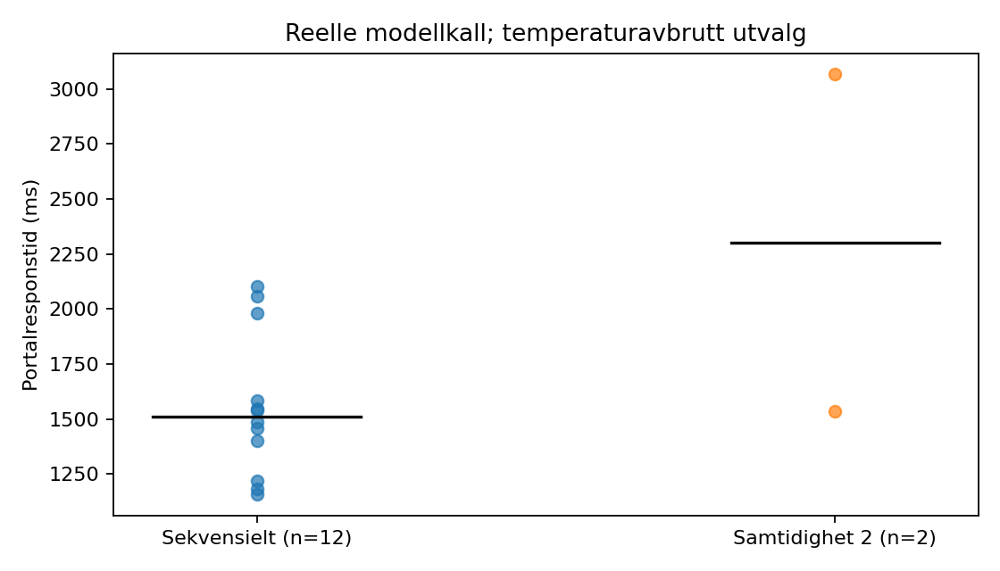
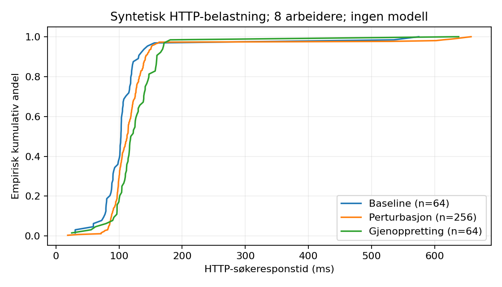

# Figurer og tabeller

Figur 1. Portalresponstid for reelle modellkall: 12 sekvensielle og 2 samtidige observasjoner. Punkter er enkeltmålinger, svarte streker er medianer. Planen var 20 forespørsler; serien ble stoppet etter 14 ved GPU-temperatur 80 °C, over den definerte stoppgrensen 78 °C. Datagrunnlag: logger/model-measurements.json.

[SVG](norsk/figurer/01_model_response_times.svg)

Figur 2. Empirisk kumulativ fordeling av HTTP-søkeresponstid med 8 arbeidere: baseline n=64, perturbasjon n=256 og gjenoppretting n=64. Perturbasjonen inneholder 16 forventede HTTP403-avslag; alle fasene hadde 0 uventede utfall. Ingen modellkall inngår. Datagrunnlag: logger/http-stress.json.

[SVG](norsk/figurer/02_http_latency_distribution.svg)

Figur 3. Kildebasert flertrinnsarbeidsflyt. Diagrammet er arkitektur, ikke en måling. Kilde: hamar_agent/portal.py og hamar_agent/real_sources.py.
