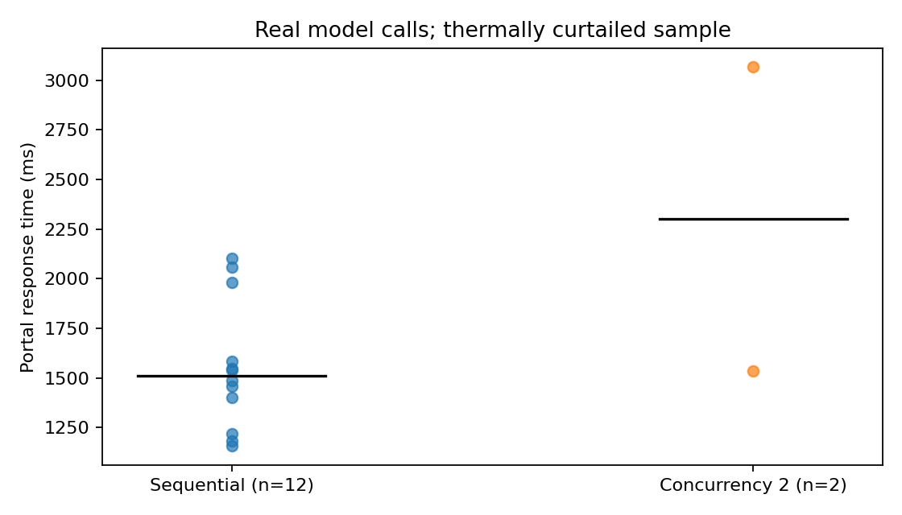
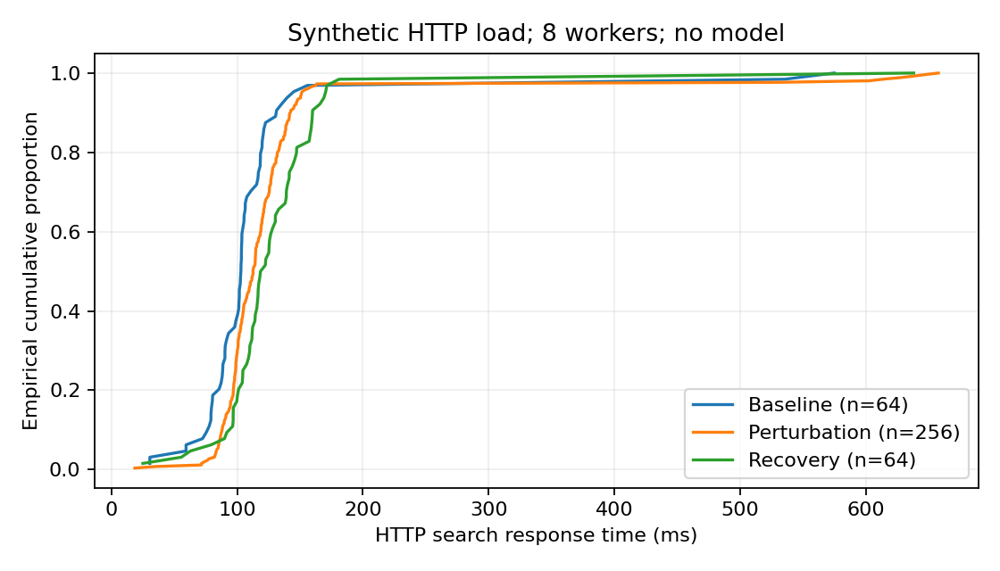

# Figures and tables

Figure 1. Portal response times for real model calls: 12 sequential and 2 concurrent observations. Points are individual measurements; black segments show medians. The plan comprised 20 requests; the series stopped after 14 at a GPU temperature of 80 °C, above the specified 78 °C stop threshold. Source: logger/model-measurements.json.

[SVG](figurer/01_model_response_times.svg)

Figure 2. Empirical cumulative distribution of HTTP search latency with 8 workers: baseline n=64, perturbation n=256 and recovery n=64. The perturbation contains 16 expected HTTP403 rejections; all phases had 0 unexpected outcomes. No model calls are included. Source: logger/http-stress.json.

[SVG](figurer/02_http_latency_distribution.svg)

Figure 3. Multi-stage source-grounded workflow. The diagram describes architecture, not a measurement. Source: hamar_agent/portal.py and hamar_agent/real_sources.py.
